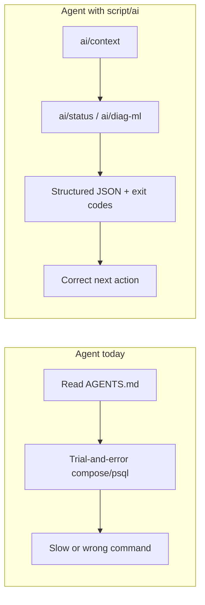

# AI agent tooling for fantasy-sports

## Current state (you are already ahead of most repos)

| Asset | Location | What agents get today |
| --- | --- | --- |
| Agent playbook | [fantasy-sports-airflow/AGENTS.md](fantasy-sports-airflow/AGENTS.md), [fantasy-sports-db/AGENTS.md](fantasy-sports-db/AGENTS.md) | Coverage expectations, DB workflow, doc coupling |
| Scoped rules | [fantasy-sports-airflow/.cursor/rules/](fantasy-sports-airflow/.cursor/rules/) (6 `.mdc` files) | Auto-attach on `dags/`, `include/`, SQL, integration tests |
| Human scripts | `script/test`, `script/db-query`, `script/db-migrate`, `script/lib/db.sh` | Docker-parity tests and MariaDB access |
| Per-DAG docs | [fantasy-sports-airflow/docs/nascar/](fantasy-sports-airflow/docs/nascar/) | Truth for task graphs, env knobs, incident notes |

**Recurring agent pain** (from recent sessions): discovering paused DAGs, running full Docker test suites when a `-k` filter would do, writing ad-hoc diagnostic SQL for ML gates (week 1021), grepping host `journalctl` for OOM, confusing `FS_ML_BACKTEST_MAX_WEEKS` vs `FS_ML_BACKTEST_LOAD_WEEKS`, and cross-repo path drift (`fantasy-sports-db` vs Compose `mariadb`).



---

## Recommendation 1: Add `script/ai/` (Airflow repo, primary)

Create [fantasy-sports-airflow/script/ai/](fantasy-sports-airflow/script/ai/) as the **agent command surface**: thin bash entrypoints that wrap existing `script/lib/db.sh` and `docker compose`, with a single README agents are told to read first.

### Design principles

- **Delegate, don't duplicate** — call `./script/db-query`, `./script/test`, `docker compose exec`; never fork SQL connection logic.
- **Machine-readable by default** — support `--json` on diagnostic scripts so agents parse output reliably; human tables via `--pretty` (default for TTY).
- **Fast failure** — exit `2` = prerequisites missing (stack down), `1` = check failed, `0` = ok; document in README.
- **Idempotent / read-only** — diagnostics never mutate DB; mutating helpers live under existing `script/db-*` and are only *linked*, not reimplemented.

### Proposed scripts (priority order)

| Script | Purpose | Why agents need it |
| --- | --- | --- |
| `ai/context` | Print one-screen briefing: repo roots, compose service health, `GIT_COMMIT` / key `FS_*` env from worker, current Cup week (`v_series_current_week`), link to relevant `docs/nascar/*.md` | Replaces 5–10 exploratory shell commands at session start |
| `ai/status` | Stack health: `docker compose ps`, scheduler paused DAGs, last run state for core DAGs (`aggregate`, `importer`, `machine_learning.models`, `backtest`, `monte_carlo`, `lineup_generator`) | Caught paused ML DAG blocking recovery |
| `ai/diag-ml` | Run the ML pipeline gate SQL (predict snapshot, predictions, MC batch, lineups for current week); `--json` + optional `--week-id` | Encodes the week-1021 diagnostic you built manually |
| `ai/diag-week` | General “current week readiness”: agg rows, salaries, lineups, predictions — importer/DFS oriented | Speeds “why no lineups?” triage |
| `ai/logs` | `ai/logs <dag_id> [task_id] [--run latest\|scheduled] [--tail N]` — finds newest log under `logs/` and tails or prints path | Agents grep wrong paths or huge trees |
| `ai/test-unit` | Wrapper: `./script/test --unit --no-cov -k "$@"` with sane defaults; documents `-k` examples in `--help` | Stops accidental full 647-test Docker runs |
| `ai/oom-check` | Host-side: last OOM lines from `journalctl`, worker cgroup limit from `docker inspect`, current `docker stats` for worker | Post-incident triage in one command |
| `ai/env-show` | Diff `.env.example` keys vs worker container env for `FS_ML_*`, `FS_MC_*`, `FS_DK_*` | Surfaces unset vs default (e.g. backtest load weeks) |

**Shared library:** [fantasy-sports-airflow/script/ai/lib/common.sh](fantasy-sports-airflow/script/ai/lib/common.sh) — `ai_repo_root`, `ai_require_compose`, `ai_json_row`, `ai_dag_last_run` (wraps `airflow dags list-runs` when scheduler container is up).

**Entry-point index:** [fantasy-sports-airflow/script/ai/README.md](fantasy-sports-airflow/script/ai/README.md) — table of scripts, exit codes, example invocations for agents.

Wire into existing docs:

- Add a **“AI / agent helpers”** section to [fantasy-sports-airflow/AGENTS.md](fantasy-sports-airflow/AGENTS.md) pointing at `script/ai/README.md`.
- Extend [fantasy-sports-airflow/.cursor/rules/repo-navigation.mdc](fantasy-sports-airflow/.cursor/rules/repo-navigation.mdc) with one bullet: prefer `./script/ai/*` for diagnostics before inventing shell.

### Example: `ai/diag-ml` contract (sketch)

```bash
# Usage: ./script/ai/diag-ml [--week-id N] [--json]
# Delegates SQL to ./script/db-query; outputs columns:
# week_id, train_snapshot_id, predict_snapshot_id, prediction_rows,
# mc_batch_id, lineup_rows, week_eligible_for_predict (inferred)
```

SQL can live in [fantasy-sports-airflow/script/ai/sql/diag_ml_week.sql](fantasy-sports-airflow/script/ai/sql/diag_ml_week.sql) with `:week_id` replaced by the wrapper — easier to test and diff than inline heredocs in bash.

---

## Recommendation 2: Thin `script/ai/` in DB repo (optional, smaller)

[fantasy-sports-db](fantasy-sports-db) has **no** `.cursor/rules/` today. Minimum high-value additions:

| Script | Purpose |
| --- | --- |
| `ai/context` | DDL band counts, pending migrations vs `schema_migrations`, seed 9000 present/missing |
| `ai/migrate-status` | List applied vs files in `nascar/migrations/` |
| `ai/ddl-grep` | `rg` wrapper across `nascar/ddl/` with object-type filter (`--proc`, `--table`) |

Point [fantasy-sports-db/AGENTS.md](fantasy-sports-db/AGENTS.md) at `script/ai/README.md` the same way as Airflow.

---

## Recommendation 3: Cursor rules and workspace orientation

### DB repo rules (missing today)

Add [fantasy-sports-db/.cursor/rules/](fantasy-sports-db/.cursor/rules/):

| Rule | Glob | Content |
| --- | --- | --- |
| `schema-navigation.mdc` | `alwaysApply: true` | DDL bands, migration vs seed vs queries, sibling Airflow `db-migrate` |
| `migration-discipline.mdc` | `nascar/migrations/**`, `nascar/ddl/**` | Full DROP+CREATE for procs, ledger, mirror DDL |
| `no-airflow-sql-here.mdc` | `nascar/**` | ETL SQL belongs in Airflow `dags/sql/` |

### Parent workspace doc (optional)

If you often open **both** repos in one Cursor workspace, add:

[fantasy-sports/AGENTS.md](/home/jackalope/Projects/fantasy-sports/AGENTS.md) (parent folder, not inside either git repo)

- Two-repo map, which script runs against which MariaDB (`fantasy-sports-db:36000` vs Compose `mariadb`)
- “Start here” links to both child `AGENTS.md` and `script/ai/README.md`

### Cursor Skills (user-level, high leverage)

You already have generic Cursor skills under `~/.cursor/skills-cursor/`. Add **project-specific** skills (or rules) for workflows agents repeat:

| Skill name | When to use |
| --- | --- |
| `fantasy-sports-ml-triage` | “models trained but no predictions”, post-race recovery |
| `fantasy-sports-db-migration` | DDL + migration + `db-migrate` checklist |
| `fantasy-sports-importer-change` | Importer SQL + contract test + CONTRIBUTING process |

Each skill should say: **run `./script/ai/diag-ml` first**, then read the matching `docs/nascar/cup.*.md`.

---

## Recommendation 4: Make existing scripts more agent-friendly (small deltas)

No new folders required — tighten what you have:

| Change | File | Benefit |
| --- | --- | --- |
| `--help` on all `script/*` entrypoints | `db-query`, `test`, `db-migrate`, … | Agents invoke `--help` instead of reading source |
| `script/test --quick` alias | [script/test](fantasy-sports-airflow/script/test) | Same as `--unit --no-cov` (document in help) |
| `script/db-query --json` | [script/lib/db.sh](fantasy-sports-airflow/script/lib/db.sh) | Tab-separated or JSON lines for parsing |
| Document “fast path” in AGENTS.md | Already has `uv run pytest -o addopts=''` — add explicit **“do not run full `./script/test` unless validating Docker parity”** | Saves 20+ min per session |

---

## Recommendation 5: What not to build (yet)

| Idea | Why defer |
| --- | --- |
| Custom MCP server for MariaDB/Airflow | High maintenance; `script/ai/diag-*` + `db-query` covers 80% with less surface |
| Agent that auto-runs full regression on every edit | Too slow; keep targeted `-k` as default |
| Duplicating Airflow CLI in Python | Bash wrappers around existing CLI/SQL are enough |
| Checking in `.env` or secrets for agents | Keep using `.env.example` + `ai/env-show` |

---

## Suggested implementation phases

### Phase A — High impact, ~1 day

1. `script/ai/README.md` + `lib/common.sh`
2. `ai/context`, `ai/status`, `ai/diag-ml` (+ SQL file)
3. AGENTS.md + `repo-navigation.mdc` links
4. `ai/test-unit` wrapper

### Phase B — DB repo + ergonomics, ~half day

5. `fantasy-sports-db/script/ai/migrate-status`, `ai/context`
6. `fantasy-sports-db/.cursor/rules/` (2–3 rules)
7. `--help` on top 5 existing scripts

### Phase C — Polish, as needed

8. `ai/logs`, `ai/oom-check`, `ai/env-show`
9. Parent `fantasy-sports/AGENTS.md`
10. Project Cursor skills for ML triage and DB migration

---

## Success criteria

- A new agent session can answer “why is week X stuck?” with **one command** (`./script/ai/diag-ml --week-id X --json`) without writing SQL from scratch.
- Agents default to **targeted** tests (`./script/ai/test-unit -k '…'`) unless the user asks for full Docker parity.
- Schema work in **fantasy-sports-db** gets the same rule auto-attach quality as Airflow Python.
- Post-OOM triage uses `./script/ai/oom-check` instead of manual `journalctl` grepping.
