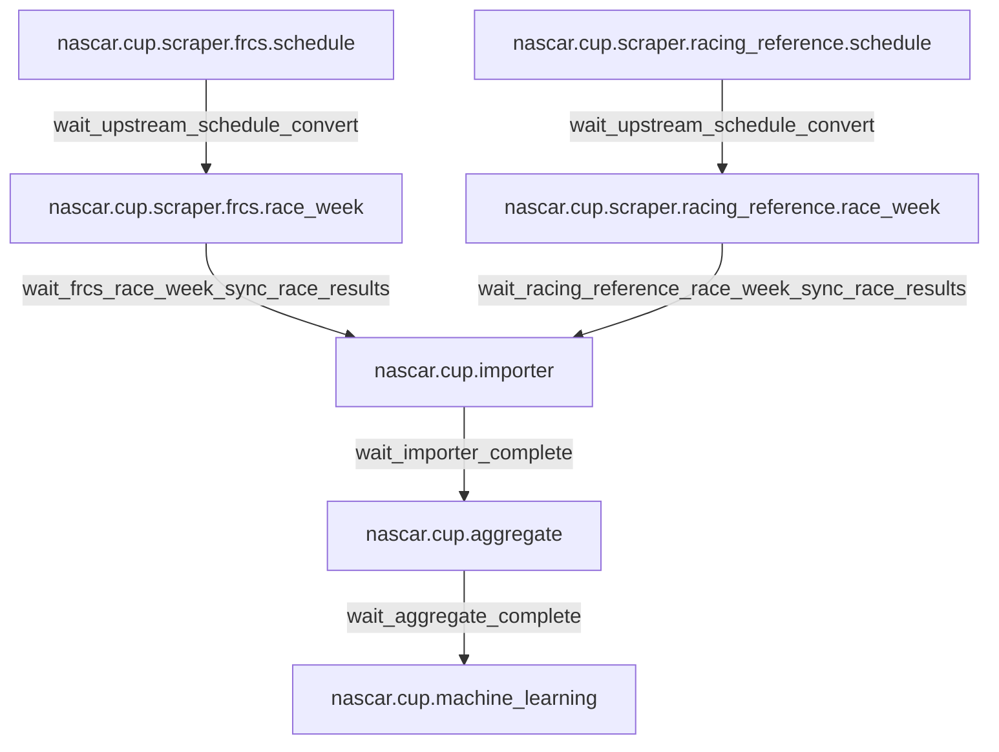

# NASCAR DAG reference

This directory contains one markdown file per DAG source file under
[`dags/nascar/cup/`](../../dags/nascar/cup/). Each source file registers a
production DAG plus (for everything except `aggregate` and
`machine_learning`) a `backfill.*` twin built from the same factory call; the
backfill variant is documented in a dedicated section of the same file rather
than duplicating the task graph.

## Cross-DAG flow

Each prod DAG above has a matching `backfill.<dag_id>` twin chained through
`backfill.*` sensor targets. The backfill twins share the production task
graph and use the same callables; only the schedule, `catchup`, asset URIs,
and external-sensor targets differ.

## DAG index

| DAG | Doc | Source |
| --- | --- | --- |
| `nascar.cup.scraper.frcs.schedule` (+ backfill) | [cup.scraper.frcs.schedule.md](./cup.scraper.frcs.schedule.md) | [dags/nascar/cup/scraper/frcs/schedule.py](../../dags/nascar/cup/scraper/frcs/schedule.py) |
| `nascar.cup.scraper.frcs.race_week` (+ backfill) | [cup.scraper.frcs.race_week.md](./cup.scraper.frcs.race_week.md) | [dags/nascar/cup/scraper/frcs/race_week.py](../../dags/nascar/cup/scraper/frcs/race_week.py) |
| `nascar.cup.scraper.racing_reference.schedule` (+ backfill) | [cup.scraper.racing_reference.schedule.md](./cup.scraper.racing_reference.schedule.md) | [dags/nascar/cup/scraper/racing_reference/schedule.py](../../dags/nascar/cup/scraper/racing_reference/schedule.py) |
| `nascar.cup.scraper.racing_reference.race_week` (+ backfill) | [cup.scraper.racing_reference.race_week.md](./cup.scraper.racing_reference.race_week.md) | [dags/nascar/cup/scraper/racing_reference/race_week.py](../../dags/nascar/cup/scraper/racing_reference/race_week.py) |
| `nascar.cup.importer` (+ backfill) | [cup.importer.md](./cup.importer.md) | [dags/nascar/cup/importer.py](../../dags/nascar/cup/importer.py) |
| `nascar.cup.aggregate` | [cup.aggregate.md](./cup.aggregate.md) | [dags/nascar/cup/aggregate.py](../../dags/nascar/cup/aggregate.py) |
| `nascar.cup.machine_learning` | [cup.machine_learning.md](./cup.machine_learning.md) | [dags/nascar/cup/machine_learning.py](../../dags/nascar/cup/machine_learning.py) |

## Shared constants

- `CUP_SCRAPER_PROD_HOURLY_CRON = "0 * * * *"` — production hourly cron for
  every scraper/importer/aggregate/ML DAG.
- `BACKFILL_YEARLY_SCHEDULE = "0 0 31 12 *"` — Dec 31 00:00 UTC, used by every
  `backfill.*` twin (window: `2010-12-31` through `2025-12-31`).
- `CUP_EXTERNAL_SENSOR_POKE_INTERVAL = 30s`, `CUP_RACE_WEEK_WAIT_SCHEDULE_TIMEOUT = 2h`,
  `CUP_IMPORTER_WAIT_RACE_WEEK_TIMEOUT = 6h`. Definitions live in
  [dags/nascar/cup/scraper/dag_factories.py](../../dags/nascar/cup/scraper/dag_factories.py)
  and [dags/nascar/cup/scraper/backfill_assets.py](../../dags/nascar/cup/scraper/backfill_assets.py).
- All DAGs run with `max_active_runs=1` and use Airflow connection
  `nascar_conn` (MySQL).

## Editing rules

- If you change a DAG task id, ordering, schedule, or external-sensor target,
  update the matching doc in this directory in the same PR.
- Keep mermaid diagrams faithful to the actual `>>` chain in the DAG file.
- When repetitive task families exist (e.g. the 34 wave-2 aggregate loads),
  keep one `### <task_id>` heading per task plus one shared explainer
  subsection — don't copy-paste prose.
