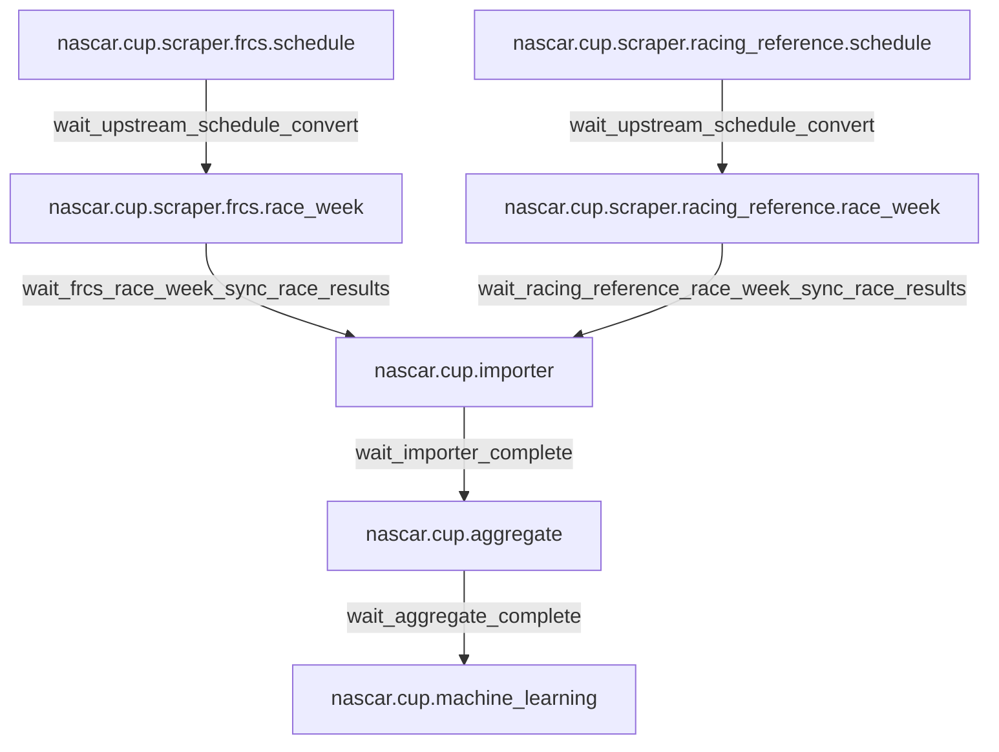

# NASCAR DAG reference

This directory contains one markdown file per DAG source file under
[`dags/nascar/cup/`](../../dags/nascar/cup/). Each source file registers a
production DAG plus (for everything except `aggregate` and
`machine_learning`) a `backfill.*` twin built from the same factory call; the
backfill variant is documented in a dedicated section of the same file rather
than duplicating the task graph.

## Cross-DAG flow



Each prod DAG above has a matching `backfill.<dag_id>` twin chained through
`backfill.*` sensor targets. The backfill twins share the production task
graph and use the same callables; only the schedule, `catchup`, asset URIs,
and external-sensor targets differ.

## DAG index

| DAG | Doc | Source |
| --- | --- | --- |
| `nascar.cup.scraper.frcs.schedule` (+ backfill) | [cup.scraper.frcs.schedule.md](./cup.scraper.frcs.schedule.md) | [dags/nascar/cup/scraper/frcs/schedule.py](../../dags/nascar/cup/scraper/frcs/schedule.py) |
| `nascar.cup.scraper.frcs.race_week` (+ backfill) | [cup.scraper.frcs.race_week.md](./cup.scraper.frcs.race_week.md) | [dags/nascar/cup/scraper/frcs/race_week.py](../../dags/nascar/cup/scraper/frcs/race_week.py) |
| `nascar.cup.scraper.racing_reference.schedule` (+ backfill) | [cup.scraper.racing_reference.schedule.md](./cup.scraper.racing_reference.schedule.md) | [dags/nascar/cup/scraper/racing_reference/schedule.py](../../dags/nascar/cup/scraper/racing_reference/schedule.py) |
| `nascar.cup.scraper.racing_reference.race_week` (+ backfill) | [cup.scraper.racing_reference.race_week.md](./cup.scraper.racing_reference.race_week.md) | [dags/nascar/cup/scraper/racing_reference/race_week.py](../../dags/nascar/cup/scraper/racing_reference/race_week.py) |
| `nascar.cup.importer` (+ backfill) | [cup.importer.md](./cup.importer.md) | [dags/nascar/cup/importer.py](../../dags/nascar/cup/importer.py) |
| `nascar.cup.aggregate` | [cup.aggregate.md](./cup.aggregate.md) | [dags/nascar/cup/aggregate.py](../../dags/nascar/cup/aggregate.py) |
| `nascar.cup.machine_learning` | [cup.machine_learning.md](./cup.machine_learning.md) | [dags/nascar/cup/machine_learning.py](../../dags/nascar/cup/machine_learning.py) |

## Shared constants

- `CUP_SCRAPER_PROD_HOURLY_CRON = "0 * * * *"` — production hourly cron for
  every scraper/importer/aggregate/ML DAG.
- `BACKFILL_YEARLY_SCHEDULE = "0 0 31 12 *"` — Dec 31 00:00 UTC, used by every
  `backfill.*` twin (window: `2010-12-31` through `2025-12-31`).
- `FS_ENABLE_BACKFILL_DAGS` — env var (default off). When unset, `0`, or
  `false`, the five `backfill.*` DAG modules do not register their backfill
  twins (see `backfill_dags_enabled()` in
  [backfill_assets.py](../../dags/nascar/cup/scraper/backfill_assets.py)).
  Set to `1` in `.env` to show backfill DAGs in the Airflow UI.
- `CUP_EXTERNAL_SENSOR_POKE_INTERVAL = 30s`, `CUP_RACE_WEEK_WAIT_SCHEDULE_TIMEOUT = 2h`,
  `CUP_IMPORTER_WAIT_RACE_WEEK_TIMEOUT = 6h`. Definitions live in
  [dags/nascar/cup/scraper/dag_factories.py](../../dags/nascar/cup/scraper/dag_factories.py)
  and [dags/nascar/cup/scraper/backfill_assets.py](../../dags/nascar/cup/scraper/backfill_assets.py).
- All DAGs run with `max_active_runs=1` and use Airflow connection
  `nascar_conn` (MySQL).

## Track type groupings (FRCS)

Track-to-type mappings live in `nascar.tracks_track_types` and power aggregate
`prev_track_types_*` rollups and ML `track_type` model routing. Source of truth
is [FRCS.pro NASCAR tracks](https://frcs.pro/nascar/tracks/) (Accupredict
grouping + NASCAR shape + NASCAR size per track).

**Canonical CSV:** [`data/nascar_tracks_groupings.csv`](../../data/nascar_tracks_groupings.csv)
(36 tracks × 3 grouping columns).

**Regenerate from FRCS markdown or live page:**

```bash
./script/generate-track-groupings-csv.py --url
# or: --input /path/to/frcs-tracks.md
```

**Import into MariaDB** (additive: inserts/restores missing rows; does not
soft-delete extras):

```bash
./script/import-track-groupings
# optional: ./script/import-track-groupings /path/to.csv
```

Requires the Airflow stack (`docker compose up`) and tracks already present in
`nascar.tracks` (from the Cup schedule importer). The script prints
`UNMATCHED_TRACKS` for CSV rows whose `track_name` is not in `tracks` — common
for Xfinity/Truck-only venues until they appear on a Cup schedule.

**Validate** (spot-check via view):

```sql
SELECT track_name, track_types FROM nascar.v_tracks_track_types
WHERE track_name = 'Daytona International Speedway';
-- Expect: Restrictor Plate, Superspeedway, Tri-oval
```

Oval tracks with three distinct grouping names get three bridge rows. Road
courses where all three columns are `Road Course` collapse to a single row
(unique on `(track_id, track_type_id)`).

## Merging duplicate tracks

When the importer creates two `nascar.tracks` rows for the same venue (e.g.
truncated name vs full name), consolidate them with the stored procedure
`merge_track_ids` (DDL:
[`6060-create_merge_track_ids_stored_procedure.sql`](../../../fantasy-sports-db/nascar/ddl/stored_procedures/6060-create_merge_track_ids_stored_procedure.sql)):

```sql
-- Find candidates
SELECT id, name FROM nascar.tracks
WHERE name LIKE 'Daytona%' AND deleted_at IS NULL;

-- Retire duplicate row; keep canonical row
CALL merge_track_ids(
  p_duplicate_track_id => <id_to_retire>,
  p_canonical_track_id => <surviving_id>
);
```

The procedure runs in a transaction: re-points all `track_id` and overlapping
`week_id` foreign keys to the canonical track, resolves unique-key conflicts
via delete-then-update, merges `tracks_track_types` bridge rows, then
soft-deletes the duplicate track. Caller supplies both IDs; there is no
automatic duplicate discovery. After merging, the Cup schedule importer
(`import_schedule`) reuses `data_sources_tracks.track_id` on the next run
instead of creating a new `tracks` row from the truncated FRCS label.

**Validate after merge:**

```sql
SELECT id, name, deleted_at FROM nascar.tracks WHERE id IN (<dup>, <canon>);
-- dup: deleted_at set; canon: deleted_at NULL

SELECT track_name, track_types FROM nascar.v_tracks_track_types
WHERE track_id = <canon>;
```

## Editing rules

- If you change a DAG task id, ordering, schedule, or external-sensor target,
  update the matching doc in this directory in the same PR.
- Keep mermaid diagrams faithful to the actual `>>` chain in the DAG file.
- When repetitive task families exist (e.g. the 34 wave-2 aggregate loads),
  keep one `### <task_id>` heading per task plus one shared explainer
  subsection — don't copy-paste prose.
