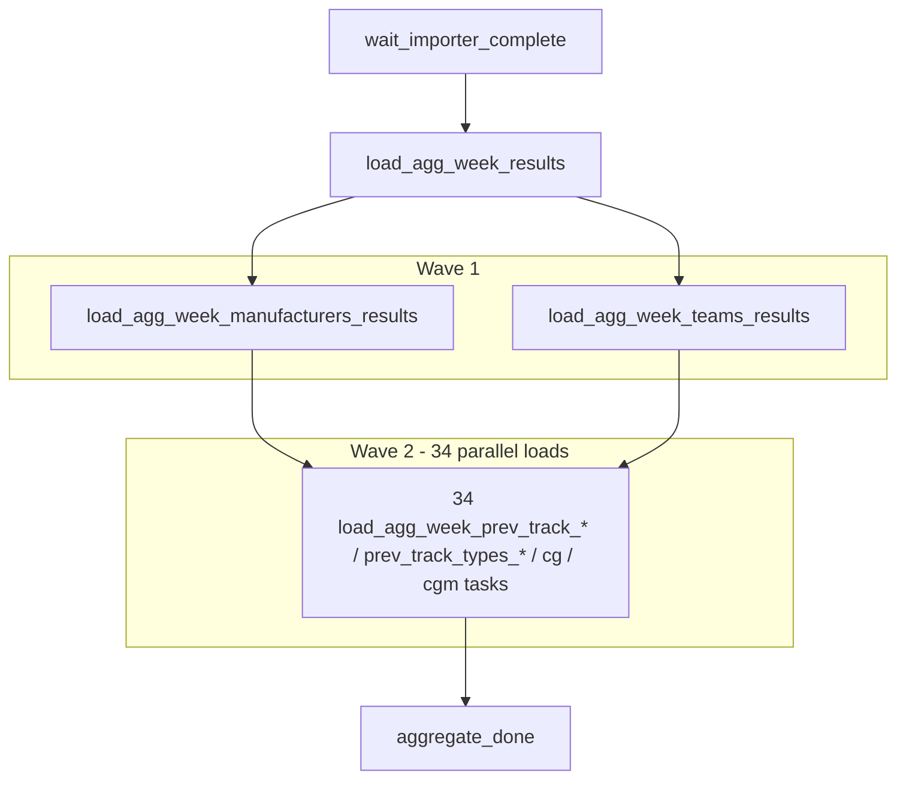

# `nascar.cup.aggregate`

Hourly aggregation DAG that builds the per-week analytics tables on top of
the importer's canonical rows. Produces `agg_week_results` and the family of
prior-track / per-entity aggregate tables consumed by
`nascar.cup.machine_learning`.

- **DAG ID:** `nascar.cup.aggregate` (no `backfill.*` twin)
- **Source:** [dags/nascar/cup/aggregate.py](../../dags/nascar/cup/aggregate.py)
- **Wave catalog:** `WAVE1_LOAD_TASKS`, `WAVE2_PREV_TRACK_LOAD_TASKS` in
  [include/nascar/cup/aggregate_load.py](../../include/nascar/cup/aggregate_load.py)
- **Tests:** [tests/unit/test_cup_aggregate_dag.py](../../tests/unit/test_cup_aggregate_dag.py)

## Purpose

Each hourly run loads `agg_week_results` once (the week-level race results
view), then fans out to parameterized SQL loaders that backfill the
per-week prior-track and per-entity aggregate tables (drivers, cars,
teams, manufacturers, car generations + car-generation models). The trailing
`aggregate_done` sentinel exists so downstream DAGs (currently
`nascar.cup.machine_learning`) can wait on a single stable task id rather
than every wave-2 task.

## Schedule and basic settings

| Setting | Value |
| --- | --- |
| Cron / `schedule` | `CUP_SCRAPER_PROD_HOURLY_CRON` (`0 * * * *`) |
| `start_date` | `datetime(2025, 7, 11)` |
| `end_date` | `None` |
| `catchup` | `False` |
| `max_active_runs` | `1` |

Total tasks: **39** (1 sensor + 1 base load + 2 wave-1 loads + 34 wave-2
loads + 1 sentinel).

## Upstream and downstream wiring

- **Upstream:** `wait_importer_complete` waits on
  `nascar.cup.importer.cleanup_importer_staging_and_temp_tables` for the
  matching logical date (`mode=reschedule`, `poke_interval=30s`,
  `timeout=CUP_IMPORTER_WAIT_RACE_WEEK_TIMEOUT` = 6h).
- **Downstream:** `nascar.cup.machine_learning.wait_aggregate_complete`
  waits on `aggregate_done`.

## Task graph

Every wave-2 task is upstream of `aggregate_done`; every wave-1 task is
upstream of every wave-2 task.

## Shared task-family conventions

The 2 wave-1 + 34 wave-2 SQL loaders all share the same shape — only the
target table differs. To avoid copy-pasting prose into 36 headings, the
shared behavior is captured once here:

- **Operator:** `MySQLTemplateFileOperatorFromContext` built by
  `include.nascar.cup.aggregate_load.make_aggregate_load_operator`.
- **SQL location:** each task id `X` maps to
  `dags/sql/nascar.cup.aggregate/X.sql`.
- **Parameters factory:** `aggregate_load_parameters` (also in
  [include/nascar/cup/aggregate_load.py](../../include/nascar/cup/aggregate_load.py))
  runs the `WEEKS_TO_LOAD_SQL` query against `nascar_conn` to find every
  Cup `week_id` with at least one row in `agg_week_results` where
  `r_finish_position IS NOT NULL`. The factory returns
  `{"series_id": NascarSeries.CUP.series_id, "weeks": [{"week_id": …}, …]}`
  which the Jinja-templated SQL files iterate over.
- **MySQL connection:** `nascar_conn`.
- **Idempotency:** each loader fully replaces rows for the target weeks
  (typically a `DELETE … WHERE week_id IN (...)` followed by an `INSERT …
  SELECT`), so re-running a task simply rebuilds the per-week rows.

## Tasks

### `wait_importer_complete`

- **Operator:** `ExternalTaskSensor` (`mode=reschedule`).
- **Target:** `nascar.cup.importer.cleanup_importer_staging_and_temp_tables`
  for the same logical date.
- **Behavior:** blocks until the matching hourly importer run has finished
  cleanup. Poke interval 30s; timeout 6h.
- **Upstream:** (root). **Downstream:** `load_agg_week_results`.

### `load_agg_week_results`

- **Operator:** `MySQLTemplateFileOperatorFromContext`.
- **SQL:** `dags/sql/nascar.cup.aggregate/load_agg_week_results.sql` —
  `CALL nascar.load_agg_week_results({{ series_id }});`.
- **Parameters factory:** `aggregate_base_load_parameters` in
  [include/nascar/cup/aggregate_load.py](../../include/nascar/cup/aggregate_load.py),
  which returns `{"series_id": NascarSeries.CUP.series_id}`. The parameter
  scopes the proc to Cup so a future Xfinity / Truck aggregate DAG can
  reuse the same proc with its own `series_id` without trampling Cup rows.
- **Stored procedure:** `nascar.load_agg_week_results(p_series_id BIGINT
  UNSIGNED)` — filters its internal `weeks` CTE on `sr.id = p_series_id`
  so only rows for the requested series are inserted into
  `nascar.agg_week_results`.
- **Behavior:** rebuilds the per-week per-car_driver row that downstream
  loaders join against. Columns include `r_start_position`, `r_finish_position`,
  `r_place_diff`, `r_total_fastest_laps`, `r_total_laps_led`, and other
  per-driver per-race counters consumed by the ML pipeline.
- **Upstream:** `wait_importer_complete`. **Downstream:** both wave-1 tasks.

### Wave 1 (parallel after `load_agg_week_results`)

Every task below uses the conventions in "Shared task-family conventions".
Both fan out to every wave-2 task.

#### `load_agg_week_manufacturers_results`
- **Target table:** `nascar.agg_week_manufacturers_results` — per-week
  manufacturer-level aggregates (rolled up across drivers / cars for that
  manufacturer that week).
- **Upstream:** `load_agg_week_results`. **Downstream:** all wave-2 tasks.

#### `load_agg_week_teams_results`
- **Target table:** `nascar.agg_week_teams_results` — per-week team-level
  aggregates.
- **Upstream:** `load_agg_week_results`. **Downstream:** all wave-2 tasks.

### Wave 2 (34 parallel loads after wave 1)

Every wave-2 task runs the matching SQL file under
`dags/sql/nascar.cup.aggregate/<task_id>.sql` and rebuilds rows for every
target week. Tasks split along two orthogonal axes:

- **Entity:** `car_drivers`, `drivers`, `cars`, `teams`, `manufacturers`,
  `car_generations` (`cg_*`), `car_generation_models` (`cgm_*`).
- **Slice:** `prev_track_*` (prior visits to the same track) vs
  `prev_track_types_*` (prior visits to tracks of the same type).

Upstream/downstream for every wave-2 task: upstream =
`load_agg_week_manufacturers_results` and `load_agg_week_teams_results`;
downstream = `aggregate_done`.

#### `load_agg_week_prev_track_car_generation_models_results`
- **Target table:** `agg_week_prev_track_car_generation_models_results`.

#### `load_agg_week_prev_track_types_car_generation_models_results`
- **Target table:** `agg_week_prev_track_types_car_generation_models_results`.

#### `load_agg_week_prev_track_car_generations_results`
- **Target table:** `agg_week_prev_track_car_generations_results`.

#### `load_agg_week_prev_track_types_car_generations_results`
- **Target table:** `agg_week_prev_track_types_car_generations_results`.

#### `load_agg_week_prev_track_cars_drivers_results`
- **Target table:** `agg_week_prev_track_cars_drivers_results`.

#### `load_agg_week_prev_track_types_cars_drivers_results`
- **Target table:** `agg_week_prev_track_types_cars_drivers_results`.

#### `load_agg_week_prev_track_cars_results`
- **Target table:** `agg_week_prev_track_cars_results`.

#### `load_agg_week_prev_track_types_cars_results`
- **Target table:** `agg_week_prev_track_types_cars_results`.

#### `load_agg_week_prev_track_drivers_results`
- **Target table:** `agg_week_prev_track_drivers_results`.

#### `load_agg_week_prev_track_types_drivers_results`
- **Target table:** `agg_week_prev_track_types_drivers_results`.

#### `load_agg_week_prev_track_teams_results`
- **Target table:** `agg_week_prev_track_teams_results`.

#### `load_agg_week_prev_track_types_teams_results`
- **Target table:** `agg_week_prev_track_types_teams_results`.

#### `load_agg_week_prev_track_manufacturers_results`
- **Target table:** `agg_week_prev_track_manufacturers_results`.

#### `load_agg_week_prev_track_types_manufacturers_results`
- **Target table:** `agg_week_prev_track_types_manufacturers_results`.

#### `load_agg_week_prev_track_cg_cars_drivers_results`
- **Target table:** `agg_week_prev_track_cg_cars_drivers_results` —
  car-generation-scoped prior-track aggregate.

#### `load_agg_week_prev_track_cgm_cars_drivers_results`
- **Target table:** `agg_week_prev_track_cgm_cars_drivers_results` —
  car-generation-model-scoped prior-track aggregate.

#### `load_agg_week_prev_track_cg_cars_results`
- **Target table:** `agg_week_prev_track_cg_cars_results`.

#### `load_agg_week_prev_track_cgm_cars_results`
- **Target table:** `agg_week_prev_track_cgm_cars_results`.

#### `load_agg_week_prev_track_cg_drivers_results`
- **Target table:** `agg_week_prev_track_cg_drivers_results`.

#### `load_agg_week_prev_track_cgm_drivers_results`
- **Target table:** `agg_week_prev_track_cgm_drivers_results`.

#### `load_agg_week_prev_track_cg_manufacturers_results`
- **Target table:** `agg_week_prev_track_cg_manufacturers_results`.

#### `load_agg_week_prev_track_cgm_manufacturers_results`
- **Target table:** `agg_week_prev_track_cgm_manufacturers_results`.

#### `load_agg_week_prev_track_cg_teams_results`
- **Target table:** `agg_week_prev_track_cg_teams_results`.

#### `load_agg_week_prev_track_cgm_teams_results`
- **Target table:** `agg_week_prev_track_cgm_teams_results`.

#### `load_agg_week_prev_track_types_cg_cars_drivers_results`
- **Target table:** `agg_week_prev_track_types_cg_cars_drivers_results` —
  car-generation × track-type aggregate.

#### `load_agg_week_prev_track_types_cgm_cars_drivers_results`
- **Target table:** `agg_week_prev_track_types_cgm_cars_drivers_results`.

#### `load_agg_week_prev_track_types_cg_cars_results`
- **Target table:** `agg_week_prev_track_types_cg_cars_results`.

#### `load_agg_week_prev_track_types_cgm_cars_results`
- **Target table:** `agg_week_prev_track_types_cgm_cars_results`.

#### `load_agg_week_prev_track_types_cg_drivers_results`
- **Target table:** `agg_week_prev_track_types_cg_drivers_results`.

#### `load_agg_week_prev_track_types_cgm_drivers_results`
- **Target table:** `agg_week_prev_track_types_cgm_drivers_results`.

#### `load_agg_week_prev_track_types_cg_manufacturers_results`
- **Target table:** `agg_week_prev_track_types_cg_manufacturers_results`.

#### `load_agg_week_prev_track_types_cgm_manufacturers_results`
- **Target table:** `agg_week_prev_track_types_cgm_manufacturers_results`.

#### `load_agg_week_prev_track_types_cg_teams_results`
- **Target table:** `agg_week_prev_track_types_cg_teams_results`.

#### `load_agg_week_prev_track_types_cgm_teams_results`
- **Target table:** `agg_week_prev_track_types_cgm_teams_results`.

### `aggregate_done`

- **Operator:** `EmptyOperator`.
- **Behavior:** no-op fan-in target so any downstream DAG can wait on a
  single stable task id instead of all 34 wave-2 loads. Success of this
  task is the heartbeat `nascar.cup.machine_learning.wait_aggregate_complete`
  watches.
- **Upstream:** every wave-2 task. **Downstream:** none in this DAG.

## Data sources and sinks

- **Reads:** `nascar.agg_week_results` (rebuilt by this DAG) plus the per-week
  canonical tables populated by `nascar.cup.importer`.
- **Writes:** `agg_week_results`, `agg_week_manufacturers_results`,
  `agg_week_teams_results`, plus the 32 prior-track / prior-track-types
  aggregate tables listed above. The full list is the source of truth in
  `WAVE2_PREV_TRACK_LOAD_TASKS`.
- **No external network traffic.**

## Configuration

- **Airflow connection:** `nascar_conn` (MySQL).
- **Env vars:** none required. The SQL root resolves via
  `Path(__file__).resolve().parents[2] / "sql"`, i.e.
  `dags/sql/nascar.cup.aggregate/`.

## Backfill variant

None. The aggregate tables are derived from canonical importer data, so
historical aggregates are rebuilt the next hour after a backfill importer
run lands new rows in `agg_week_results`. If you need to retrigger a full
rebuild, clear `wait_importer_complete` for the relevant logical dates.

## Operational notes

- 36 SQL load tasks plus 1 base load run concurrently within the per-DAG
  limits. The MySQL connection pool needs enough headroom (default Airflow
  `worker_concurrency` × `nascar_conn` pool size). If load tasks queue
  excessively, surface that to the operator.
- Each loader is idempotent: re-running a single failed task rebuilds rows
  for that task's target table without interfering with the others.
- The `aggregate_done` sentinel keeps the downstream sensor wiring stable
  even when wave-2 task lists change. Whenever you add or remove a wave-2
  task, update [include/nascar/cup/aggregate_load.py](../../include/nascar/cup/aggregate_load.py)
  and the matching SQL file; the test in
  [tests/unit/test_cup_aggregate_dag.py](../../tests/unit/test_cup_aggregate_dag.py)
  pins the total task count.

## Related tests

- [tests/unit/test_cup_aggregate_dag.py](../../tests/unit/test_cup_aggregate_dag.py) — DAG metadata, task ids (39 total), wave-1/wave-2 fan-out, `aggregate_done` sentinel.
