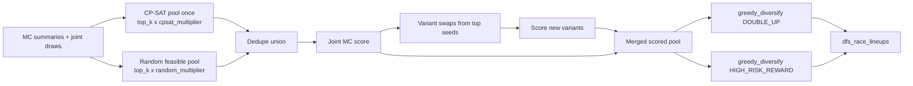

# `nascar.cup.dfs.lineup_generator`

Hourly Cup DraftKings lineup generator. Waits for Monte Carlo
`validate_simulation_batch` on
[`nascar.cup.machine_learning.models.monte_carlo`](./cup.machine_learning.models.monte_carlo.md)
(which itself waits on ML `predict_upcoming_week`), then builds top-K optimal
lineups per strategy when simulation summaries and DK salaries exist.

- **DAG ID:** `nascar.cup.dfs.lineup_generator` (no `backfill.*` twin)
- **Source:** [dags/nascar/cup/dfs/lineup_generator.py](../../dags/nascar/cup/dfs/lineup_generator.py)
- **Tests:** [tests/unit/test_dfs_lineup_generator_dag.py](../../tests/unit/test_dfs_lineup_generator_dag.py),
  [tests/unit/test_dfs_lineup_optimizer.py](../../tests/unit/test_dfs_lineup_optimizer.py),
  [tests/unit/test_dfs_lineup_generator_gates.py](../../tests/unit/test_dfs_lineup_generator_gates.py),
  [tests/unit/test_lineup_portfolio.py](../../tests/unit/test_lineup_portfolio.py)

## Schedule and settings

| Setting | Value |
| --- | --- |
| Cron / `schedule` | `CUP_SCRAPER_PROD_HOURLY_CRON` (`0 * * * *`) |
| `catchup` | `False` |
| `max_active_runs` | `1` |

## Upstream dependency

`wait_mc_complete` sensors `nascar.cup.machine_learning.models.monte_carlo` /
`validate_simulation_batch` (same poke/timeout as aggregate→ML sensors). The
Monte Carlo DAG itself sensors `predict_upcoming_week`, so this also blocks
implicitly on ML predict.

`wait_dk_salaries_complete` sensors `nascar.cup.dfs.salary_importer` /
`import_draftkings_salaries`. The generate task still soft-skips with a log if
salaries or simulation summaries are missing in the database.

## Tasks

| Task ID | Purpose |
| --- | --- |
| `wait_mc_complete` | `ExternalTaskSensor` on Monte Carlo validate task |
| `wait_dk_salaries_complete` | `ExternalTaskSensor` on DK salary import task |
| `generate_draftkings_lineups` | Top-K CP-SAT lineups → `dfs_race_lineups` + child rows |

## Skip conditions

Skip paths log at WARNING with `reason=…`. The generate task returns
`{"skipped": true, "reason": ...}` when any of:

- No active `dfs_scoring_rules` for DraftKings
- No latest `kind='predict'` snapshot
- **`lineups_already_present_post_race`** — race has finished AND live
  `dfs_race_lineups` already exist for the snapshot's race + DraftKings
  dfs id. Symmetric to the predict / MC post-race guards; see
  [Self-healing post-race recovery](./cup.machine_learning.models.md#self-healing-post-race-recovery)
  in the upstream ML DAG. Pre-race the optimizer still re-runs every
  hour so lineups reflect refreshed MC summaries.
- No active `ml_race_simulation_batches` row for that snapshot (`no_mc_summaries`)
- No `races` row for snapshot `week_id`
- No active `dfs_salaries` for DraftKings on that `week_id` (join via `races`)
- Player pool smaller than lineup size (default 6) — inner join of MC summaries + salaries
- CP-SAT candidate pool yields zero feasible lineups under salary cap (`no_feasible_lineups`)

Parent lineup rows use `NascarMySqlHook.run_insert_returning_id` (not
`LAST_INSERT_ID()` on a pooled connection) so child `dfs_race_lineups_car_drivers`
rows get a valid `dfs_race_lineup_id`.

## Portfolio-aware optimizer

The lineup task builds **one shared candidate union per race**, scores it
once against the joint matrix, then runs **per-strategy** greedy selection:



1. **Shared candidate pool.**
   [`generate_candidate_pool`](../../include/nascar/dfs/lineup_optimizer.py) runs
   CP-SAT once per race with `min_diff = max(strategy CP-SAT min_diff)` (default
   `max(2, 1) = 2`). [`generate_random_candidate_pool`](../../include/nascar/dfs/lineup_optimizer.py)
   adds cheap random salary-feasible lineups (`top_k × FS_DK_RANDOM_POOL_MULTIPLIER`,
   default 15). The union is deduped before scoring. CP-SAT uses
   `FS_DK_MC_OBJECTIVE` (default `p50`) only to order the optimization frontier.
2. **Joint MC scoring + variant expansion.**
   [`score_candidates_against_joint_samples`](../../include/nascar/dfs/lineup_portfolio.py)
   scores the union. [`generate_lineup_variants`](../../include/nascar/dfs/lineup_variants.py)
   builds 1–2 driver swaps from the top `FS_DK_VARIANT_SEED_COUNT` joint-scored
   seeds (default 25); new variants are scored and merged into the pool.
3. **Greedy diversify (per strategy).**
   [`greedy_diversify`](../../include/nascar/dfs/lineup_portfolio.py) enforces
   per-driver exposure (`ceil(top_k × exposure_cap)`), minimum driver difference
   between accepted lineups (`FS_DK_WRITE_MIN_DIFF_*`), optional median **quality
   floor** (`FS_DK_WRITE_QUALITY_FLOOR`), and max pairwise MC correlation
   (`FS_DK_WRITE_MAX_LINEUP_CORR`). `min_driver_diff` relaxes down to `1`, then
   exposure cap relaxes `+0.05`, with WARNING logs — chronic relaxation means the
   candidate pool is still too small or caps are too tight.

### Per-strategy objectives

| Strategy | Default objective | Write-time cap | Why |
| --- | --- | --- | --- |
| `DOUBLE_UP` (cash / 50-50) | `joint_p10` (high floor) | `0.35` | Cash payouts reward consistency over upside; the strategy is expressed via the floor-focused objective, not via a loose cap. |
| `HIGH_RISK_REWARD` (GPP / tournament) | `joint_p90` (high ceiling) | `0.35` | Top-heavy payouts reward ceilings; the strategy is expressed via the ceiling-focused objective, not via a tight cap. |

The write-time cap is uniform across strategies because diversification
is enforced at *read time* by the `nascar.dfs_lineups` stored procedure
— see [Read-time diversification](#read-time-diversification) below.

Valid objective tokens (env vars below): `joint_p10`, `joint_p50`,
`joint_p90`, `joint_mean`, `joint_sharpe`. Anything else falls back to
`joint_p10` / `joint_p90` and logs a WARNING.

### Configuration

| Env var | Default | Meaning |
| --- | --- | --- |
| `FS_DK_LINEUP_SIZE` | `6` | Drivers per lineup |
| `FS_DK_SALARY_CAP` | `50000` | Salary cap |
| `FS_DK_TOP_K` | `40` | Lineups per strategy (80 per race across both) |
| `FS_DK_CANDIDATE_POOL_MULTIPLIER` | `5` | Shared CP-SAT pool = `top_k × multiplier` |
| `FS_DK_RANDOM_POOL_MULTIPLIER` | `15` | Random feasible pool = `top_k × multiplier` (`0` disables) |
| `FS_DK_VARIANT_SEED_COUNT` | `25` | Top joint-scored lineups that seed driver-swap variants (`0` disables) |
| `FS_DK_VARIANT_MAX_SWAPS` | `2` | Max drivers replaced per seed (2 supports `write_min_driver_diff=3`) |
| `FS_DK_VARIANT_POOL_CAP` | `max(top_k×5, 120)` | Cap on variant lineups generated per race |
| `FS_DK_WRITE_QUALITY_FLOOR` | `1` | Drop candidates below pool median on strategy objective before greedy select |
| `FS_DK_WRITE_MAX_LINEUP_CORR` | `0.85` | Max Pearson correlation on MC lineup totals vs accepted lineups |
| `FS_DK_MIN_DIFF_DOUBLE_UP` | `2` | CP-SAT overlap blocker (contributes to shared `max` min_diff) |
| `FS_DK_MIN_DIFF_HIGH_RISK_REWARD` | `1` | CP-SAT overlap blocker (contributes to shared `max` min_diff) |
| `FS_DK_WRITE_MIN_DIFF_DOUBLE_UP` | `3` | Write-time min distinct drivers vs prior accepted lineups |
| `FS_DK_WRITE_MIN_DIFF_HIGH_RISK_REWARD` | `2` | Write-time min distinct drivers vs prior accepted lineups |
| `FS_DK_MC_OBJECTIVE` | `p50` | Per-driver summary column used only to **order** the candidate pool (`mean`, `p05`, `p50`, `p95`, `min`, `max`) |
| `FS_DK_DOUBLE_UP_OBJECTIVE` | `joint_p10` | Portfolio objective for DOUBLE_UP |
| `FS_DK_DOUBLE_UP_EXPOSURE_CAP` | `0.70` | Write-time max fraction of DOUBLE_UP lineups any driver may appear in (read-time cap is supplied by the caller of `nascar.dfs_lineups`) |
| `FS_DK_HIGH_RISK_REWARD_OBJECTIVE` | `joint_p90` | Portfolio objective for HIGH_RISK_REWARD |
| `FS_DK_HIGH_RISK_REWARD_EXPOSURE_CAP` | `0.40` | Write-time max fraction of HIGH_RISK_REWARD lineups any driver may appear in (read-time cap is supplied by the caller of `nascar.dfs_lineups`) |

### Submission portfolio (recommended for entries)

When submitting **n = 5–15** lineups to a contest, use the Python
[`select_portfolio_for_submission`](../../include/nascar/dfs/submission_portfolio.py)
selector over the persisted candidate pool (or CP-SAT pool). It uses the
joint MC matrix without changing the simulator.

| Strategy | Contest | Objective | Typical knobs |
| --- | --- | --- | --- |
| `DOUBLE_UP` | Cash / double-up (~top 45%) | Maximize expected **count** of cashing lineups vs synthetic field | `exposure_cap=0.25`, `min_driver_diff=3`, field percentile `0.55` |
| `HIGH_RISK_REWARD` | GPP min-cash (~top 18%) | Same cash-count objective at a **higher** field bar + `joint_p90` ceiling bonus | `exposure_cap=0.35`, `min_driver_diff=2`, field percentile `0.82` |

Both strategies enforce per-driver exposure scaled to **n**, minimum driver
difference between lineups, max pairwise correlation on MC lineup totals,
optional DNF-weighted caps (`driver_pdnf`), and a quality floor
(`joint_p10` for Double Up, `joint_p50` for GPP).

Field cutoffs come from
[`estimate_field_cutoffs`](../../include/nascar/dfs/field_cutoff.py) (random
salary-feasible opponent lineups scored on the same joint matrix).

Backtest helper:
[`compare_portfolio_selectors`](../../include/nascar/dfs/submission_portfolio.py).
Diagnostics:
[`dfs_submission_portfolio_diagnostics.sql`](../../../fantasy-sports-db/nascar/queries/dfs_submission_portfolio_diagnostics.sql).

### Read-time diversification (SQL fallback)

The lineup generator persists `FS_DK_TOP_K` lineups per strategy under
write-time caps (`greedy_diversify`). For apps that cannot run Python,
[`nascar.dfs_lineups`](../../../fantasy-sports-db/nascar/ddl/stored_procedures/6063-create_dfs_lineups_stored_procedure.sql)
applies min-driver-diff selection and an optional exposure cap over the
persisted pool (no correlation check).

Signature:

```sql
CALL nascar.dfs_lineups(
    p_race_id                  BIGINT UNSIGNED,
    p_dfs_strategy_id          BIGINT UNSIGNED,
    p_min_driver_diff          INT UNSIGNED,
    p_num_lineups              INT UNSIGNED,
    p_max_driver_exposure_cap  DECIMAL(5, 4)   -- NULL disables; e.g. 0.25 for Double Up
);
```

Suggested SQL fallback parameters:

- **DOUBLE_UP:** `p_min_driver_diff = 3`, `p_max_driver_exposure_cap = 0.25`
- **HIGH_RISK_REWARD:** `p_min_driver_diff = 2`, `p_max_driver_exposure_cap = 0.35`

Returns a single result set, one row per `(lineup, driver)`:
`lineup_rank`, `dfs_race_lineup_id`, `lineup_projected_points`,
`lineup_salary`, `driver_rank`, `driver_name`, `driver_dfs_id`,
`driver_salary`, `driver_projected_points`, `driver_actual_points`.
The `dfs_race_lineup_id` is the `nascar.dfs_race_lineups.id` of the
selected lineup so callers can join back to the MC fingerprint columns
(`mc_p10_dfs_points`, `objective_value`, `mc_score_method`, etc.) when
they need the full audit row.
Output is ordered by `lineup_rank ASC, driver_rank ASC`. The procedure
starts from the requested `p_min_driver_diff` and relaxes downward to 1
when needed to fill `p_num_lineups`; if the persisted pool is still too
concentrated at `min_diff=1`, the result is short by design.

The actuals column (`driver_actual_points`) joins through the latest
`kind='train'` snapshot in `ml_training_snapshots` and pulls
`ml_labels.dfs_points`. It is `NULL` pre-race (no train snapshot yet)
and populated after the post-race snapshot build completes.

A copy/paste-ready caller lives in
[`fantasy-sports-db/nascar/queries/dfs_lineups_smoke.sql`](../../../fantasy-sports-db/nascar/queries/dfs_lineups_smoke.sql).

### Full pool MC audit (`dfs_lineup_mc_projections`)

When you need the **entire persisted lineup pool** with lineup-level MC
fingerprints and per-driver Monte Carlo summary columns (not a diversified
subset), use
[`nascar.dfs_lineup_mc_projections`](../../../fantasy-sports-db/nascar/ddl/stored_procedures/6064-create_dfs_lineup_mc_projections_stored_procedure.sql).

| Procedure | Use when |
| --- | --- |
| `nascar.dfs_lineups` | Picking a diversified N-lineup slate (exposure cap + min driver diff) |
| `nascar.dfs_lineup_mc_projections` | Auditing/exploring all persisted lineups with full MC driver stats |

Signature:

```sql
CALL nascar.dfs_lineup_mc_projections(
    p_race_id           BIGINT UNSIGNED,
    p_dfs_strategy_id   BIGINT UNSIGNED   -- NULL = all strategies
);
```

Returns one row per `(lineup, driver)` with lineup MC fingerprint columns
(`lineup_mc_p10_dfs_points`, etc.) plus all
`ml_race_simulation_driver_summaries` stats prefixed as `driver_*`
(`driver_mean_dfs_points`, `driver_p50_r_finish_position`, `driver_dnf_pct`,
etc.). Output includes `lineup_rank` and `driver_rank`.

Smoke caller:
[`fantasy-sports-db/nascar/queries/dfs_lineup_mc_projections_smoke.sql`](../../../fantasy-sports-db/nascar/queries/dfs_lineup_mc_projections_smoke.sql).

### Validation after tuning

Compare one race week before/after changing pool multipliers or exposure caps:

1. **Runtime:** Airflow task duration for `generate_draftkings_lineups`.
2. **Driver exposure:** `SELECT * FROM nascar.v_dfs_strategies_drivers_exposure WHERE race_id = ?`.
3. **Relaxation logs:** grep for `greedy_diversify: relaxing` — occasional is OK; chronic means pool too small or caps too tight.
4. **Unit tests:** `pytest tests/unit/test_lineup_portfolio.py tests/unit/test_dfs_lineup_optimizer.py tests/unit/test_dfs_lineup_generator_gates.py`

### Summary-fallback path

When `ml_race_simulation_batches.joint_samples_artifact_uri` is `NULL`,
the file is missing, or the schema check fails (driver missing,
`n_simulations` mismatch, etc.), the lineup task synthesizes an
independent-Gaussian joint matrix from each driver's
`mean_dfs_points` / `std_dfs_points` and stamps every row's
`mc_score_method` with `summary_fallback` so the audit trail
distinguishes it from true joint scoring. The fallback path keeps the
pipeline running on first deploy and on degraded artifact writes, but
the variance-aware portfolio benefit only kicks in once a
post-migration MC batch with a writable artifact root has shipped.

## Database tables

- `dfs_race_lineups` — lineup header. Widened with 8 MC fingerprint columns:
  `mc_mean_dfs_points`, `mc_std_dfs_points`, `mc_p10_dfs_points`,
  `mc_p50_dfs_points`, `mc_p90_dfs_points`, `mc_sharpe`, `objective_value`
  (the actual scalar the selector ranked on), and `mc_score_method` (audit
  trail: `joint_p10` / `joint_p50` / `joint_p90` / `joint_mean` /
  `joint_sharpe` / `summary_fallback`).
- `dfs_strategies` — strategy lookup (`name`: `DOUBLE_UP`, `HIGH_RISK_REWARD`).
  Both rows are **required reference data** — the lineup task resolves the
  pivot foreign key via
  [`_strategy_id_by_name`](../../include/nascar/dfs/lineup_generator_task.py)
  and raises ``RuntimeError: dfs_strategies row not found for name=...`` if
  either is missing. See [Required reference data](#required-reference-data)
  below for the bootstrap and backfill paths.
- `dfs_strategies_race_lineups` — pivot linking lineups to strategies.
- `dfs_race_lineups_car_drivers` — picked drivers (`dfs_driver_id` from salaries).

Driver exposure by strategy: view `nascar.v_dfs_strategies_drivers_exposure`.

DDL: `fantasy-sports-db/nascar/ddl/tables/1078-*.sql`, `1079-*.sql`, `1080-*.sql`, `1081-*.sql`.
Migration adding the 8 MC fingerprint columns: `20260613T120000_lineup_mc_fingerprint.sql`.

## Required reference data

`nascar.dfs_strategies` must contain active rows for both `DOUBLE_UP` and
`HIGH_RISK_REWARD` before the lineup DAG can run. The strategy names are
referenced directly in [_strategy_configs](../../include/nascar/dfs/lineup_generator_task.py)
and looked up by name inside the per-strategy persistence transaction; a
missing row crashes the task with an actionable
``RuntimeError: dfs_strategies row not found for name='DOUBLE_UP'``.

Two bootstrap paths in **fantasy-sports-db** keep this invariant true:

- **Fresh installs** — `nascar/seed/9003-insert_dfs_strategies_seed.sql`
  runs on Docker init after DDL via `/docker-entrypoint-initdb.d/` (lexical
  order). Idempotent overlay using `ON DUPLICATE KEY UPDATE deleted_at = NULL`
  on `unique_dfs_strategies_name`.
- **Existing databases** — migration
  `nascar/migrations/20260613T140000_dfs_strategies_required_rows.sql`
  backfills environments that came up from a snapshot pre-dating
  migration `20260525180000_dfs_strategies_and_race_lineups_pivot.sql`
  (which originally introduced the two rows). Apply with:

  ```bash
  ./script/db-migrate ../fantasy-sports-db/nascar/migrations/20260613T140000_dfs_strategies_required_rows.sql
  ```

### Troubleshooting `dfs_strategies row not found`

1. Confirm the rows are absent:

   ```bash
   ./script/db-query "SELECT name FROM nascar.dfs_strategies WHERE deleted_at IS NULL ORDER BY name"
   ```

2. Run the backfill migration above (records itself in
   `nascar.schema_migrations`; safe to re-run — the ledger refuses
   duplicates and the SQL itself is idempotent).
3. Clear or retry the failed `generate_draftkings_lineups` task. No code
   change is needed; the lookup will succeed on the next run.

## Related

- Salary import: [cup.dfs.salary_importer.md](./cup.dfs.salary_importer.md)
- Joint MC artifact: [cup.machine_learning.models.monte_carlo.md](./cup.machine_learning.models.monte_carlo.md)
