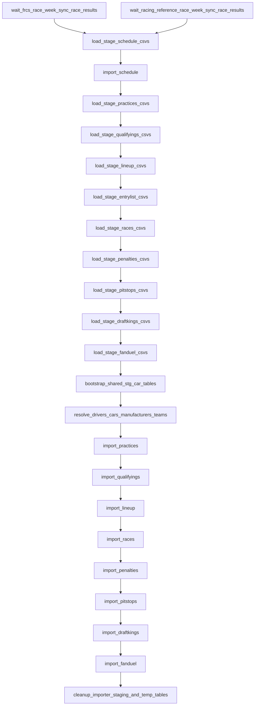

# `nascar.cup.importer`

Hourly importer that turns the per-week FRCS and Racing Reference CSVs into
normalized rows in the `nascar` MySQL schema. Bridges the gap between the
scraper DAGs and `nascar.cup.aggregate` / `nascar.cup.machine_learning.models`.

- **DAG IDs:** `nascar.cup.importer`, `backfill.nascar.cup.importer`
- **Source:** [dags/nascar/cup/importer.py](../../dags/nascar/cup/importer.py)
- **Process notes:** [CONTRIBUTING.md → Importer DAG Process](../../CONTRIBUTING.md)
- **Tests:**
  [tests/unit/test_cup_scraper_importer_dag.py](../../tests/unit/test_cup_scraper_importer_dag.py),
  [tests/unit/test_cup_importer_stage_import_regression.py](../../tests/unit/test_cup_importer_stage_import_regression.py),
  [tests/unit/test_cup_importer_practice_csv.py](../../tests/unit/test_cup_importer_practice_csv.py),
  [tests/unit/test_cup_importer_qualifying_csv.py](../../tests/unit/test_cup_importer_qualifying_csv.py)

## Purpose

Each hourly run:

1. Waits until both the FRCS and Racing Reference race-week DAGs finished
   `sync_race_results` for the same logical date.
2. Stages schedule + per-week CSVs into per-run MySQL staging tables that
   carry a `table_suffix` (the schedule-load run anchor in `%Y%m%d%H%M`).
3. Resolves shared entities (drivers, cars, teams, manufacturers, car
   generations / car-driver pairs).
4. Imports per-kind data (practices, qualifying, lineup, races, penalties,
   pit stops, DraftKings, FanDuel) into the canonical `nascar` tables.
5. Drops staging / temp tables for this run's `table_suffix`.

The importer is the single source of truth for the contract between the
scrapers and the normalized DB. See
[CONTRIBUTING.md](../../CONTRIBUTING.md) section "Importer DAG Process" for
the full data-integrity rules.

## Schedule and basic settings

| Setting | Prod | Backfill |
| --- | --- | --- |
| Cron / `schedule` | `CUP_SCRAPER_PROD_HOURLY_CRON` (`0 * * * *`) | `BACKFILL_YEARLY_SCHEDULE` (`0 0 31 12 *`) |
| `start_date` | `datetime(2025, 7, 11)` | `BACKFILL_START_DATE` (`2010-12-31`) |
| `end_date` | `None` | `BACKFILL_END_DATE` (`2025-12-31`) |
| `catchup` | `False` | `True` |
| `max_active_runs` | `1` | `1` |

Total tasks: **24**.

## Upstream and downstream wiring

- **Upstream sensors:**
  - `wait_frcs_race_week_sync_race_results` waits on
    `nascar.cup.scraper.frcs.race_week.sync_race_results` (prod) or
    `backfill.nascar.cup.scraper.frcs.race_week.sync_race_results` (backfill).
  - `wait_racing_reference_race_week_sync_race_results` waits on the matching
    Racing Reference DAG.
  - Both use `mode=reschedule`, `poke_interval=30s`,
    `timeout=CUP_IMPORTER_WAIT_RACE_WEEK_TIMEOUT` (6h).
- **Downstream:** `nascar.cup.aggregate.wait_importer_complete` waits on
  `cleanup_importer_staging_and_temp_tables` for the same logical date.

## Task graph

## Shared task-family conventions

To avoid copy-pasting prose into every `load_stage_*` / `import_*` heading
below, the conventions used by every pair are summarized once here:

- **MySQL hook:** every callable instantiates
  `NascarMySqlHook(mysql_conn_id="nascar_conn")`.
- **Run isolation:** each task derives `table_suffix` (the schedule load
  anchor, `strftime('%Y%m%d%H%M')`) so its staging / temp table names are
  unique to this DAG run. `cleanup_importer_staging_and_temp_tables` drops
  everything ending in that suffix.
- **Year resolution:** `_context_year(kwargs)` and
  `_cup_series_schedule_year_from_context` use `logical_date` so prod and
  backfill runs target the right season folder under
  `/home/airflow/scraper/nascar/<host>/cup/<year>/`.
- **Target weeks:** schedule tasks emit a list of `(week_id, season_id,
  event_number, rr_week_number)` tuples; downstream `load_stage_*` tasks
  iterate over that list (pulled via XCom).
- **Source preference:** practice / qualifying loaders prefer the FRCS CSV;
  if missing, the RR CSV is used and FRCS-only columns are left NULL.
- **Domain events:** every load / import step emits a `CupImporterEventType`
  `DomainEvent` via `_emit_cup_importer_domain_event` so downstream
  observability can react.
- **SQL templates:** `MySQLTemplateFileOperatorFromContext` and inline
  `_execute_templated_sql_file` render Jinja-templated SQL files under
  `dags/sql/nascar.cup.importer/` (resolved by `_sql_root`).

## Tasks

### `wait_frcs_race_week_sync_race_results`

- **Operator:** `ExternalTaskSensor` (`mode=reschedule`).
- **Target:** `nascar.cup.scraper.frcs.race_week.sync_race_results` for the
  same logical date (backfill twin targets `backfill.*`).
- **Behavior:** confirms FRCS race-week scraping is complete before staging.
- **Upstream:** (root). **Downstream:** `load_stage_schedule_csvs`.

### `wait_racing_reference_race_week_sync_race_results`

- **Operator:** `ExternalTaskSensor` (`mode=reschedule`).
- **Target:** `nascar.cup.scraper.racing_reference.race_week.sync_race_results`
  (backfill twin → `backfill.*`).
- **Behavior:** confirms Racing Reference race-week scraping is complete.
- **Upstream:** (root). **Downstream:** `load_stage_schedule_csvs`.

### `load_stage_schedule_csvs`

- **Operator:** `MySQLTemplateFileOperatorFromContext`.
- **SQL:** `dags/sql/nascar.cup.importer/load_stage_schedule_csvs.sql`.
- **Parameters factory:** `_importer_params_load_schedule` — supplies the
  FRCS + RR `schedule.csv` paths and the run `table_suffix`.
- **Behavior:** truncates per-run staging tables
  (`stg_cup_frcs_schedule_import_<suffix>` and
  `stg_cup_racing_reference_schedule_import_<suffix>`) and `LOAD DATA`s the
  schedule CSVs into them.
- **Success callback:** `_emit_cup_schedule_staged_domain_event` emits one
  `SCHEDULE_STAGED` event per source.
- **Inputs:** `schedule.csv` from both scraper DAGs.
- **Outputs:** per-suffix MySQL staging tables.
- **Upstream:** both wait sensors. **Downstream:** `import_schedule`.

### `import_schedule`

- **Operator:** `MySQLTemplateFileOperatorFromContext`.
- **SQL:** `dags/sql/nascar.cup.importer/import_schedule.sql`.
- **Parameters factory:** `_importer_params_import_schedule` — supplies
  `series_id`, source ids, season year, and `table_suffix`.
- **Behavior:** merges the FRCS + RR schedule staging tables into the
  canonical `nascar.weeks` + `nascar.tracks` rows (and associated mapping
  tables), using FRCS as the source of truth where they conflict and using
  RR `week_number` / `week_date` + `week_race_name` to reconcile RR disk
  paths. Track resolution is **mapping-first**: each schedule row resolves
  `track_id` via `COALESCE(data_sources_tracks.track_id)` for the FRCS and
  RR source names before inserting new `tracks` rows. Truncated FRCS display
  names (ending in `…`) fall back to the RR label for canonical name selection;
  schedule import does not revive soft-deleted `tracks` rows on duplicate name.
  After `merge_track_ids`, existing `data_sources_tracks.track_id` mappings
  prevent duplicate venue rows on subsequent imports.
- **Success callback:** `_emit_cup_schedule_imported_domain_event`.
- **Outputs:** rows in `nascar.weeks`, `nascar.tracks`, `nascar.seasons`
  (insert / update), and the target-week XCom used by every downstream
  `load_stage_*` task.
- **Upstream:** `load_stage_schedule_csvs`. **Downstream:**
  `load_stage_practices_csvs`.

### `load_stage_practices_csvs`

- **Operator:** `PythonOperator`.
- **Callable:** `load_stage_practices_csvs` in
  [dags/nascar/cup/importer.py](../../dags/nascar/cup/importer.py).
- **Behavior:** for every target week + practice session number, picks the
  FRCS `practice-<n>.csv` when present (falls back to the RR file),
  template-loads it into `stg_frcs_practice_<week_id>_<n>_<suffix>` via
  `dags/sql/nascar.cup.importer/load_practice_csv_into_staging_table.sql`,
  and pushes a `staged_practices` XCom list. Emits `PRACTICE_STAGED` domain
  events.
- **Outputs:** per-week / per-session staging tables + XCom.
- **Upstream:** `import_schedule`. **Downstream:** `load_stage_qualifyings_csvs`.

### `load_stage_qualifyings_csvs`

- **Operator:** `PythonOperator`.
- **Callable:** `load_stage_qualifyings_csvs`.
- **Behavior:** mirror of the practices loader for the qualifying CSV
  (FRCS preferred, RR fallback). Stages each week's qualifying rows into
  `stg_frcs_qualifying_<week_id>_<suffix>`.
- **Outputs:** per-week qualifying staging tables + XCom.
- **Upstream:** `load_stage_practices_csvs`. **Downstream:**
  `load_stage_lineup_csvs`.

### `load_stage_lineup_csvs`

- **Operator:** `PythonOperator`.
- **Callable:** `load_stage_lineup_csvs`.
- **Behavior:** stages FRCS `lineup.csv` (the published starting grid) into
  per-week tables. The downstream ML DAG depends on these rows landing in
  `agg_week_results.r_start_position`.
- **Upstream:** `load_stage_qualifyings_csvs`. **Downstream:**
  `load_stage_entrylist_csvs`.

### `load_stage_entrylist_csvs`

- **Operator:** `PythonOperator`.
- **Callable:** `load_stage_entrylist_csvs`.
- **Behavior:** stages FRCS / RR entrylist CSVs into
  `stg_frcs_entrylist_*` and `stg_frcs_rr_entrylist_*` tables (the importer
  consults both sources when resolving drivers / cars).
- **Note:** there is no separate `import_entrylist` task — the entrylist
  rows are consumed during `resolve_drivers_cars_manufacturers_teams` and
  `import_lineup`.
- **Upstream:** `load_stage_lineup_csvs`. **Downstream:**
  `load_stage_races_csvs`.

### `load_stage_races_csvs`

- **Operator:** `PythonOperator`.
- **Callable:** `load_stage_races_csvs`.
- **Behavior:** stages the FRCS + RR final race-results CSVs into per-week
  tables. Race rows are the canonical post-race source for `r_finish_position`
  and the per-driver stat columns the aggregate DAG depends on.
- **Upstream:** `load_stage_entrylist_csvs`. **Downstream:**
  `load_stage_penalties_csvs`.

### `load_stage_penalties_csvs`

- **Operator:** `PythonOperator`.
- **Callable:** `load_stage_penalties_csvs`.
- **Behavior:** stages the FRCS / RR penalties CSVs (in-race and pre-race)
  into per-week tables. RR is the only pre-race-penalty source.
- **Upstream:** `load_stage_races_csvs`. **Downstream:**
  `load_stage_pitstops_csvs`.

### `load_stage_pitstops_csvs`

- **Operator:** `PythonOperator`.
- **Callable:** `load_stage_pitstops_csvs`.
- **Behavior:** stages the FRCS `pit-stops.csv` into per-week tables.
- **Upstream:** `load_stage_penalties_csvs`. **Downstream:**
  `load_stage_draftkings_csvs`.

### `load_stage_draftkings_csvs`

- **Operator:** `PythonOperator`.
- **Callable:** `load_stage_draftkings_csvs`.
- **Behavior:** stages FRCS `draftkings.csv` (DFS salaries + identifiers).
  Feeds `import_draftkings`.
- **Upstream:** `load_stage_pitstops_csvs`. **Downstream:**
  `load_stage_fanduel_csvs`.

### `load_stage_fanduel_csvs`

- **Operator:** `PythonOperator`.
- **Callable:** `load_stage_fanduel_csvs`.
- **Behavior:** stages FRCS `fanduel.csv`. Feeds `import_fanduel`.
- **Upstream:** `load_stage_draftkings_csvs`. **Downstream:**
  `bootstrap_shared_stg_car_tables`.

### `bootstrap_shared_stg_car_tables`

- **Operator:** `PythonOperator`.
- **Callable:** `bootstrap_shared_stg_car_tables`.
- **Behavior:** ensures the shared `stg_car_*` and `stg_car_season_*`
  staging tables exist for every target week / season touched by this run.
  These are inputs to the resolver in the next task.
- **Upstream:** `load_stage_fanduel_csvs`. **Downstream:**
  `resolve_drivers_cars_manufacturers_teams`.

### `resolve_drivers_cars_manufacturers_teams`

- **Operator:** `PythonOperator`.
- **Callable:** `resolve_drivers_cars_manufacturers_teams`.
- **Behavior:** resolves driver, team, manufacturer, car, and `cars_drivers`
  rows for the target weeks. Backfills `car_driver_id` where missing.
  Sentinel-entity creation is forbidden per the
  [AGENTS.md guardrails](../../AGENTS.md). After this task every downstream
  `import_*` task can safely INSERT/UPSERT into the canonical tables knowing
  FK targets exist.
- **Upstream:** `bootstrap_shared_stg_car_tables`. **Downstream:**
  `import_practices`.

### `import_practices`

- **Operator:** `PythonOperator`.
- **Callable:** `import_practices`.
- **Behavior:** for each staged practice table from
  `load_stage_practices_csvs`, merges rows into `nascar.practices` (and
  per-session sub-tables). Leaves FRCS-only columns NULL when the staged
  source is RR.
- **Upstream:** `resolve_drivers_cars_manufacturers_teams`. **Downstream:**
  `import_qualifyings`.

### `import_qualifyings`

- **Operator:** `PythonOperator`.
- **Callable:** `import_qualifyings`.
- **Behavior:** merges staged qualifying rows into `nascar.qualifyings`.
  Uses FRCS-derived rows as source of truth; RR is the fallback.
- **Upstream:** `import_practices`. **Downstream:** `import_lineup`.

### `import_lineup`

- **Operator:** `PythonOperator`.
- **Callable:** `import_lineup`.
- **Behavior:** stages the FRCS starting grid into `nascar.race_results` via
  [`import_lineup_staging_into_db.sql`](../dags/sql/nascar.cup.importer/import_lineup_staging_into_db.sql):
  ensures a `races` row with `INSERT … WHERE NOT EXISTS` (does **not** delete
  `races` — deleting would CASCADE-remove `dfs_salaries` for the week).
  Sets **`start_position`** from `stg.start` only (leaves **`finish_position`**
  null until `import_races`). Uses `ON DUPLICATE KEY UPDATE` on
  `(race_id, car_driver_id)` and deletes only lineup-only shells
  (`total_laps_completed IS NULL`) so a re-run does not wipe post-race rows.
  This populates `agg_week_results.r_start_position` after aggregate and
  enables ML predict snapshots (`r_start_position` set, `r_finish_position`
  null while the race is open).
- **Upstream:** `import_qualifyings`. **Downstream:** `import_races`.

### `import_races`

- **Operator:** `PythonOperator`.
- **Callable:** `import_races`.
- **Behavior:** merges the staged race-results rows into the canonical
  race-results tables. Triggers downstream `agg_week_results` calculations
  via the aggregate DAG.
- **Upstream:** `import_lineup`. **Downstream:** `import_penalties`.

### `import_penalties`

- **Operator:** `PythonOperator`.
- **Callable:** `import_penalties`.
- **Behavior:** merges staged in-race + pre-race penalty rows into the
  canonical `nascar.penalties` table.
- **Upstream:** `import_races`. **Downstream:** `import_pitstops`.

### `import_pitstops`

- **Operator:** `PythonOperator`.
- **Callable:** `import_pitstops`.
- **Behavior:** merges staged pit-stop detail rows into the canonical
  pit-stops table; preserves FRCS time format contracts (see
  [tests/unit/test_frcs_pit_stops_csv_time_format.py](../../tests/unit/test_frcs_pit_stops_csv_time_format.py)).
- **Upstream:** `import_penalties`. **Downstream:** `import_draftkings`.

### `import_draftkings`

- **Operator:** `PythonOperator`.
- **Callable:** `import_draftkings`.
- **Behavior:** merges staged DraftKings slate rows (salaries, IDs) into
  `nascar.dfs_salaries` (and related DFS tables). Provides the per-week
  inputs the ML pipeline ultimately joins against when it predicts DFS
  points (note: today's ML DAG joins DraftKings scoring rules only — the
  salary join is a downstream lineup-optimizer concern).
- **Upstream:** `import_pitstops`. **Downstream:** `import_fanduel`.

### `import_fanduel`

- **Operator:** `PythonOperator`.
- **Callable:** `import_fanduel`.
- **Behavior:** merges staged FanDuel slate rows. The ML DAG does not yet
  consume FanDuel scoring rules, but the rows are imported for completeness.
- **Upstream:** `import_draftkings`. **Downstream:**
  `cleanup_importer_staging_and_temp_tables`.

### `cleanup_importer_staging_and_temp_tables`

- **Operator:** `PythonOperator`.
- **Callable:** `cleanup_importer_staging_and_temp_tables`.
- **Behavior:** computes this run's `table_suffix`, queries
  `information_schema.TABLES` for every table whose name matches one of the
  prefixes in `_IMPORTER_STAGING_PREFIXES` **and** ends with that suffix,
  validates the names against `_TABLE_NAME_RE` + `_TABLE_SUFFIX_RE`, and
  drops each one (`DROP TABLE IF EXISTS ...`). Tables for other runs are
  left alone, which is critical for safe `max_active_runs > 1` recovery.
- **Success heartbeat:** this is the task `nascar.cup.aggregate` waits on
  (`wait_importer_complete`).
- **Upstream:** `import_fanduel`. **Downstream:** none in this DAG.

## Data sources and sinks

- **External CSVs (filesystem):** per-week CSVs produced by the FRCS and
  Racing Reference race-week DAGs (see those docs for exact filenames).
- **MySQL staging tables (per `table_suffix`):** prefixes are
  `stg_cup_frcs_schedule_import_`, `stg_cup_racing_reference_schedule_import_`,
  `stg_frcs_*`, `stg_car_*`, `stg_car_season_*`, plus temp tables under
  `tmp_cup_schedule_*`, `tmp_car_*`, `tmp_practice_*`, `tmp_qualifying_*`,
  `tmp_race_*`, `tmp_preload_driver_car_wide_`, `tmp_driver_car_map_`.
- **MySQL canonical writes:** `nascar.weeks`, `nascar.tracks`,
  `nascar.seasons`, `nascar.drivers`, `nascar.cars`, `nascar.teams`,
  `nascar.manufacturers`, `nascar.car_generations`, `nascar.cars_drivers`,
  `nascar.practices`, `nascar.qualifyings`, lineup table,
  `nascar.race_results`, `nascar.penalties`, `nascar.pit_stops`,
  `nascar.dfs_salaries` (and other DFS tables).

## Configuration

- **Airflow connection:** `nascar_conn` (MySQL).
- **Env vars:** `NASCAR_AIRFLOW_SQL_ROOT` (optional override of the SQL
  files root; defaults to `<dags>/sql`, falling back to `$AIRFLOW_HOME/sql`).
- **Scraper root:** consumed only as a path source via
  `FrcsSource.storage_path_series_year(...)` /
  `RacingReferenceSource.storage_path_series_year(...)`. Mount the host
  scraper volume at `/home/airflow/scraper`.

## Backfill variant

`backfill.nascar.cup.importer` reuses `_register_cup_importer_dag` with:

- `schedule = BACKFILL_YEARLY_SCHEDULE`, `catchup=True`.
- `wait_frcs_race_week_sync_race_results` retargets
  `backfill.nascar.cup.scraper.frcs.race_week.sync_race_results`.
- `wait_racing_reference_race_week_sync_race_results` retargets
  `backfill.nascar.cup.scraper.racing_reference.race_week.sync_race_results`.
- Same callables, same staging-suffix isolation; `cleanup_importer_staging_and_temp_tables`
  only drops tables whose `table_suffix` matches that backfill run.

## Operational notes

- Tasks are linear in the executable order shown above. A failure in any
  `load_stage_*` task is recoverable by re-running from that step — staging
  tables for the run's suffix are re-truncated by each load task.
- A failure in `resolve_drivers_cars_manufacturers_teams` (FK targets
  missing) typically means the entrylist CSV is incomplete; investigate the
  matching FRCS / RR race-week run.
- `cleanup_importer_staging_and_temp_tables` is intentionally conservative:
  it validates every candidate table name against a strict regex before
  issuing `DROP TABLE`. Adding a new staging prefix requires updating
  `_IMPORTER_STAGING_PREFIXES` plus
  [tests/unit/test_cup_scraper_importer_dag.py](../../tests/unit/test_cup_scraper_importer_dag.py).
- Sensor target downtime: the upstream race-week DAGs are how the importer
  finds out that "today's CSVs are ready". If either DAG fails permanently,
  the importer sensors will time out at 6h.

## Related tests

- [tests/unit/test_cup_scraper_importer_dag.py](../../tests/unit/test_cup_scraper_importer_dag.py) — task ids, ordering, sensor wiring, cleanup behavior.
- [tests/unit/test_cup_importer_stage_import_regression.py](../../tests/unit/test_cup_importer_stage_import_regression.py) — stage/import callable regression coverage.
- [tests/unit/test_cup_importer_practice_csv.py](../../tests/unit/test_cup_importer_practice_csv.py),
  [tests/unit/test_cup_importer_qualifying_csv.py](../../tests/unit/test_cup_importer_qualifying_csv.py) — per-kind CSV contracts.
- [tests/unit/test_domain_events.py](../../tests/unit/test_domain_events.py) — `CupImporterEventType` events emitted by load/import tasks.
- [tests/unit/test_cup_rr_week_folder_map.py](../../tests/unit/test_cup_rr_week_folder_map.py) — RR week-number reconciliation used by `import_schedule`.
