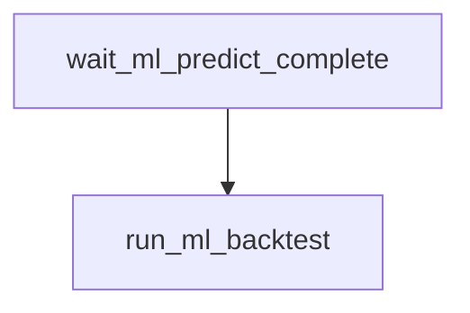

# `nascar.cup.machine_learning.backtest`

Optional walk-forward evaluation for the Cup ML pipeline. Runs after production
train/predict complete; does not write `ml_predictions`.

- **DAG ID:** `nascar.cup.machine_learning.backtest` (no `backfill.*` twin)
- **Source:** [dags/nascar/cup/machine_learning_backtest.py](../../dags/nascar/cup/machine_learning_backtest.py)
- **Tests:** [tests/unit/test_machine_learning_backtest_dag.py](../../tests/unit/test_machine_learning_backtest_dag.py),
  [tests/unit/test_ml_backtest.py](../../tests/unit/test_ml_backtest.py)

## Purpose

Each run retrains in memory on prior finished weeks and scores the most recent
`FS_ML_BACKTEST_MAX_WEEKS` holdout weeks using the same track / track_type /
global routing heuristic as production. Results are logged (DFS-point MAE, RMSE,
Spearman); no registry or prediction tables are updated.

## Schedule and basic settings

| Setting | Value |
| --- | --- |
| Cron / `schedule` | `CUP_SCRAPER_PROD_HOURLY_CRON` (`0 * * * *`) |
| `start_date` | `datetime(2025, 7, 11)` |
| `catchup` | `False` |
| `max_active_runs` | `1` |

Total tasks: **2** (1 sensor + 1 Python task).

## Upstream and downstream wiring

- **Upstream:** `wait_ml_predict_complete` blocks on
  `nascar.cup.machine_learning.predict_upcoming_week` for the same logical date
  (`mode=reschedule`, `poke_interval=30s`,
  `timeout=CUP_IMPORTER_WAIT_RACE_WEEK_TIMEOUT` = 6h, `check_existence=True`).
- **Downstream:** none.

## Task graph

## Tasks

### `wait_ml_predict_complete`

- **Operator:** `ExternalTaskSensor` (`mode=reschedule`).
- **Target:** `nascar.cup.machine_learning.predict_upcoming_week`.
- **Upstream:** (root). **Downstream:** `run_ml_backtest`.

### `run_ml_backtest`

- **Operator:** `PythonOperator`.
- **Callable:** `run_ml_backtest_task` in
  [include/nascar/ml/backtest_task.py](../../include/nascar/ml/backtest_task.py).
- **Behavior:** runs `run_walk_forward_backtest` in
  [include/nascar/ml/backtest.py](../../include/nascar/ml/backtest.py).
- **Upstream:** `wait_ml_predict_complete`. **Downstream:** none.

## Configuration

- **Airflow connection:** `nascar_conn` (MySQL).
- **Env vars:**
  - `FS_ML_HOLDOUT_WEEKS` — int, defaults to `1` (passed through to in-memory train).
  - `FS_ML_BACKTEST_MAX_WEEKS` — int, defaults to `12`. Caps eval weeks in the loop.
  - Same ML routing knobs as production (`FS_ML_MIN_TRACK_WEEKS`, `FS_ML_MIN_TYPE_WEEKS`,
    `FS_ML_ENABLE_GLOBAL_FALLBACK`, `FS_ML_MAX_TRAIN_WEEKS`) apply inside the backtest trainer.

## Operational notes

- Disable by pausing this DAG in the Airflow UI; production ML and lineup generation
  are unaffected.
- Failures here do not fail `nascar.cup.machine_learning` or
  `nascar.cup.dfs.lineup_generator`.
