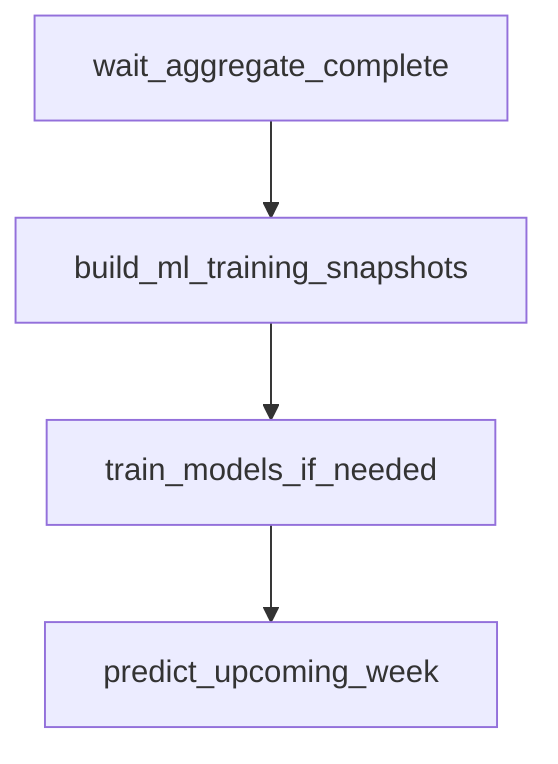

# `nascar.cup.machine_learning`

Hourly Cup ML pipeline. Builds the per-week ML training + prediction
snapshots, retrains the per-target XGBoost regressors when a new finished
week is available, and predicts DraftKings fantasy points for the next
unfinished race.

- **DAG ID:** `nascar.cup.machine_learning` (no `backfill.*` twin)
- **Source:** [dags/nascar/cup/machine_learning.py](../../dags/nascar/cup/machine_learning.py)
- **Tests:** [tests/unit/test_machine_learning_dag.py](../../tests/unit/test_machine_learning_dag.py),
  [tests/unit/test_train_predict_pipeline.py](../../tests/unit/test_train_predict_pipeline.py),
  [tests/unit/test_xgb_tuning.py](../../tests/unit/test_xgb_tuning.py),
  [tests/unit/test_snapshot_build_predict_kind.py](../../tests/unit/test_snapshot_build_predict_kind.py)

## Purpose

Each run materializes the latest training and prediction snapshots and,
when warranted, refits the per-target models that score the next race for
the DraftKings slate. Concretely:

- **Train snapshots (`kind='train'`):** materialized for every Cup week with
  finished race rows in `agg_week_results`. Include features + labels.
- **Predict snapshots (`kind='predict'`):** materialized for upcoming Cup
  weeks where `r_start_position IS NOT NULL` but `r_finish_position IS NULL`
  in `agg_week_results`. Features only; no labels.
- **Retraining:** per target (`r_finish_position`, `r_total_fastest_laps`,
  `r_total_laps_led`), refit an XGBoost regressor using Boruta-selected
  features and a `RandomizedSearchCV` over chronological folds, but **only
  when** the latest finished week is newer than the most recent training
  cohort recorded in `ml_model_training_snapshots`.
- **Predicting:** apply the latest active model per target to each prediction
  snapshot row, blend the per-target predictions into DraftKings points via
  `nascar.dfs_scoring_rules`, and upsert into `ml_predictions`.

## Schedule and basic settings

| Setting | Value |
| --- | --- |
| Cron / `schedule` | `CUP_SCRAPER_PROD_HOURLY_CRON` (`0 * * * *`) |
| `start_date` | `datetime(2025, 7, 11)` |
| `end_date` | `None` |
| `catchup` | `False` |
| `max_active_runs` | `1` |

Total tasks: **4** (1 sensor + 3 Python tasks).

## Upstream and downstream wiring

- **Upstream:** `wait_aggregate_complete` blocks on
  `nascar.cup.aggregate.aggregate_done` for the same logical date
  (`mode=reschedule`, `poke_interval=30s`,
  `timeout=CUP_IMPORTER_WAIT_RACE_WEEK_TIMEOUT` = 6h, `check_existence=True`).
- **Downstream:** none. `ml_predictions` and `ml_model_evaluations` are
  consumed by downstream BI / lineup tooling outside Airflow.

## Task graph

## Tasks

### `wait_aggregate_complete`

- **Operator:** `ExternalTaskSensor` (`mode=reschedule`).
- **Target:** `nascar.cup.aggregate.aggregate_done` for the same logical
  date. This is the `EmptyOperator` sentinel the aggregate DAG ends on, so
  this sensor flips green once every wave-2 aggregate load is done.
- **Behavior:** poke interval 30s, timeout 6h.
- **Inputs:** Airflow metadata DB.
- **Outputs:** none.
- **Upstream:** (root). **Downstream:** `build_ml_training_snapshots`.

### `build_ml_training_snapshots`

- **Operator:** `PythonOperator`.
- **Callable:** `build_ml_training_snapshots_task` in
  [include/nascar/ml/training_snapshot_task.py](../../include/nascar/ml/training_snapshot_task.py).
- **Behavior:** calls both
  `include.nascar.ml.snapshot_build.build_all_week_training_snapshots` and
  `build_all_week_prediction_snapshots` (lazy-imported through
  [include/nascar/ml/__init__.py](../../include/nascar/ml/__init__.py)) with
  `pipeline_version` derived from `FS_PIPELINE_VERSION` or `GIT_COMMIT`. The
  train branch enumerates every Cup week with finished `agg_week_results`
  rows (`r_finish_position IS NOT NULL`) and writes one snapshot per week +
  scoring-rules version into `ml_training_snapshots` with `kind='train'`,
  one row per car-driver into `ml_training_rows`, and one label row per
  car-driver into `ml_labels`. The predict branch enumerates every Cup
  week with `r_start_position IS NOT NULL AND r_finish_position IS NULL`
  via `_PREDICT_WEEKS_SQL` and writes `kind='predict'` snapshots +
  `ml_training_rows` (no `ml_labels`). The `(series_id, week_id, grain,
  kind, dfs_scoring_rules_id)` unique key keeps train and predict snapshots
  separate.
- **Inputs:** `agg_week_results` plus the prior-track / track-types
  aggregate tables in [snapshot_config.py](../../include/nascar/ml/snapshot_config.py)
  (`PREV_TRACK_SOURCES`, `PREV_TRACK_TYPES_SOURCES`); active
  `nascar.dfs_scoring_rules` row for DraftKings (`dfs_id=1`).
- **Outputs:** rows in `ml_training_snapshots`, `ml_training_rows`, and
  `ml_labels`; returns `{"train": [snapshot_id,...], "predict": [...]}` for
  observability.
- **Upstream:** `wait_aggregate_complete`. **Downstream:**
  `train_models_if_needed`.
- **Failure notes:** the unique-key violation on
  `(series_id, week_id, grain, kind, dfs_scoring_rules_id)` is caught by
  `_delete_existing_snapshot` before insert, so rebuilds are idempotent.

### `train_models_if_needed`

- **Operator:** `PythonOperator`.
- **Callable:** `train_models_if_needed_task` in
  [include/nascar/ml/train_task.py](../../include/nascar/ml/train_task.py).
- **Behavior:**
  1. Looks up the latest active `nascar.dfs_scoring_rules` row for
     DraftKings (`DRAFTKINGS_DFS_ID = 1`). Skips with `no_active_rules` if
     missing.
  2. Reads `MAX(week_id)` from `ml_training_snapshots WHERE kind='train' AND
     dfs_scoring_rules_id = ...`. Skips with `no_training_snapshots` if
     empty.
  3. Reads `MAX(s.week_id)` joined through `ml_model_training_snapshots →
     ml_training_snapshots`. If the covered week is already at or beyond
     the latest train week, returns `no_new_finished_weeks` without
     retraining.
  4. Loads the full training frame via
     `include.nascar.ml.training_targets.load_training_frame` (ordered by
     `week_id` to keep `TimeSeriesSplit` chronological).
  5. For each target in `DEFAULT_TARGETS` (`r_finish_position`,
     `r_total_fastest_laps`, `r_total_laps_led`) calls
     `train_models_for_targets` which runs Boruta feature selection
     (`include.nascar.ml.xgb_boruta.select_features`), then `tune_xgb`
     (`RandomizedSearchCV` + `TimeSeriesSplit`), then fits the final
     `XGBRegressor`, evaluating MAE on the trailing `holdout_weeks` weeks
     (env `FS_ML_HOLDOUT_WEEKS`, default `1`).
  6. Persists artifacts to `<FS_ML_ARTIFACT_ROOT>/<model_id>/<target>.json`
     (default `/opt/airflow/artifacts/ml/...`) and writes
     `ml_feature_sets` (`target_keys` = `[target]`, `selected_features`,
     `boruta_metadata`), `ml_models` (`algorithm='xgboost'`,
     `hyperparams_json` includes the target), `ml_model_training_snapshots`
     (every training snapshot id), and per-target `ml_model_evaluations`
     rows (`metric='mae'`).
  7. Computes overall DraftKings DFS-points MAE for the holdout
     (`predicted_dfs_mae_on_holdout` applies scoring rules to the
     per-target predictions) and writes one
     `ml_model_evaluations` row (`metric='dfs_points_mae'`) against the
     primary model (`PRIMARY_TARGET = "r_finish_position"`).
- **Inputs:** `ml_training_snapshots`, `ml_training_rows`, `ml_labels`,
  `ml_models` / `ml_model_training_snapshots`, `dfs_scoring_rules`.
- **Outputs:** rows in `ml_feature_sets`, `ml_models`,
  `ml_model_training_snapshots`, `ml_model_evaluations`; serialized XGBoost
  artifacts on disk; returns a dict with `trained_models`,
  `primary_model_id`, `dfs_points_mae`, and (when skipped) the skip reason.
- **Upstream:** `build_ml_training_snapshots`. **Downstream:**
  `predict_upcoming_week`.
- **Failure notes:** RandomizedSearchCV defaults can be capped via
  `FS_ML_TUNE_N_ITER` and `FS_ML_TUNE_CV_SPLITS`, and tuning can be
  short-circuited entirely with `FS_ML_TUNE_DISABLE=1` (the run still
  records `tuning_skipped=True` in `ml_feature_sets.boruta_metadata`).

### `predict_upcoming_week`

- **Operator:** `PythonOperator`.
- **Callable:** `predict_upcoming_week_task` in
  [include/nascar/ml/predict_task.py](../../include/nascar/ml/predict_task.py).
- **Behavior:**
  1. Resolves the active DraftKings scoring rules.
  2. Loads the latest `kind='predict'` snapshot for the active rules
     (`_latest_predict_snapshot`). If none exists, returns
     `no_predict_snapshot`.
  3. For each target in `DEFAULT_TARGETS`, fetches the most recent
     active `ml_models` row joined through `ml_feature_sets.target_keys`,
     loads the on-disk artifact, and scores the prediction snapshot's
     `ml_training_rows`.
  4. Combines the per-target predictions into a `predicted_targets_json`
     blob, applies `compute_dfs_points_from_targets(scoring_rules, ...)`
     to derive `predicted_dfs_points`, and upserts one
     `ml_predictions` row per `car_driver_id` keyed by the primary model
     id (`PRIMARY_TARGET = "r_finish_position"`).
- **Inputs:** `ml_training_snapshots` (`kind='predict'`),
  `ml_training_rows`, `ml_models`, `ml_feature_sets`, on-disk XGBoost
  artifacts, `dfs_scoring_rules`.
- **Outputs:** rows in `ml_predictions`; returns a dict with
  `primary_model_id`, the snapshot id, and the number of rows scored.
- **Upstream:** `train_models_if_needed`. **Downstream:** none in this DAG.
- **Failure notes:** missing per-target models surface as
  `missing_model_for_target` skips. Re-running after a successful
  `train_models_if_needed` resolves the missing model.

## Data sources and sinks

- **Reads:** `agg_week_results`, every `agg_week_prev_track_*` /
  `agg_week_prev_track_types_*` table referenced by
  [snapshot_config.py](../../include/nascar/ml/snapshot_config.py),
  `nascar.dfs_scoring_rules`, and the ML registry tables
  (`ml_training_snapshots`, `ml_training_rows`, `ml_labels`,
  `ml_feature_sets`, `ml_models`, `ml_model_training_snapshots`).
- **Writes (DB):**
  - `ml_training_snapshots` — header row per snapshot (`kind` ∈
    `{train, predict}`).
  - `ml_training_rows` — one row per car-driver / snapshot.
  - `ml_labels` — one row per car-driver / training snapshot
    (train-kind only).
  - `ml_feature_sets` — one row per trained model (`target_keys`,
    `selected_features`, Boruta + tuning metadata).
  - `ml_models` — one row per (target, training cohort) pair.
  - `ml_model_training_snapshots` — link table covering every snapshot the
    model trained on.
  - `ml_model_evaluations` — per-model `mae` rows + a primary-model
    `dfs_points_mae` row per training run.
  - `ml_predictions` — per car-driver per snapshot prediction with
    `predicted_targets_json` and `predicted_dfs_points`.
- **Writes (filesystem):** XGBoost JSON artifacts under
  `<FS_ML_ARTIFACT_ROOT>/<model_id>/<target>.json`.

## Configuration

- **Airflow connection:** `nascar_conn` (MySQL).
- **Env vars:**
  - `FS_PIPELINE_VERSION` / `GIT_COMMIT` — stamped onto each snapshot's
    `pipeline_version` field for lineage.
  - `FS_ML_ARTIFACT_ROOT` — root for the on-disk XGBoost JSON artifacts.
    Defaults to `/opt/airflow/artifacts/ml`.
  - `FS_ML_HOLDOUT_WEEKS` — int, defaults to `1`. Controls how many of the
    most recent training weeks become the chronological holdout.
  - `FS_ML_TUNE_N_ITER` — int, defaults to the value in `tune_xgb`
    (currently RandomizedSearchCV's `n_iter`).
  - `FS_ML_TUNE_CV_SPLITS` — int, defaults to the value in `tune_xgb` for
    the `TimeSeriesSplit` `n_splits`.
  - `FS_ML_TUNE_DISABLE` — `1` / `true` / `yes` short-circuits tuning to
    `DEFAULT_PARAMS` and records `tuning_skipped=true` in
    `ml_feature_sets.boruta_metadata`.
- **Python deps:** `scikit-learn`, `xgboost`, `boruta` (see
  [pyproject.toml](../../pyproject.toml)).

## Backfill variant

None. The ML registry is intentionally append-only on top of whatever
`ml_training_snapshots` exists — a backfill is performed simply by letting
this DAG run once after the aggregate DAG fills in historical
`agg_week_results` rows.

## Operational notes

- **Idempotency:** the snapshot builder reuses the unique key
  `(series_id, week_id, grain, kind, dfs_scoring_rules_id)` so re-runs
  refresh, rather than duplicate, snapshots. The trainer's "skip if covered"
  guard means the task is safe to schedule hourly.
- **Disk usage:** each retrain emits 3 JSON artifacts (one per target).
  Plan for `~$num_retrains × 3 × few-KB` under `FS_ML_ARTIFACT_ROOT`.
- **Tuning cost:** RandomizedSearchCV is the dominant CPU cost. Use
  `FS_ML_TUNE_N_ITER`, `FS_ML_TUNE_CV_SPLITS`, or `FS_ML_TUNE_DISABLE` for
  cheaper runs during incident response or local debugging.
- **Backwards compatibility:** if `ml_models.artifact_uri` is `NULL`
  (legacy rows or failed disk writes) `predict_upcoming_week` skips that
  target and emits a `missing_model_for_target` log line.

## Related tests

- [tests/unit/test_machine_learning_dag.py](../../tests/unit/test_machine_learning_dag.py) — DAG metadata, task ids, sensor wiring, linear chain.
- [tests/unit/test_train_predict_pipeline.py](../../tests/unit/test_train_predict_pipeline.py) — end-to-end synthetic train + predict including hand-computed DFS points.
- [tests/unit/test_xgb_tuning.py](../../tests/unit/test_xgb_tuning.py) — RandomizedSearchCV envelope + `FS_ML_TUNE_DISABLE` short-circuit.
- [tests/unit/test_snapshot_build_predict_kind.py](../../tests/unit/test_snapshot_build_predict_kind.py) — predict-kind branch (no labels, anchor SQL, `kind` column).
