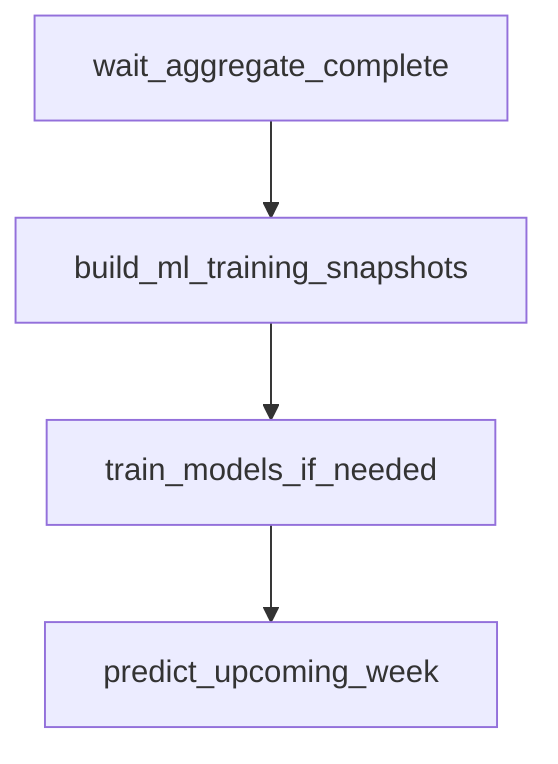

# `nascar.cup.machine_learning`

Hourly Cup ML pipeline. Builds the per-week ML training + prediction
snapshots, retrains the per-target XGBoost regressors when a new finished
week is available, and predicts DraftKings fantasy points for the next
unfinished race.

- **DAG ID:** `nascar.cup.machine_learning` (no `backfill.*` twin)
- **Source:** [dags/nascar/cup/machine_learning.py](../../dags/nascar/cup/machine_learning.py)
- **Tests:** [tests/unit/test_machine_learning_dag.py](../../tests/unit/test_machine_learning_dag.py),
  [tests/unit/test_train_predict_pipeline.py](../../tests/unit/test_train_predict_pipeline.py),
  [tests/unit/test_xgb_tuning.py](../../tests/unit/test_xgb_tuning.py),
  [tests/unit/test_snapshot_build_predict_kind.py](../../tests/unit/test_snapshot_build_predict_kind.py)

## Purpose

Each run materializes the latest training and prediction snapshots and,
when warranted, refits the per-target models that score the next race for
the DraftKings slate. Concretely:

- **Train snapshots (`kind='train'`):** materialized for every Cup week with
  finished race rows in `agg_week_results`. Include features + labels.
- **Predict snapshots (`kind='predict'`):** materialized for upcoming Cup
  weeks where `r_start_position IS NOT NULL` but `r_finish_position IS NULL`
  in `agg_week_results`. Features only; no labels.
- **Retraining:** per `(series_id, model_scope, target)`, refit an XGBoost
  regressor using Boruta-selected features and a `RandomizedSearchCV` over
  chronological folds, but **only when** the latest finished week is newer
  than the most recent training cohort recorded in
  `ml_model_training_snapshots`. Models are partitioned by NASCAR series
  first (Cup / Xfinity / Truck) so Cup snapshots never train weights used
  to predict Xfinity races. Within a series the scopes are:
  - `track` — one model per `track_id` with at least `FS_ML_MIN_TRACK_WEEKS`
    finished weeks (default `3`). Features restricted to the per-track
    family (`*_pt_*`) plus anchor columns (`r_start_position`, etc.).
  - `track_type` — one model per `track_type_id` with at least
    `FS_ML_MIN_TYPE_WEEKS` finished weeks (default `10`). Features
    restricted to that type's `*_tt_<track_type_id>_*` columns plus
    anchors. Used as the cold-start fallback for tracks lacking enough
    history.
  - `global` — legacy single-frame model per series. Trained whenever
    `FS_ML_ENABLE_GLOBAL_FALLBACK=1` (default).
- **Predicting:** resolve a model per target via the routing chain
  `series_id -> track -> track_type -> global` (see
  [include/nascar/ml/model_scope.py](../../include/nascar/ml/model_scope.py)),
  blend the per-target predictions into DraftKings points via
  `nascar.dfs_scoring_rules`, and upsert into `ml_predictions`.

## Schedule and basic settings

| Setting | Value |
| --- | --- |
| Cron / `schedule` | `CUP_SCRAPER_PROD_HOURLY_CRON` (`0 * * * *`) |
| `start_date` | `datetime(2025, 7, 11)` |
| `end_date` | `None` |
| `catchup` | `False` |
| `max_active_runs` | `1` |

Total tasks: **4** (1 sensor + 3 Python tasks).

## Upstream and downstream wiring

- **Upstream:** `wait_aggregate_complete` blocks on
  `nascar.cup.aggregate.aggregate_done` for the same logical date
  (`mode=reschedule`, `poke_interval=30s`,
  `timeout=CUP_IMPORTER_WAIT_RACE_WEEK_TIMEOUT` = 6h, `check_existence=True`).
- **Downstream:** none. `ml_predictions` and `ml_model_evaluations` are
  consumed by downstream BI / lineup tooling outside Airflow.

## Task graph



## Tasks

### `wait_aggregate_complete`

- **Operator:** `ExternalTaskSensor` (`mode=reschedule`).
- **Target:** `nascar.cup.aggregate.aggregate_done` for the same logical
  date. This is the `EmptyOperator` sentinel the aggregate DAG ends on, so
  this sensor flips green once every wave-2 aggregate load is done.
- **Behavior:** poke interval 30s, timeout 6h.
- **Inputs:** Airflow metadata DB.
- **Outputs:** none.
- **Upstream:** (root). **Downstream:** `build_ml_training_snapshots`.

### `build_ml_training_snapshots`

- **Operator:** `PythonOperator`.
- **Callable:** `build_ml_training_snapshots_task` in
  [include/nascar/ml/training_snapshot_task.py](../../include/nascar/ml/training_snapshot_task.py).
- **Behavior:** calls both
  `include.nascar.ml.snapshot_build.build_all_week_training_snapshots` and
  `build_all_week_prediction_snapshots` (lazy-imported through
  [include/nascar/ml/__init__.py](../../include/nascar/ml/__init__.py)) with
  `pipeline_version` derived from `FS_PIPELINE_VERSION` or `GIT_COMMIT`. The
  train branch enumerates every Cup week with finished `agg_week_results`
  rows (`r_finish_position IS NOT NULL`) and writes one snapshot per week +
  scoring-rules version into `ml_training_snapshots` with `kind='train'`,
  one row per car-driver into `ml_training_rows`, and one label row per
  car-driver into `ml_labels`. The predict branch builds at most one
  `kind='predict'` snapshot for the Cup **current week** from
  `v_series_current_week` when that week has a known grid and no finish
  (`r_start_position IS NOT NULL AND r_finish_position IS NULL` on
  `agg_week_results`) and writes `ml_training_rows` only (no `ml_labels`).
  The `(series_id, week_id, grain,
  kind, dfs_scoring_rules_id)` unique key keeps train and predict snapshots
  separate.
- **Inputs:** `agg_week_results` plus the prior-track / track-types
  aggregate tables in [snapshot_config.py](../../include/nascar/ml/snapshot_config.py)
  (`PREV_TRACK_SOURCES`, `PREV_TRACK_TYPES_SOURCES`); active
  `nascar.dfs_scoring_rules` row for DraftKings (`dfs_id=1`). Reference data
  is seeded on DB init via
  [`9001-insert_dfs_seed.sql`](../../../fantasy-sports-db/nascar/seed/9001-insert_dfs_seed.sql)
  and
  [`9002-insert_dfs_scoring_rules_seed.sql`](../../../fantasy-sports-db/nascar/seed/9002-insert_dfs_scoring_rules_seed.sql).
  On an existing database, apply those files manually before the first ML run.
- **Outputs:** rows in `ml_training_snapshots`, `ml_training_rows`, and
  `ml_labels`; returns `{"train": [snapshot_id,...], "predict": [...]}` for
  observability.
- **Upstream:** `wait_aggregate_complete`. **Downstream:**
  `train_models_if_needed`.
- **Failure notes:** before insert, `_delete_existing_snapshot` physically
  deletes any prior row for `(series_id, week_id, grain, kind,
  dfs_scoring_rules_id)` (CASCADE removes child rows/labels). Soft-delete
  cannot be used here because the unique key ignores `deleted_at`. Rebuilds
  are idempotent once this delete runs.
  If no active `dfs_scoring_rules` row exists for DraftKings, the task logs a
  warning and returns empty train/predict id lists (same as `train_models_if_needed`
  `no_active_rules` skip) instead of raising.

### `train_models_if_needed`

- **Operator:** `PythonOperator`.
- **Callable:** `train_models_if_needed_task` in
  [include/nascar/ml/train_task.py](../../include/nascar/ml/train_task.py).
- **Behavior:**
  1. Looks up the latest active `nascar.dfs_scoring_rules` row for
     DraftKings (`DRAFTKINGS_DFS_ID = 1`). Skips with `no_active_rules` if
     missing.
  2. Requires a row in `v_series_current_week` for Cup; skips with
     `no_current_week` if missing.
  3. Reads the latest train `week_id` capped to weeks in
     `v_series_before_current_week` or the current week (finished live
     week train snapshots). Skips with `no_training_snapshots` if empty.
  4. Reads `MAX(s.week_id)` joined through `ml_model_training_snapshots →
     ml_training_snapshots`. If the covered week is already at or beyond
     that latest train week, returns `no_new_finished_weeks` without
     retraining.
  5. Reads the feature allowlist from `ml_training_snapshots.feature_keys`
     on the latest train snapshot for the active rules version (no full-table
     scan of every row's `features_json`).
  6. **Per-series, per-scope training loop** with **scoped SQL loads** via
     `load_training_frame(dfs_scoring_rules_id=..., series_id=..., ...)`.
     Each `(track_id)` / `(track_type_id)` / global bucket loads only its rows,
     trains, then drops the frame before the next scope — avoiding a single
     query with hundreds of snapshot ids and ~24k parsed JSON blobs in memory.
     Rows are ordered by `week_id` for chronological `TimeSeriesSplit`.
     Each row carries `series_id`, `track_id`, and `track_type_id`
     (canonical primary type from `tracks_track_types`). Within each series:
     - SQL discovers `track_id` / `track_type_id` buckets with at least
       `FS_ML_MIN_TRACK_WEEKS` / `FS_ML_MIN_TYPE_WEEKS` distinct finished
       weeks. Global scope is gated behind `FS_ML_ENABLE_GLOBAL_FALLBACK` and
       may be capped with `FS_ML_MAX_TRAIN_WEEKS` (most recent N weeks only).
     - For each bucket, build a per-scope feature allowlist from
       `model_scope.features_for_scope`:
       `*_pt_*` + anchors for `track`, `*_tt_<track_type_id>_*` + anchors
       for `track_type`, everything for `global`.
     - For each target in `DEFAULT_TARGETS` (`r_finish_position`,
       `r_total_fastest_laps`, `r_total_laps_led`) call
       `train_models_for_targets(rows, feature_allowlist=...)`. Boruta runs
       on the allowlist subset, then `tune_xgb` (`RandomizedSearchCV` +
       `TimeSeriesSplit`), then a final `XGBRegressor` fit. MAE on the
       trailing `FS_ML_HOLDOUT_WEEKS` (default `1`) weeks is recorded.
  7. Persists artifacts to `<FS_ML_ARTIFACT_ROOT>/<model_id>/<target>.json`
     and writes:
     - `ml_feature_sets` — `target_keys=[target]`, `selected_features`,
       `boruta_metadata` (includes `scope` block with `series_id` /
       `model_scope` / `track_id` / `track_type_id`).
     - `ml_models` — one row per `(series_id, scope, scope_key, target)`
       with `series_id` (NOT NULL) plus `model_scope` / `track_id` /
       `track_type_id` populated per the `chk_ml_models_scope_keys` check
       constraint.
     - `ml_model_training_snapshots` — every snapshot id in the bucket.
     - `ml_model_evaluations` — per-model `mae` rows + a primary-model
       `dfs_points_mae` row per (scope, group).
- **Inputs:** `ml_training_snapshots`, `ml_training_rows`, `ml_labels`,
  `tracks_track_types`, `ml_models` / `ml_model_training_snapshots`,
  `dfs_scoring_rules`.
- **Outputs:** rows in `ml_feature_sets`, `ml_models`,
  `ml_model_training_snapshots`, `ml_model_evaluations`; serialized XGBoost
  artifacts on disk; returns a dict with `scope_results` (one entry per
  trained `(scope, group)`), `latest_train_week`, `covered_week`, and
  (when skipped) the skip reason.
- **Upstream:** `build_ml_training_snapshots`. **Downstream:**
  `predict_upcoming_week`.
- **Failure notes:** RandomizedSearchCV defaults can be capped via
  `FS_ML_TUNE_N_ITER` and `FS_ML_TUNE_CV_SPLITS`, and tuning can be
  short-circuited entirely with `FS_ML_TUNE_DISABLE=1` (the run still
  records `tuning_skipped=True` in `ml_feature_sets.boruta_metadata`).
  Buckets that fall under the min-week threshold are silently skipped — a
  rare-track-type (e.g. road course in early season) simply does not get a
  scoped model until enough weeks accumulate.

### `predict_upcoming_week`

- **Operator:** `PythonOperator`.
- **Callable:** `predict_upcoming_week_task` in
  [include/nascar/ml/predict_task.py](../../include/nascar/ml/predict_task.py).
- **Behavior:**
  1. Resolves the active DraftKings scoring rules.
  2. Loads the `kind='predict'` snapshot for the active rules on the Cup
     **current week** (`v_series_current_week`, not `MAX(week_id)`).
     The snapshot lookup joins `tracks_track_types` so the snapshot dict
     carries `series_id`, `track_id`, and the canonical `track_type_id`.
     If no predict snapshot exists, returns `no_predict_snapshot`.
  3. For each target in `DEFAULT_TARGETS`, walks the scope routing chain
     in `_resolve_model_for_target`. The snapshot's `series_id` is the
     outermost filter on every `_scope_lookup` so a Cup model never
     resolves for an Xfinity / Truck predict snapshot at the same
     physical track:

     ```mermaid
     flowchart TB
       Snap["predict snapshot (series_id, track_id, track_type_id)"]
       HasTrack{"track model for (series_id, track_id)?"}
       HasType{"track_type model for (series_id, track_type_id)?"}
       HasGlobal{"FS_ML_ENABLE_GLOBAL_FALLBACK and global model for series_id?"}
       TrackModel["use track model"]
       TypeModel["use track_type model"]
       GlobalModel["use series global model"]
       Skip["return no_model_for_target"]
       Snap --> HasTrack
       HasTrack -- yes --> TrackModel
       HasTrack -- no --> HasType
       HasType -- yes --> TypeModel
       HasType -- no --> HasGlobal
       HasGlobal -- yes --> GlobalModel
       HasGlobal -- no --> Skip
     ```

     A model entry is considered usable only if it has a non-null
     `artifact_uri`. There is no cross-series fallback by design.
  4. Loads the on-disk artifact and scores the prediction snapshot's
     `ml_training_rows`.
  5. Combines the per-target predictions into a `predicted_targets_json`
     blob, applies `compute_dfs_points_from_targets(scoring_rules, ...)`
     to derive `predicted_dfs_points`, and upserts one
     `ml_predictions` row per `car_driver_id` keyed by the primary model
     id (`PRIMARY_TARGET = "r_finish_position"`).
- **Inputs:** `ml_training_snapshots` (`kind='predict'`, contributes
  `series_id`, `track_id`, `track_type_id`), `ml_training_rows`,
  `ml_models` (filtered by `series_id` and `model_scope`),
  `ml_feature_sets`, `tracks_track_types`, on-disk XGBoost artifacts,
  `dfs_scoring_rules`.
- **Outputs:** rows in `ml_predictions`; returns a dict with
  `primary_model_id`, `model_ids`, `resolved_scopes` (per-target scope
  metadata including `series_id` and whether the track, track_type, or
  global model was chosen), the snapshot id, and the number of rows
  scored.
- **Upstream:** `train_models_if_needed`. **Downstream:** none in this DAG.
- **Failure notes:** if even the global fallback is missing (or disabled)
  the task short-circuits with `no_model_for_target:<target>`. Per-target
  scope decisions are logged so it is easy to see which model was actually
  used for each prediction.

## Data sources and sinks

- **Reads:** `agg_week_results`, every `agg_week_prev_track_*` /
  `agg_week_prev_track_types_*` table referenced by
  [snapshot_config.py](../../include/nascar/ml/snapshot_config.py),
  `nascar.dfs_scoring_rules`, and the ML registry tables
  (`ml_training_snapshots`, `ml_training_rows`, `ml_labels`,
  `ml_feature_sets`, `ml_models`, `ml_model_training_snapshots`).
- **Writes (DB):**
  - `ml_training_snapshots` — header row per snapshot (`kind` ∈
    `{train, predict}`).
  - `ml_training_rows` — one row per car-driver / snapshot.
  - `ml_labels` — one row per car-driver / training snapshot
    (train-kind only).
  - `ml_feature_sets` — one row per trained model (`target_keys`,
    `selected_features`, Boruta + tuning metadata).
  - `ml_models` — one row per (target, training cohort) pair.
  - `ml_model_training_snapshots` — link table covering every snapshot the
    model trained on.
  - `ml_model_evaluations` — per-model `mae` rows + a primary-model
    `dfs_points_mae` row per training run.
  - `ml_predictions` — per car-driver per snapshot prediction with
    `predicted_targets_json` and `predicted_dfs_points`.
- **Writes (filesystem):** XGBoost JSON artifacts under
  `<FS_ML_ARTIFACT_ROOT>/<model_id>/<target>.json`.

## Configuration

- **Airflow connection:** `nascar_conn` (MySQL).
- **Env vars:**
  - `FS_PIPELINE_VERSION` / `GIT_COMMIT` — stamped onto each snapshot's
    `pipeline_version` field for lineage.
  - `FS_ML_ARTIFACT_ROOT` — root for the on-disk XGBoost JSON artifacts.
    Defaults to `/opt/airflow/artifacts/ml`.
  - `FS_ML_HOLDOUT_WEEKS` — int, defaults to `1`. Controls how many of the
    most recent training weeks become the chronological holdout.
  - `FS_ML_TUNE_N_ITER` — int, defaults to the value in `tune_xgb`
    (currently RandomizedSearchCV's `n_iter`).
  - `FS_ML_TUNE_CV_SPLITS` — int, defaults to the value in `tune_xgb` for
    the `TimeSeriesSplit` `n_splits`.
  - `FS_ML_TUNE_DISABLE` — `1` / `true` / `yes` short-circuits tuning to
    `DEFAULT_PARAMS` and records `tuning_skipped=true` in
    `ml_feature_sets.boruta_metadata`.
  - `FS_ML_MIN_TRACK_WEEKS` — int, defaults to `3`. Minimum distinct
    finished Cup weeks at a `track_id` before a track-scoped model is
    trained.
  - `FS_ML_MIN_TYPE_WEEKS` — int, defaults to `10`. Same idea for the
    per-track-type fallback. Lower values speed up cold-start coverage at
    the cost of less stable models.
  - `FS_ML_ENABLE_GLOBAL_FALLBACK` — `0` disables both training **and**
    predict-time resolution of the legacy global-scope model. Default `1`
    keeps the rollout safe while per-track / per-track-type coverage
    grows.
  - `FS_ML_MAX_TRAIN_WEEKS` — int, defaults to `0` (no cap). When set to
    a positive value, global-scope training loads only the N most recent
    distinct finished `week_id` values for that series. Per-track and
    per-track-type loads are already smaller and ignore this knob. Use
    `156` (~4 Cup seasons) or lower if global retrain OOMs on the worker.
- **Python deps:** `scikit-learn`, `xgboost`, `boruta` (see
  [pyproject.toml](../../pyproject.toml)).

## Backfill variant

None. The ML registry is intentionally append-only on top of whatever
`ml_training_snapshots` exists — a backfill is performed simply by letting
this DAG run once after the aggregate DAG fills in historical
`agg_week_results` rows.

## Operational notes

- **Idempotency:** the snapshot builder reuses the unique key
  `(series_id, week_id, grain, kind, dfs_scoring_rules_id)` so re-runs
  refresh, rather than duplicate, snapshots. The trainer's "skip if covered"
  guard means the task is safe to schedule hourly.
- **Disk usage:** each retrain emits 3 JSON artifacts (one per target).
  Plan for `~$num_retrains × 3 × few-KB` under `FS_ML_ARTIFACT_ROOT`.
- **Tuning cost:** RandomizedSearchCV is the dominant CPU cost. Use
  `FS_ML_TUNE_N_ITER`, `FS_ML_TUNE_CV_SPLITS`, or `FS_ML_TUNE_DISABLE` for
  cheaper runs during incident response or local debugging.
- **Worker memory:** scoped per-track / per-track-type loads are typically
  modest. Global-scope training over the full Cup history can require **4–8GB+**
  RAM during Boruta + `RandomizedSearchCV` (×3 targets). If the worker is
  SIGKILL'd (OOM), set `FS_ML_MAX_TRAIN_WEEKS` (e.g. `52` or `156`), increase
  Celery/worker memory, or disable global training with
  `FS_ML_ENABLE_GLOBAL_FALLBACK=0` once per-track models cover most venues.
- **Backwards compatibility:** if `ml_models.artifact_uri` is `NULL`
  (legacy rows or failed disk writes) `predict_upcoming_week` skips that
  target and emits a `missing_model_for_target` log line.

## Related tests

- [tests/unit/test_machine_learning_dag.py](../../tests/unit/test_machine_learning_dag.py) — DAG metadata, task ids, sensor wiring, linear chain.
- [tests/unit/test_train_predict_pipeline.py](../../tests/unit/test_train_predict_pipeline.py) — end-to-end synthetic train + predict including hand-computed DFS points.
- [tests/unit/test_xgb_tuning.py](../../tests/unit/test_xgb_tuning.py) — RandomizedSearchCV envelope + `FS_ML_TUNE_DISABLE` short-circuit.
- [tests/unit/test_snapshot_build_predict_kind.py](../../tests/unit/test_snapshot_build_predict_kind.py) — predict-kind branch (no labels, anchor SQL, `kind` column).
- [tests/unit/test_model_scope.py](../../tests/unit/test_model_scope.py) — feature-allowlist filtering, frame grouping, env-var thresholds.
- [tests/unit/test_predict_routing.py](../../tests/unit/test_predict_routing.py) — predict-time resolver: series_id → track → track_type → global, including the global-fallback disable flag, missing-artifact skip, and the cross-series isolation guard.
- [tests/unit/test_scoped_training.py](../../tests/unit/test_scoped_training.py) — confirms `feature_allowlist` keeps track scope on `*_pt_*` features and track_type scope on the matching `*_tt_<id>_*` family.
- [tests/unit/test_training_targets_load.py](../../tests/unit/test_training_targets_load.py) — filtered `load_training_frame` SQL and scoped train-task loads (no monolithic snapshot-id `IN` list).
