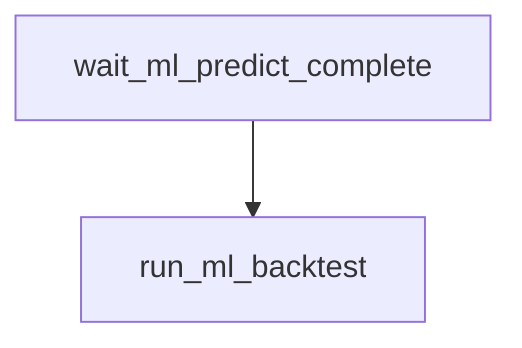

# `nascar.cup.machine_learning.models.backtest`

Optional walk-forward evaluation for the Cup ML pipeline. Runs after production
train/predict complete; does not write `ml_predictions`.

- **DAG ID:** `nascar.cup.machine_learning.models.backtest` (no `backfill.*` twin)
- **Source:** [dags/nascar/cup/machine_learning_models_backtest.py](../../dags/nascar/cup/machine_learning_models_backtest.py)
- **Tests:** [tests/unit/test_machine_learning_models_backtest_dag.py](../../tests/unit/test_machine_learning_models_backtest_dag.py),
  [tests/unit/test_ml_backtest.py](../../tests/unit/test_ml_backtest.py)

## Purpose

Each run retrains in memory on prior finished weeks and scores the most recent
`FS_ML_BACKTEST_MAX_WEEKS` holdout weeks using the same cohort-blend strategy
as production (one model per `(series_id, track_type_id)`, blended for the
eval week's track via `FS_ML_BLEND_WEIGHTS`). Results are logged (DFS-point
MAE, RMSE, Spearman); no registry or prediction tables are updated.

## Schedule and basic settings

| Setting | Value |
| --- | --- |
| Cron / `schedule` | `CUP_SCRAPER_PROD_HOURLY_CRON` (`0 * * * *`) |
| `start_date` | `datetime(2025, 7, 11)` |
| `catchup` | `False` |
| `max_active_runs` | `1` |

Total tasks: **2** (1 sensor + 1 Python task).

## Upstream and downstream wiring

- **Upstream:** `wait_ml_predict_complete` blocks on
  `nascar.cup.machine_learning.models.predict_upcoming_week` for the same logical date
  (`mode=reschedule`, `poke_interval=30s`,
  `timeout=CUP_IMPORTER_WAIT_RACE_WEEK_TIMEOUT` = 6h, `check_existence=True`).
- **Downstream:** none.

## Task graph

## Tasks

### `wait_ml_predict_complete`

- **Operator:** `ExternalTaskSensor` (`mode=reschedule`).
- **Target:** `nascar.cup.machine_learning.models.predict_upcoming_week`.
- **Upstream:** (root). **Downstream:** `run_ml_backtest`.

### `run_ml_backtest`

- **Operator:** `PythonOperator`.
- **Callable:** `run_ml_backtest_task` in
  [include/nascar/ml/backtest_task.py](../../include/nascar/ml/backtest_task.py).
- **Behavior:** runs `run_walk_forward_backtest` in
  [include/nascar/ml/backtest.py](../../include/nascar/ml/backtest.py).
- **Upstream:** `wait_ml_predict_complete`. **Downstream:** none.

## Configuration

- **Airflow connection:** `nascar_conn` (MySQL).
- **Env vars:**
  - `FS_ML_HOLDOUT_WEEKS` — int, defaults to `1` (passed through to in-memory train).
  - `FS_ML_BACKTEST_MAX_WEEKS` — int, defaults to `12`. Caps **outer eval weeks**
    in the walk-forward loop (wall-clock dial). Does **not** bound the underlying
    training-frame load — that is `FS_ML_BACKTEST_LOAD_WEEKS` below.
  - `FS_ML_BACKTEST_LOAD_WEEKS` — int, defaults to `64`. Caps the
    **training-frame SQL load** at the most-recent N distinct `week_id`
    values for the active `(series_id, dfs_scoring_rules_id)` pair.
    Forwarded to `load_training_frame` as `max_train_weeks` so the row
    count drops proportionally at the DB layer via the same window
    subselect production uses. Lower under memory pressure; raise only
    when the worker has comfortable headroom under its cgroup cap (see
    [Incident note — 27 May 2026](#incident-note--27-may-2026)).
    Non-int / non-positive values fall back to the default with a
    warning, so a typo in `.env` cannot re-introduce the unbounded
    regression.
  - Same cohort knobs as production (`FS_ML_MIN_COHORT_WEEKS`,
    `FS_ML_BLEND_WEIGHTS`) apply inside the in-memory backtest trainer.

### `FS_ML_BACKTEST_LOAD_WEEKS` vs `FS_ML_BACKTEST_MAX_WEEKS`

The two knobs target different resources and both are required:

| Knob | Default | Bounds | Effect |
| --- | --- | --- | --- |
| `FS_ML_BACKTEST_LOAD_WEEKS` | `64` | DB row count + RAM | SQL window subselect on `ml_training_rows` so only the most-recent N weeks ever materialize as Python dicts. |
| `FS_ML_BACKTEST_MAX_WEEKS` | `12` | Wall-clock | Number of outer eval iterations (`train_models_for_targets` is called twice per eval week, so this dominates compute). |

For the default frame size of ~24,130 rows across ~616 weeks (Cup, late
2026), the `64`-week cap loads roughly `24130 × (64 / 616) ≈ 2.5k rows`
of `features_json` averaging ~238 KB each — about 600 MB of JSON text
on the wire, comfortably under the 8 GiB worker cgroup limit even after
JSON parsing and the downstream XGBoost matrices.

## Incident note — 27 May 2026

The backtest task crashed the host four times on 27 May (reboots at
09:17, 11:45, 15:26, 16:43 CDT). Root cause: `run_walk_forward_backtest`
previously called `load_training_frame(dfs_scoring_rules_id, series_id)`
with **neither `track_type_id` nor `max_train_weeks`** — the only
`load_training_frame` caller in the codebase that materialized the full
series history. With Cup history at ~24,130 rows × ~238 KB `features_json`
each, the worker hit 11.36 GB RSS before the SQL streaming load finished
and was SIGKILL'd by the kernel via a **global OOM**
(`task_memcg=/system.slice/docker-...`, `constraint=CONSTRAINT_NONE`),
which reaped enough of the user session that the host needed a reboot.
Because the DAG is on an hourly cron, every tick re-triggered the
crash.

Two-layer mitigation:

1. **Bounded load** — `FS_ML_BACKTEST_LOAD_WEEKS` (default `64`)
   forwarded to `load_training_frame(max_train_weeks=…)` so the SQL
   row count is capped at the DB layer. Pinned by
   `test_backtest_passes_max_train_weeks_to_loader` in
   [tests/unit/test_ml_backtest.py](../../tests/unit/test_ml_backtest.py).
2. **Container memory cap** — `airflow-worker` now declares
   `deploy.resources.limits.memory: 8G` in
   [docker-compose.yaml](../../docker-compose.yaml). When this cap is
   hit, the kernel issues a **cgroup OOM** that kills only the worker
   (Airflow retries cleanly) instead of the global OOM that reaped the
   host. Sized for the 16 GiB development host: half for the worker,
   half for the rest of the Airflow stack + MariaDB + Docker + the
   user's desktop session.

## Operational notes

- Disable by pausing this DAG in the Airflow UI; production ML and lineup generation
  are unaffected.
- Failures here do not fail `nascar.cup.machine_learning.models` or
  `nascar.cup.dfs.lineup_generator`.
