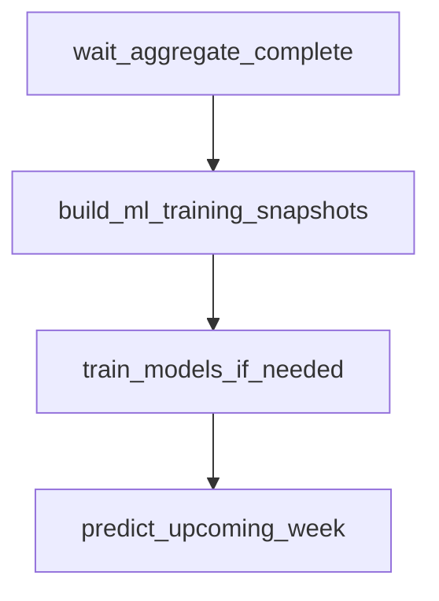
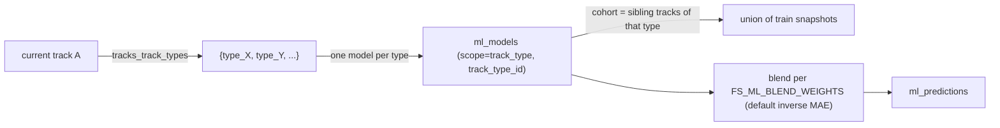

# `nascar.cup.machine_learning.models`

Hourly Cup ML pipeline. Builds the per-week ML training + prediction
snapshots, retrains one XGBoost regressor per `(series_id, track_type_id,
target)` from the **union of training snapshots at every track sharing
that `track_type_id`**, then predicts DraftKings fantasy points for the
next unfinished race by blending those per-cohort models.

- **DAG ID:** `nascar.cup.machine_learning.models` (no `backfill.*` twin)
- **Source:** [dags/nascar/cup/machine_learning_models.py](../../dags/nascar/cup/machine_learning_models.py)
- **Tests:** [tests/unit/test_machine_learning_models_dag.py](../../tests/unit/test_machine_learning_models_dag.py),
  [tests/unit/test_train_predict_pipeline.py](../../tests/unit/test_train_predict_pipeline.py),
  [tests/unit/test_xgb_tuning.py](../../tests/unit/test_xgb_tuning.py),
  [tests/unit/test_snapshot_build_predict_kind.py](../../tests/unit/test_snapshot_build_predict_kind.py)

## Purpose

Each run materializes the latest training and prediction snapshots and,
when warranted, refits the per-target models that score the next race for
the DraftKings slate. Concretely:

- **Train snapshots (`kind='train'`):** materialized for every Cup week in
  `v_series_before_current_week` with finished race rows in
  `agg_week_results` (strictly historical; current week is excluded even
  post-race). Include features + labels.
- **Predict snapshots (`kind='predict'`):** materialized for the Cup
  current week when the grid is known (`r_start_position IS NOT NULL` in
  `agg_week_results`) and the eligibility gate
  `week_eligible_for_predict_snapshot` returns True — i.e. either the
  race has not finished (`r_finish_position IS NULL`, the normal pre-race
  hourly rebuild) **or** the race has finished and no live
  `ml_predictions` row yet references a `kind='predict'` snapshot for
  that week (the post-race self-healing branch — see
  [Self-healing post-race recovery](#self-healing-post-race-recovery)).
  The builder itself is finish-agnostic: it only requires `r_start_position
  IS NOT NULL`. The eligibility gate is the single source of truth for
  "should we build?", so the recovery branch above actually materializes
  a fresh snapshot from the same anchor rows the train branch uses.
  Features only; no labels.
- **Retraining:** per `(series_id, track_type_id, target)`, refit an
  XGBoost regressor using Boruta-selected features and a
  `RandomizedSearchCV` over chronological folds, but **only when** the
  cohort's covered training week is older than the latest finished week
  for the series. Models are partitioned by NASCAR series first (Cup /
  Xfinity / Truck) so Cup snapshots never train weights used to predict
  Xfinity races. Within a series there is exactly **one model scope**:
  - `track_type` — one model per `(series_id, track_type_id)`, trained on
    the union of train snapshots at every sibling `track_id` in
    `tracks_track_types` mapped to that type. Features are restricted to
    the per-track family (`*_pt_*`) plus anchor columns (`r_start_position`,
    `q_*`, `pt_*`, `pf_*`). All `*_tt_*` columns are deliberately excluded
    (v1).
- **Predicting:** for each target, look up every cohort model for the
  current track's `track_type_id` set (via `tracks_track_types`), score
  the prediction snapshot with each, then blend the per-cohort
  predictions using `FS_ML_BLEND_WEIGHTS`:
  - `inverse_mae` (default) — weight by `1 / holdout_mae`; falls back to
    equal weights if any cohort is missing a recorded MAE.
  - `sample_count` — weight by `cohort_n_weeks` recorded on the model row.
  - `equal` — uniform 1/N.
  - `spearman` (Phase E5) — weight by `max(0, dfs_points_spearman)` read
    from the cohort's latest `ml_model_evaluations` row; favors models
    whose rank correlation against observed DFS points is highest. Falls
    back to equal when any contributor lacks a recorded Spearman or
    when every contributor has Spearman ≤ 0.

  After the blend, the primary head (`r_finish_position`) is rank-
  reconciled (Phase D1): a stable argsort across the entire predict
  pool replaces the blended float with an integer rank `1..field_size`
  while preserving the float under
  `predicted_targets_json["r_finish_position_raw"]` for audits.

  The two-stage DNF design (Phase D3) layers a separate
  `r_is_dnf` classifier blend in front of the regression heads. When a
  cohort carries a `dnf_classifier` model, predict composes:
  `E[finish] = P_dnf * field_size + (1 - P_dnf) * E[finish | clean]`
  and `E[secondary] = (1 - P_dnf) * E[secondary | clean]`. Cohorts
  without a DNF head pass through unchanged for full backward
  compatibility.

  See [include/nascar/ml/predict_task.py](../../include/nascar/ml/predict_task.py)
  and [include/nascar/ml/model_scope.py](../../include/nascar/ml/model_scope.py).

## Schedule and basic settings

| Setting | Value |
| --- | --- |
| Cron / `schedule` | `CUP_SCRAPER_PROD_HOURLY_CRON` (`0 * * * *`) |
| `start_date` | `datetime(2025, 7, 11)` |
| `end_date` | `None` |
| `catchup` | `False` |
| `max_active_runs` | `1` |

Total tasks: **4** (1 sensor + 3 Python tasks). Walk-forward backtest is
[`nascar.cup.machine_learning.models.backtest`](./cup.machine_learning.models.backtest.md).

## Upstream and downstream wiring

- **Upstream:** `wait_aggregate_complete` blocks on
  `nascar.cup.aggregate.aggregate_done` for the same logical date
  (`mode=reschedule`, `poke_interval=30s`,
  `timeout=CUP_IMPORTER_WAIT_RACE_WEEK_TIMEOUT` = 6h, `check_existence=True`).
- **Downstream:**
  [`nascar.cup.machine_learning.models.monte_carlo`](./cup.machine_learning.models.monte_carlo.md)
  sensors `predict_upcoming_week`, simulates ≥ 1,000 race outcomes per driver
  from calibrated prediction uncertainty, and persists
  `ml_race_simulation_*` summaries that
  [`nascar.cup.dfs.lineup_generator`](./cup.dfs.lineup_generator.md) consumes
  in place of raw `ml_predictions` point estimates.
  [`nascar.cup.machine_learning.models.backtest`](./cup.machine_learning.models.backtest.md)
  also sensors `predict_upcoming_week` to schedule walk-forward evaluation.

## Task graph



## Cohort + blend overview



## Tasks

### `wait_aggregate_complete`

- **Operator:** `ExternalTaskSensor` (`mode=reschedule`).
- **Target:** `nascar.cup.aggregate.aggregate_done` for the same logical
  date. This is the `EmptyOperator` sentinel the aggregate DAG ends on, so
  this sensor flips green once every wave-2 aggregate load is done.
- **Behavior:** poke interval 30s, timeout 6h.
- **Inputs:** Airflow metadata DB.
- **Outputs:** none.
- **Upstream:** (root). **Downstream:** `build_ml_training_snapshots`.

### `build_ml_training_snapshots`

- **Operator:** `PythonOperator`.
- **Callable:** `build_ml_training_snapshots_task` in
  [include/nascar/ml/training_snapshot_task.py](../../include/nascar/ml/training_snapshot_task.py).
- **Behavior:** calls both
  `include.nascar.ml.snapshot_build.build_all_week_training_snapshots` and
  `build_all_week_prediction_snapshots` (lazy-imported through
  [include/nascar/ml/__init__.py](../../include/nascar/ml/__init__.py)) with
  `pipeline_version` derived from `FS_PIPELINE_VERSION` or `GIT_COMMIT`. The
  train branch enumerates every Cup week in
  `v_series_before_current_week` with completed `agg_week_results` rows
  (`r_start_position IS NOT NULL AND r_finish_position IS NOT NULL` —
  both endpoints are required so the B4 `r_place_diff` invariant in
  `compute_dfs_points_from_targets` holds for every labeled anchor) and
  writes one snapshot per week +
  scoring-rules version into `ml_training_snapshots` with `kind='train'`,
  one row per car-driver into `ml_training_rows`, and one label row per
  car-driver into `ml_labels`.
  **Skip-when-up-to-date:** before looping the per-week builder, the train
  branch queries `ml_training_snapshots` for every active row whose
  `source_pipeline_version` matches the version it is about to stamp
  (using MariaDB's NULL-safe `<=>` so dev environments without a
  pipeline version still match). Those weeks are dropped from the build
  set, so an hourly run after an "aggregate added zero rows" cycle is a
  near-noop: one cheap SELECT, no `DELETE`s, no feature recomputation,
  no FK cascades into `ml_training_rows` / `ml_labels` /
  `ml_model_training_snapshots` / `ml_predictions`. Operators force a
  refresh in one of two ways:
  - bump `FS_PIPELINE_VERSION` (explicit semver / build id) **or** let
    `GIT_COMMIT` change naturally — the `.githooks/` scripts wired in
    `script/setup` rewrite `.git-commit.env` on every `git pull` / `git
    commit` / `git checkout` / `git rebase`, and Docker Compose forwards
    that file into every Airflow service via the `env_file:` block on the
    `&airflow-common` anchor. A `docker compose restart` after the git
    op picks up the new SHA and every finished-week snapshot rebuilds on
    the next scheduled run.
  - set `FS_ML_REBUILD_WEEK_IDS=<comma-list>` for a per-week override —
    those weeks are rebuilt even when their `source_pipeline_version`
    matches, but the strict historical policy still applies (current-week
    IDs are ignored until rollover moves them into
    `v_series_before_current_week`).
  The predict branch builds at most one
  `kind='predict'` snapshot for the Cup **current week** from
  `v_series_current_week` when that week has a known grid and is still
  eligible per `week_eligible_for_predict_snapshot`: pre-race
  (`r_finish_position IS NULL`) **or** the post-race self-healing branch
  when no live `ml_predictions` row exists for the week yet (see
  [Self-healing post-race recovery](#self-healing-post-race-recovery)).
  The builder anchor itself is finish-agnostic — it only requires
  `r_start_position IS NOT NULL` — so the recovery branch now actually
  materializes a fresh snapshot from scratch when no surviving pre-race
  snapshot exists (previously this branch could only re-score a
  surviving pre-race snapshot, and was silently a no-op when none was
  on disk, trapping the chain at `no_predict_snapshot`). Eligibility is
  the single source of truth for "should we build?"; the builder
  doesn't redundantly re-gate on `r_finish_position`.
  The predict path intentionally does **not** apply the train-branch
  skip-gate: pre-race the feature inputs change every hour as new
  qualifying / anchor data lands, so a rebuild is real work; post-race
  the `week_eligible_for_predict_snapshot` self-healing gate already
  short-circuits once predictions exist.
  Writes `ml_training_rows` only (no `ml_labels`).
  The `(series_id, week_id, grain, kind, dfs_scoring_rules_id)` unique
  key keeps train and predict snapshots separate.
- **Inputs:** `agg_week_results` plus the prior-track aggregate tables in
  [snapshot_config.py](../../include/nascar/ml/snapshot_config.py)
  (`PREV_TRACK_SOURCES`). The cohort design intentionally excludes
  `PREV_TRACK_TYPES_SOURCES` (`*_tt_*` columns) from the feature
  allowlist. Active `nascar.dfs_scoring_rules` row for DraftKings
  (`dfs_id=1`). Reference data is seeded on DB init via
  [`9001-insert_dfs_seed.sql`](../../../fantasy-sports-db/nascar/seed/9001-insert_dfs_seed.sql)
  and
  [`9002-insert_dfs_scoring_rules_seed.sql`](../../../fantasy-sports-db/nascar/seed/9002-insert_dfs_scoring_rules_seed.sql).
  On an existing database, apply those files manually before the first ML run.
- **Outputs:** rows in `ml_training_snapshots`, `ml_training_rows`, and
  `ml_labels`; returns `{"train": [snapshot_id,...], "predict": [...]}`
  for observability. `train` only lists snapshots actually built on this
  run — weeks whose existing train snapshot already matches the current
  `pipeline_version` are skipped by the gate and excluded from the
  returned list. The task log records
  `finished=N already_built=K forced=F to_build=B skipped=S
  pipeline_version=V` so steady-state runs are visibly cheap.
- **Upstream:** `wait_aggregate_complete`. **Downstream:**
  `train_models_if_needed`.
- **Failure notes:** when a week is in the build set,
  `_delete_existing_snapshot` physically deletes any prior row for
  `(series_id, week_id, grain, kind, dfs_scoring_rules_id)` before
  re-inserting (CASCADE removes child rows/labels). Soft-delete cannot be
  used here because the unique key ignores `deleted_at`. Rebuilds are
  idempotent once this delete runs. Weeks excluded by the skip-gate
  never reach `_delete_existing_snapshot`, so existing
  `ml_training_rows` / `ml_labels` / `ml_predictions` for those weeks
  are preserved untouched. If no active `dfs_scoring_rules` row exists
  for DraftKings, the task logs a warning and returns empty train/predict
  id lists (same as `train_models_if_needed` `no_active_rules` skip)
  instead of raising.

### `train_models_if_needed`

- **Operator:** `PythonOperator`.
- **Callable:** `train_models_if_needed_task` in
  [include/nascar/ml/train_task.py](../../include/nascar/ml/train_task.py).
- **Behavior:**
  1. Looks up the latest active `nascar.dfs_scoring_rules` row for
     DraftKings (`DRAFTKINGS_DFS_ID = 1`). Skips with `no_active_rules` if
     missing.
  2. Requires a row in `v_series_current_week` for Cup; skips with
     `no_current_week` if missing.
  3. Reads the latest train `week_id` capped to weeks in
     `v_series_before_current_week` or the current week (finished live
     week train snapshots). Skips with `no_training_snapshots` if empty.
  4. Resolves `track_type_ids = track_type_ids_for_track(hook, ctx.track_id)`
     for the current week's track. Skips with `no_track_type_ids` if the
     bridge has no rows for that track.
  5. For each `track_type_id`:
     - Loads the cohort distinct-week count
       (`cohort_distinct_weeks(hook, series_id, rules_id, track_type_id)`).
       Skips this cohort with `insufficient_cohort_weeks` when the count
       is below `FS_ML_MIN_COHORT_WEEKS` (default `2`).
     - Loads the **union of train snapshots at every sibling track** via
       `load_training_frame(dfs_scoring_rules_id=..., series_id=...,
       track_type_id=type_id)`.
     - Builds the feature allowlist with
       `features_for_scope(feature_keys, scope=SCOPE_TRACK_TYPE)` — strict
       `*_pt_*` + anchor columns, no `*_tt_*`.
     - **Adaptive tuning for small cohorts** (`distinct_weeks <
       FS_ML_TUNE_CV_SPLITS * 2`): `RandomizedSearchCV` runs with
       `n_iter = max(10, distinct_weeks)`, Boruta is skipped, and the
       snapshot's full feature key list is used (recorded as
       `boruta_skipped=true, reason='small_cohort'` in `boruta_metadata`).
     - Calls `train_models_for_targets` for `DEFAULT_TARGETS`.
     - Soft-deletes the prior active row for
       `(scope=SCOPE_TRACK_TYPE, series_id, track_type_id, target)` then
       inserts the new model row with `track_id IS NULL`,
       `track_type_id=type_id`, and `cohort_n_weeks=distinct_weeks`.
  6. **Predict-ready check:** every `track_type_id` for the current track
     either has an active cohort model covering `latest_train_week`
     **or** is below `FS_ML_MIN_COHORT_WEEKS` (skipped). When all cohorts
     are fresh, the task returns `skipped='predict_ready'` without retraining.
  7. **Evaluation rows** — for each trained model two
     `ml_model_evaluations` writes:

     | `eval_type` | `eval_key` | Slice |
     |---|---|---|
     | `cohort` | `track_type_id` | chronological holdout on the cohort frame (current `holdout_mae` shape) |
     | `track` | `track_id` of current week's track | chronological holdout restricted to rows where `s.track_id = ctx.track_id`; `track_eval_skipped=true` when fewer than 3 weeks at that track are present inside the cohort |

     `sample_count` on the `cohort` row is the cohort's `distinct_weeks`
     count — that's what the `sample_count` blend strategy reads at
     predict time.
  8. Persists artifacts to `<FS_ML_ARTIFACT_ROOT>/<model_id>/<target>.json`
     and writes:
     - `ml_feature_sets` — `target_keys=[target]`, `selected_features`,
       `boruta_metadata` (includes a `scope` block with `series_id` /
       `model_scope` / `track_type_id`).
     - `ml_models` — one row per `(series_id, track_type_id, target)`
       with `model_scope='track_type'`, `track_id IS NULL`,
       `track_type_id` populated per the `chk_ml_models_scope_keys`
       check constraint, and the optional `cohort_n_weeks` lineage column.
     - `ml_model_training_snapshots` — every snapshot id in the cohort.
- **Inputs:** `ml_training_snapshots`, `ml_training_rows`, `ml_labels`,
  `tracks_track_types`, `ml_models` / `ml_model_training_snapshots`,
  `dfs_scoring_rules`.
- **Outputs:** rows in `ml_feature_sets`, `ml_models`,
  `ml_model_training_snapshots`, `ml_model_evaluations`; serialized
  XGBoost artifacts on disk; returns a dict with per-cohort results,
  the resolved current-week context, `latest_train_week`, and (when
  skipped) the skip reason (`predict_ready`,
  `insufficient_cohort_weeks_all_cohorts`, `no_track_type_ids`, etc.).
- **Upstream:** `build_ml_training_snapshots`. **Downstream:**
  `predict_upcoming_week`.
- **Failure notes:** RandomizedSearchCV defaults can be capped via
  `FS_ML_TUNE_N_ITER` and `FS_ML_TUNE_CV_SPLITS`, and tuning can be
  short-circuited entirely with `FS_ML_TUNE_DISABLE=1` (the run still
  records `tuning_skipped=True` in `ml_feature_sets.boruta_metadata`).
  Models for cohorts whose types are not part of the current week's
  track are not refreshed each run; they age until that type appears
  again as a current-track type. Goal is predict success on the current
  week, not keeping every cohort's model fresh.

### `predict_upcoming_week`

- **Operator:** `PythonOperator`.
- **Callable:** `predict_upcoming_week_task` in
  [include/nascar/ml/predict_task.py](../../include/nascar/ml/predict_task.py).
- **Behavior:**
  1. Resolves the active DraftKings scoring rules.
  2. Loads the `kind='predict'` snapshot for the active rules on the Cup
     **current week** (`v_series_current_week`, not `MAX(week_id)`). The
     snapshot dict carries `series_id`, `track_id`, and the
     `tracks_track_types`-derived `track_type_ids`.
     If no predict snapshot exists, returns `no_predict_snapshot`.
  3. For each target in `DEFAULT_TARGETS`, `_predict_values_for_target`
     applies the cohort-blend below. The snapshot's `series_id` is the
     outermost filter on every `_scope_lookup` so a Cup model never
     resolves for an Xfinity / Truck predict snapshot at the same
     physical track:

     ```mermaid
     flowchart TB
       Snap["predict snapshot (series_id, track_id)"]
       Types["track_type_ids_for_track(track_id)"]
       Each["for each track_type_id"]
       HasModel{"active track_type model exists and has artifact_uri?"}
       LoadPred["load artifact + predict"]
       MAE["look up cohort holdout_mae"]
       Blend["blend per FS_ML_BLEND_WEIGHTS"]
       Skip["no_blend_models"]
       Snap --> Types
       Types -->|empty| Skip
       Types --> Each
       Each --> HasModel
       HasModel -- no --> Each
       HasModel -- yes --> LoadPred
       LoadPred --> MAE
       MAE --> Blend
       Blend -->|no contributors| Skip
     ```

     A model entry is considered usable only if it has a non-null
     `artifact_uri`. When `FS_ML_BLEND_WEIGHTS=inverse_mae` and any
     cohort is missing a recorded MAE, weights fall back to equal across
     all contributors (and the choice is logged). There is no
     cross-series fallback by design.
  4. Loads the on-disk artifacts and scores the prediction snapshot's
     `ml_training_rows` with each cohort model.
  5. Combines the per-target blended predictions into a
     `predicted_targets_json` blob, applies
     `compute_dfs_points_from_targets(scoring_rules, ...)` to derive
     `predicted_dfs_points`, and upserts one `ml_predictions` row per
     `car_driver_id`. The `predicted_targets_json.meta` block captures
     `track_type_ids`, contributing `model_ids`, `weights`,
     `blend_strategy` (configured) and `blend_strategy_used`
     (effective), per-cohort `maes`, and `cohort_n_weeks` so every
     prediction is auditable.
- **Inputs:** `ml_training_snapshots` (`kind='predict'`, contributes
  `series_id` and `track_id`), `ml_training_rows`, `ml_models`
  (filtered by `series_id` and `model_scope='track_type'`),
  `ml_feature_sets`, `tracks_track_types`,
  `ml_model_evaluations` (for cohort MAEs), on-disk XGBoost artifacts,
  `dfs_scoring_rules`.
- **Outputs:** rows in `ml_predictions`; returns a dict with
  `primary_model_id`, `model_ids`, `resolved_blends` (per-target blend
  metadata including `series_id`, `track_type_ids`, contributing
  `model_ids`, `weights`, and `blend_strategy_used`), the snapshot id,
  and the number of rows scored.
- **Failure notes:** missing **primary** target model
  (`r_finish_position`) short-circuits the task with
  `no_blend_models`. Secondary targets (`r_laps_led`, `r_fastest_laps`)
  use zero defaults when no cohort model resolves. Per-target blend
  decisions are logged so it is easy to see which models contributed
  and which strategy was used. Post-race, if `ml_predictions` already
  exist for the resolved predict snapshot, the task short-circuits with
  `{"skipped": True, "reason": "predictions_already_present_post_race"}`
  before reading any cohort artifacts — the inputs are frozen, so
  re-scoring would just churn the same numbers.
- **Upstream:** `train_models_if_needed`. **Downstream:** none (lineup DAG and
  [cup.machine_learning.models.backtest](./cup.machine_learning.models.backtest.md) sensor this task).

## Data sources and sinks

- **Reads:** `agg_week_results`, every `agg_week_prev_track_*` table
  referenced by
  [snapshot_config.py](../../include/nascar/ml/snapshot_config.py)
  (the `*_tt_*` columns from `PREV_TRACK_TYPES_SOURCES` are intentionally
  excluded from the feature allowlist), `nascar.dfs_scoring_rules`, and
  the ML registry tables (`ml_training_snapshots`, `ml_training_rows`,
  `ml_labels`, `ml_feature_sets`, `ml_models`,
  `ml_model_training_snapshots`).
- **Writes (DB):**
  - `ml_training_snapshots` — header row per snapshot (`kind` ∈
    `{train, predict}`).
  - `ml_training_rows` — one row per car-driver / snapshot.
  - `ml_labels` — one row per car-driver / training snapshot
    (train-kind only).
  - `ml_feature_sets` — one row per trained model (`target_keys`,
    `selected_features`, Boruta + tuning metadata).
  - `ml_models` — one row per `(series_id, track_type_id, target)` pair
    (`model_scope='track_type'`, `track_id IS NULL`,
    `cohort_n_weeks` populated).
  - `ml_model_training_snapshots` — link table covering every snapshot
    in the cohort.
  - `ml_model_evaluations` — two rows per trained model:
    `eval_type='cohort'` (keyed by `track_type_id`) and
    `eval_type='track'` (keyed by current-week `track_id`).
  - `ml_predictions` — per car-driver per snapshot prediction with
    `predicted_targets_json` (D1 `r_finish_position` integer rank plus
    `r_finish_position_raw` float), `predicted_dfs_points`, and (E3)
    `blend_metadata_json` carrying the full per-target blend lineage
    (cohort `track_type_ids`, `model_ids`, `model_kinds`, `weights`,
    requested vs effective `blend_strategy_*`, per-cohort `maes` /
    `spearmans` / `cohort_n_weeks`, E1 weight-averaged
    `conformal_intervals`, E4 `drift_warnings`, `fallback_targets`,
    `two_stage_targets`, `dnf_classifier_present`).
  - `ml_models` — every row also carries (D4) `model_kind` ∈
    `{regression, regression_clean, dnf_classifier, quantile}`, (B5)
    `train_target_mean`, and (E1) `holdout_residual_quantiles` (JSON
    `{q05, q10, q50, q90, q95}` of holdout residuals).
- **Writes (filesystem):** XGBoost JSON artifacts under
  `<FS_ML_ARTIFACT_ROOT>/<model_id>/<target>.json`.

## Configuration

- **Airflow connection:** `nascar_conn` (MySQL).
- **Env vars:**
  - `FS_PIPELINE_VERSION` / `GIT_COMMIT` — stamped onto each snapshot's
    `pipeline_version` field for lineage.
  - `FS_ML_ARTIFACT_ROOT` — root for the on-disk XGBoost JSON artifacts.
    Defaults to `/opt/airflow/artifacts/ml`.
  - `FS_ML_HOLDOUT_WEEKS` — int, defaults to `1`. Controls how many of the
    most recent training weeks become the chronological holdout.
  - `FS_ML_TUNE_N_ITER` — int, defaults to the value in `tune_xgb`
    (currently RandomizedSearchCV's `n_iter`).
  - `FS_ML_TUNE_CV_SPLITS` — int, defaults to the value in `tune_xgb` for
    the `TimeSeriesSplit` `n_splits`. Also drives the small-cohort
    threshold for adaptive tuning (`distinct_weeks < CV_SPLITS * 2`).
  - `FS_ML_TUNE_DISABLE` — `1` / `true` / `yes` short-circuits tuning to
    `DEFAULT_PARAMS` and records `tuning_skipped=true` in
    `ml_feature_sets.boruta_metadata`.
  - `FS_ML_MIN_COHORT_WEEKS` — int, defaults to `2`. Minimum distinct
    finished weeks across a `(series_id, track_type_id)` cohort before
    that cohort is trained. Lower values speed up cold-start coverage at
    the cost of less stable models.
  - `FS_ML_BLEND_WEIGHTS` — one of `inverse_mae` (default),
    `sample_count`, `equal`, or `spearman`. Selects how
    `predict_upcoming_week` blends per-cohort predictions for the
    current track's `track_type_id` set. `inverse_mae` falls back to
    `equal` when any contributor lacks a recorded holdout MAE.
    `spearman` (Phase E5) reads `dfs_points_spearman` from the cohort's
    latest `ml_model_evaluations` row and weights by `max(0, spearman)`;
    falls back to equal when any contributor lacks a recorded Spearman
    or when every contributor has Spearman ≤ 0.
  - `FS_ML_DEV_WEEKS` — int, defaults to `1`. Phase A2 dev-slice size
    used by `RandomizedSearchCV` scoring and Phase A4 early-stopping
    watch. Cohorts with `< 4` distinct weeks fall back to the legacy
    two-way `(train, holdout)` split (no dev slice).
  - `FS_ML_STRICT_FEATURES` — `1` / `true` / `yes` causes
    `build_feature_matrix` to raise (Phase B2) instead of zero-filling
    when non-finite values survive median imputation. Training tasks
    opt in; predict tasks always run non-strict.
  - `FS_ML_PRIMARY_RANK_OBJECTIVE` — `1` / `true` / `yes` switches the
    primary head's XGBoost objective to `rank:pairwise` (Phase D2),
    grouping by `week_id` as `qid`. Default off — flip on only after a
    champion/challenger cycle validates the score-space change
    downstream. Mutually exclusive with the two-stage DNF compose: if
    DNF labels are present in the cohort frame, the trainer logs a
    warning and falls back to `reg:absoluteerror`.
  - `FS_ML_INTERVAL_METHOD` — one of `conformal` (default),
    `global_mae`, `quantile`. Phase E1/E2 knob consumed by Monte Carlo
    and predict-time interval reporting. `conformal` reads the
    per-cohort `ml_models.holdout_residual_quantiles` (q10 / q90 →
    half-width σ); `global_mae` is the legacy MAE-derived σ rollback;
    `quantile` is reserved for the v3 quantile-regression heads and
    silently falls back to conformal until those land.
  - **Memory tuning knobs** (12 GB / 4-core worker profile; see
    [Memory tuning](#memory-tuning) below):
    - `AIRFLOW__CELERY__WORKER_MAX_TASKS_PER_CHILD` — recycle the
      Celery prefork worker child after every task so the heap does
      not accumulate across `build_ml_training_snapshots` →
      `train_models_if_needed`. Default `1` in compose.
    - `FS_ML_TRAIN_COHORT_ISOLATION` — when truthy (default `1`),
      `train_models_if_needed_task` forks each cohort's
      `load_training_frame + _train_cohort` into a child process so
      the heavy working set is returned to the OS at child exit. Set
      to `0` to use the legacy in-process path for tests / local
      debugging. Implemented via `billiard.get_context("fork")`
      rather than stdlib `multiprocessing` because the Airflow Celery
      worker runs each task as a daemonic process and stdlib refuses
      to let daemons start children (`daemonic processes are not
      allowed to have children`). Billiard is Celery's existing
      multiprocessing fork and is already installed in the worker
      image. Fork (not spawn) is the chosen context: spawn would
      force a cold re-import of `train_task` in the child, which
      transitively runs `airflow.__init__` →
      `settings.initialize()` → `configure_orm()`. The Celery worker
      container talks to the API server via HTTP and does not carry
      `SQL_ALCHEMY_CONN`, so the spawn child crashes on
      `sqlalchemy.exc.ArgumentError: Could not parse SQLAlchemy URL`
      before reaching the cohort body. Fork inherits the parent's
      `sys.modules` via copy-on-write, so no re-init occurs; the
      per-cohort working set still lives in the child's own memory
      and is returned to the OS on `exit(0)`.
    - `FS_ML_MAX_TRAIN_WEEKS` — cap each cohort's training horizon at
      the N most-recent distinct weeks via SQL window subselect in
      `load_training_frame`. Unset / blank = no cap (legacy
      behavior); flip on without a redeploy when a future cohort
      grows unexpectedly large.
    - `OMP_NUM_THREADS` / `MKL_NUM_THREADS` / `OPENBLAS_NUM_THREADS` —
      thread caps for XGBoost `tree_method='hist'` per-thread histogram
      buffers and numpy BLAS. Default `2` in compose.
    - `FS_ML_XGB_N_JOBS` — XGBoost `n_jobs` for the Boruta inner
      estimator, the `RandomizedSearchCV` base estimator, and the
      final early-stopping fit. Default `2` in compose, `-1` (legacy)
      when unset.
    - `FS_ML_XGB_DEVICE` — XGBoost execution device for every
      cohort-training estimator we build (Boruta inner regressor,
      `RandomizedSearchCV` base estimator, the ranker, the final
      early-stopping fit). Default `cpu`; set to `cuda` (or `cuda:N`
      for a specific GPU index) to route training through the GPU
      histogram method. Requires the host-side prerequisites + compose
      GPU reservation described in [GPU acceleration](#gpu-acceleration).
      Predict and Monte Carlo are CPU-only and ignore this knob.
    - `FS_ML_BORUTA_MAX_ITER` — Boruta iteration cap for "regular"
      cohorts (≥ `2 * FS_ML_TUNE_CV_SPLITS` distinct weeks). Default
      `30` in compose, `50` (legacy hard-coded) when unset.
    - `FS_ML_BORUTA_SMALL_COHORT_MAX_ITER` — Boruta iteration cap for
      cohorts below the small-cohort threshold. Default `10`.
  - `FS_AGG_REBUILD_WEEK_IDS` — comma-separated `week_id` values merged
    into the aggregate DAG week load list (see `nascar.cup.aggregate`).
  - `FS_ML_REBUILD_WEEK_IDS` — comma-separated `week_id` values merged
    into the ML snapshot builder's finished-week list for one-off rebuilds.
  - Walk-forward backtest env vars (`FS_ML_BACKTEST_MAX_WEEKS`, etc.) — see
    [cup.machine_learning.models.backtest.md](./cup.machine_learning.models.backtest.md).

  **Retired (no-op):** `FS_ML_MIN_TRACK_WEEKS`,
  `FS_ML_MIN_TYPE_WEEKS`, `FS_ML_ENABLE_GLOBAL_FALLBACK`. The cohort
  design has no per-track scope, no per-track-type single-model
  fallback, and no global fallback; these names are safe to leave
  set in old environments but the DAG no longer reads them.
  (`FS_ML_MAX_TRAIN_WEEKS` was retired in an earlier cohort migration
  and re-introduced by the memory-tuning work above; it is now a
  live env knob again, scoped to the cohort SQL load.)
- **Python deps:** `scikit-learn`, `xgboost`, `boruta` (see
  [pyproject.toml](../../pyproject.toml)).

## Backfill variant

None. The ML registry is intentionally append-only on top of whatever
`ml_training_snapshots` exists — a backfill is performed simply by letting
this DAG run once after the aggregate DAG fills in historical
`agg_week_results` rows.

## Operational notes

- **Idempotency:** the snapshot builder reuses the unique key
  `(series_id, week_id, grain, kind, dfs_scoring_rules_id)` so re-runs
  refresh, rather than duplicate, snapshots. The trainer's per-cohort
  "skip if covered" guard means the task is safe to schedule hourly.
- **Disk usage:** each retrain emits 3 JSON artifacts (one per target)
  per cohort. Plan for `~$num_retrains × num_track_types_for_current ×
  3 × few-KB` under `FS_ML_ARTIFACT_ROOT`.
- **Tuning cost:** RandomizedSearchCV is the dominant CPU cost. Use
  `FS_ML_TUNE_N_ITER`, `FS_ML_TUNE_CV_SPLITS`, or `FS_ML_TUNE_DISABLE` for
  cheaper runs during incident response or local debugging.
- **Worker memory:** cohort loads scale with the number of sibling tracks
  and their distinct weeks. They are still substantially smaller than the
  old global-scope load, but two failure modes still arise on the
  12 GB / 4-core profile: per-cohort peak (Boruta's 2× shadow-feature
  matrix + XGBoost `tree_method='hist'` per-thread histogram buffers)
  and cross-task heap accumulation between
  `build_ml_training_snapshots` and `train_models_if_needed`. Both
  are guarded by default — see [Memory tuning](#memory-tuning) for the
  env-knob pressure-release ordering and the "What if it still OOMs?"
  walkthrough when a cohort still hits OOM on the 12 GB worker profile.
- **Backwards compatibility:** if `ml_models.artifact_uri` is `NULL`
  (legacy rows or failed disk writes) `predict_upcoming_week` skips that
  cohort. Legacy `model_scope IN ('track','global')` rows are ignored by
  the new resolver and will be soft-deleted in a follow-up migration
  after one good prod cycle.

### Self-healing post-race recovery

The snapshot builder + `predict_upcoming_week` recover automatically
when the current week has `race_results` but never received an
`ml_predictions` row (DAG paused, worker down, prior cycle crashed,
fresh deploy). No operator action is required — the next hourly
scheduled tick after results land notices the gap and runs the missing
work. The gates are split between the snapshot builder and the predict
task so the chain self-heals **and** stops re-running once the gap is
filled:

| Stage | Pre-race | Post-race, predictions missing | Post-race, predictions present |
| --- | --- | --- | --- |
| `build_ml_training_snapshots` (predict branch via `week_eligible_for_predict_snapshot`) | builds snapshot | builds snapshot from scratch (recovery) | no-op |
| `predict_upcoming_week` | scores snapshot | scores snapshot (recovery) | skips with `predictions_already_present_post_race` |

The "post-race, predictions missing" recovery branch materializes a
**fresh** snapshot from the same anchor rows the train branch uses —
the builder's anchor filter (`r_start_position IS NOT NULL`) is
finish-agnostic, so it doesn't matter whether the race is open or
finished. This restores the chain when no surviving pre-race snapshot
exists on disk (the case that was previously silently stuck at
`no_predict_snapshot` because the builder re-gated on
`r_finish_position IS NULL` and returned zero anchor rows post-race).

The post-race / has-predictions branch returns False from
[`week_eligible_for_predict_snapshot`](../../include/nascar/cup/current_week.py)
so the predict snapshot is never rebuilt. Even if a stale snapshot is
already on disk, `predict_upcoming_week` re-checks symmetrically:
`agg_week_results` shows a populated `r_finish_position` for the week
AND `ml_predictions` already exist for the snapshot → return
`{"skipped": True, "reason": "predictions_already_present_post_race"}`.
The Monte Carlo and lineup DAGs apply the same guard with
`mc_already_present_post_race` / `lineups_already_present_post_race`
reasons (see those DAGs' docs).

Manually clearing the task in the Airflow UI bypasses the guard — a
deliberate clear means "redo this work", which matches the operator's
intent. Pre-race behavior is unchanged in every task: hourly snapshot
refresh + re-prediction continues to score the latest features for the
current week.

## Feature families

The snapshot builder writes features into `ml_training_rows.features_json`
and stamps the active key list onto `ml_training_snapshots.feature_keys`.
The allowlist in
[`features_for_scope`](../../include/nascar/ml/model_scope.py) keeps the
trainer focused on signal-bearing columns:

| Family | Source | Phase | Notes |
| --- | --- | --- | --- |
| Anchor (`r_start_position`, `q_*`, `pt_*`, `pf_*`) | `agg_week_results` | v1 | Always present. |
| `*_pt_*` (per-track aggregates) | `agg_week_prev_track_*` (excluding `*_tt_*`) | v1 | Strict per-track lag aggregates. |
| `*_tt_*` (per-track-type aggregates) | `agg_week_prev_track_types_*` | C3 | Per-cohort selective: the cohort's own `_tt_<cohort_type>_*` columns are stripped (constant by construction); other-type `_tt_*` columns are kept as cross-type signal. |
| `df_*` (driver recent form) | window queries over `agg_week_results` | C1 | Strict `week_id < current_week_id` bounds; rolling last-N + YTD + streaks. |
| `qf_*` (qualifying / field strength) | `agg_week_results` qualifying columns | C2 | Pole gap, grid percentile, opponent-`df_*` aggregates. |
| `season_*` (season / time-of-year) | `weeks` / `nascar.tracks` / `wx_*` (opportunistic) | C4 | `season_week_number`, `season_progress_pct`, `season_is_playoffs`. |

## Model-kind taxonomy (Phase D4)

`ml_models.model_kind` discriminates each registry row's role in the
two-stage / quantile design:

| `model_kind` | Trained on | Holdout metrics | Predict role |
| --- | --- | --- | --- |
| `regression` | full cohort frame | `mae` | Legacy single-head fit. Default for any pre-D3 row. |
| `regression_clean` | non-DNF subset of the cohort frame | `mae` (on clean rows only) | The "E[y | clean]" head of the two-stage DNF design. Paired with a sibling `dnf_classifier`. |
| `dnf_classifier` | full cohort frame, binary `r_is_dnf` label | `log_loss`, `auc` | Predicts `P(DNF)` per car-driver. Composes with `regression_clean` siblings at predict time. |
| `quantile` | reserved | reserved (`pinball_q05` / `q50` / `q95`) | Placeholder for the v3 quantile-regression heads called out in the plan's Phase E future work. |

## Blend metadata (Phase E3)

`ml_predictions.blend_metadata_json` is the per-prediction lineage blob
the predict task writes alongside every row. Top-level keys:

| Key | Source | Notes |
| --- | --- | --- |
| `primary_model_id` | `ml_models.id` of the primary blend's first contributor | Audits which cohort row anchored this prediction. |
| `track_type_ids` | `tracks_track_types` for the current track | The full type set the predict task considered. |
| `resolved_scopes` | per-target `(track_type_ids, model_ids, model_kinds, weights, maes, spearmans, cohort_n_weeks, blend_strategy_*)` | One sub-dict per target the blender ran. |
| `conformal_intervals` | E1 `holdout_residual_quantiles` weighted by the blend weights | Per-target `{q05, q10, q50, q90, q95}` consumed by Monte Carlo for per-driver σ. |
| `drift_warnings` | E4 train-vs-predict Z-score scan | List of `{feature, train_mean, predict_mean, train_std, z, cohort_track_type_id, ml_model_id}` for features whose predict mean drifted > 3σ. Observability only — predict still proceeds. |
| `fallback_targets` | `_FALLBACK_TARGET_DEFAULTS` route for targets without a usable cohort model | Empty on healthy snapshots; populated when a secondary fell back to `train_target_mean` or the floor default. |
| `two_stage_targets` | targets composed via D3's two-stage formula | Empty when the cohort has no `dnf_classifier`. |
| `dnf_classifier_present` | bool | True when at least one cohort produced a `P_dnf` head. |
| `blend_strategy_requested` / `blend_strategy_default` | `FS_ML_BLEND_WEIGHTS` and `DEFAULT_BLEND_STRATEGY` | Audits the requested strategy vs the effective one after any fallback. |

## Per-driver uncertainty + rank-coupled Monte Carlo

Phase E1 stores `holdout_residual_quantiles` per cohort on
`ml_models`. The predict task weights them across the contributing
cohorts (using the same blend weights as the predictions) and writes
the result into `blend_metadata_json.conformal_intervals`. The
downstream Monte Carlo task ([monte_carlo_task.py](../../include/nascar/ml/monte_carlo_task.py))
consumes that per-driver dict when `FS_ML_INTERVAL_METHOD=conformal`
(default) to derive σ ≈ (q90 - q10) / 2 per target. The legacy
`global_mae` σ remains the per-target rollback.

Phase E2 changes the simulator's loop ordering: each iteration draws
all drivers' raw finishes in parallel, argsorts them across the field,
and assigns integer ranks 1..field_size before scoring. Secondary
count targets (`r_total_laps_led`, `r_total_fastest_laps`) are still
drawn independently per driver because counts can co-vary freely. The
result is that every simulated race is a valid permutation — no two
drivers can land on the same finish slot in a draw.

## Memory tuning

`train_models_if_needed` is the most memory-hungry task in this DAG.
Two distinct failure modes have been observed in production and both
are guarded against by default:

1. **Per-cohort peak**: the dense feature matrix `X`
   (`build_feature_matrix` → `float32` `(rows × ~300 features)`),
   plus BorutaPy's `2×` shadow-feature copy, plus XGBoost
   `tree_method='hist'` per-thread histogram buffers. With
   `n_jobs=-1` on a 4-core worker that's `4×` the single-thread
   footprint, repeated `n_estimators` times per fit and
   `n_iter × cv_splits` times per `RandomizedSearchCV` sweep.
2. **Cross-task heap accumulation**: glibc / Python's allocator
   does not always return freed pages to the OS, so a heavy upstream
   task (e.g. `build_ml_training_snapshots` rebuilding hundreds of
   week snapshots) can leave the Celery worker child holding GBs of
   fragmented arenas. The next task on that same child then hits the
   cgroup ceiling before its first real allocation.

The compose default
(`[docker-compose.yaml](../../docker-compose.yaml)`) addresses both
modes: it caps each per-cohort contributor *and* recycles the
worker child between tasks so the heap can never accumulate across
task boundaries. Reach for the knobs in the order below when a new
cohort still hits OOM — each one strictly reduces peak, and you
generally don't need to leave compose to pull any of them:

| Order | Lever | Default | Effect |
| --- | --- | --- | --- |
| 1 | `AIRFLOW__CELERY__WORKER_MAX_TASKS_PER_CHILD` | `1` | Recycle the Celery prefork child between tasks. Pure cross-task fix — eliminates heap accumulation from `build_ml_training_snapshots` bleeding into `train_models_if_needed`. Cost is one fork() per task (~ms). |
| 2 | `FS_ML_TRAIN_COHORT_ISOLATION` | `1` | Spawn each cohort's `load_training_frame + _train_cohort` in a fresh subprocess. Belt-and-suspenders with lever 1: that one resets heap between tasks, this one resets it between cohorts inside the same task. Setting to `0` is only for tests / local debugging. |
| 3 | `FS_ML_MAX_TRAIN_WEEKS` | unset | Cap the cohort's training horizon at the N most-recent distinct weeks. Implemented as a SQL window subselect in `load_training_frame` so the row count (and every downstream array) drops proportionally. Flip on without a redeploy when a future cohort grows unexpectedly large. Sibling knob for the backtest DAG is `FS_ML_BACKTEST_LOAD_WEEKS` (default `64`); see [cup.machine_learning.models.backtest.md](cup.machine_learning.models.backtest.md#incident-note--27-may-2026) for the 27 May host-OOM postmortem and the per-container `airflow-worker` memory cap that backs it up. |
| 4 | `OMP_NUM_THREADS`, `MKL_NUM_THREADS`, `OPENBLAS_NUM_THREADS` | `2` | Pins OpenMP / BLAS thread count. Single biggest per-task dial — halves the histogram buffer peak when dropped from 4 → 2. |
| 5 | `FS_ML_XGB_N_JOBS` | `2` in compose, `-1` legacy | Belt-and-suspenders cap on XGBoost's own thread count. Drop to `1` as the next lever. |
| 6 | `FS_ML_TUNE_N_ITER`, `FS_ML_TUNE_CV_SPLITS` | `15`, `3` (was `25`, `4`) | Cuts the worst-case CV fit count per target from 100 to 45. |
| 7 | `FS_ML_BORUTA_MAX_ITER`, `FS_ML_BORUTA_SMALL_COHORT_MAX_ITER` | `30`, `10` | Caps the number of BorutaPy refits. Lower values reduce wall time and (transitively) the peak time the shadow matrix is resident. |
| 8 | `FS_ML_TUNE_DISABLE` | `0` | Skip `RandomizedSearchCV` entirely and use `DEFAULT_PARAMS` (still gets early stopping). Use during incident response. |
| 9 | Host swap | n/a | Last resort. XGBoost `tree_method='hist'` thrashes hard under swap — expect 10–30× slowdown — so add only as the safety net behind the levers above. On Linux add via `fallocate /swapfile`, `mkswap`, `swapon`; the worker container inherits host swap by default. |

Code-side mitigations that ship with the same release (no env tunable
because they're free wins):

- `build_feature_matrix` returns `float32` instead of `float64` — halves
  the matrix's per-cell footprint and transitively halves Boruta's
  shadow-matrix copy.
- `train_models_for_targets` calls `del` on the per-target intermediate
  arrays (`X_sel`, `X_train`, `X_dev`, `X_holdout`, …) and `gc.collect()`
  at the bottom of the loop, keeping resident memory close to a
  single-target peak instead of accumulating ~N_targets copies.
- `train_models_if_needed_task` and the spawned cohort children log
  RSS / VmPeak at every transition (`train_task_start`,
  `train_task_after_initial_scope_queries`,
  `train_task_before_cohort`, `train_task_after_cohort`,
  `train_task_end`, plus the corresponding
  `isolated_cohort_child_start` / `..._after_frame_load` /
  `..._after_train` / `..._child_exit` lines in the child). Grep the
  task log for `memory stage=` to see exactly which transition pushed
  the worker over.

### What if it still OOMs?

Step through the levers in the order above; the structure of the
table maps directly to the failure modes:

1. **Confirm the failure mode from the log.** Find the last
   `memory stage=...` line before the SIGKILL. If RSS was already
   high at `train_task_start` you're hitting cross-task accumulation
   — lever 1 / 2 are the fix and you should not need to touch
   anything else. If RSS only climbs inside a single cohort (e.g.
   between `train_task_before_cohort` and the corresponding
   `isolated_cohort_after_train`), it's per-cohort peak — start at
   lever 3 / 4.
2. **For cross-task accumulation**: verify
   `AIRFLOW__CELERY__WORKER_MAX_TASKS_PER_CHILD=1` is actually in the
   running container (`docker compose exec airflow-worker env | grep
   WORKER_MAX_TASKS_PER_CHILD`); a stale `.env` or a `docker compose
   up` without `--force-recreate` can leave the old value. Confirm
   `FS_ML_TRAIN_COHORT_ISOLATION=1` is set as well.
3. **For per-cohort peak**: set `FS_ML_MAX_TRAIN_WEEKS` to a modest
   horizon (e.g. `26`); SQL filters the cohort to the most-recent N
   distinct weeks so every downstream array shrinks proportionally.
   This is the "right now, no code change" lever.
4. **Still OOMing** after `FS_ML_MAX_TRAIN_WEEKS`: drop
   `FS_ML_XGB_N_JOBS` to `1` and confirm `OMP_NUM_THREADS=1` too.
   This roughly halves the per-thread histogram footprint at the
   cost of a ~2× wall-clock hit on the boosters.
5. **Truly stuck**: pull lever 8 (`FS_ML_TUNE_DISABLE=1`) for an
   incident-response single training pass with `DEFAULT_PARAMS`,
   then turn lever 9 (host swap) on as a safety net while you
   diagnose root cause.

The instrumentation in step 1 is intentional: peak-RSS without a
stage label tells you almost nothing about which lever to pull, but
the stage-anchored lines drop you directly into the right column of
the table.

#### Failure-mode quick reference

- `AssertionError: daemonic processes are not allowed to have children`
  in the task log (originating from `_run_cohort_isolated`): the
  cohort runner reverted from `billiard` back to stdlib
  `multiprocessing`. The Airflow Celery worker runs each task in a
  daemonic process, so stdlib spawn is a non-starter. Verify
  `include/nascar/ml/train_task.py` still uses
  `import billiard as multiprocessing` at the module top and that
  `billiard` is installed in the worker image
  (`docker compose exec airflow-worker python -c "import billiard;
  print(billiard.__version__)"`). The regression test
  `TestBilliardAlias` in `test_memory_tuning.py` pins this contract.
- `sqlalchemy.exc.ArgumentError: Could not parse SQLAlchemy URL from
  given URL string` originating from `billiard/spawn.py` →
  `airflow/settings.py` → `configure_orm()`: the cohort runner
  reverted from `billiard.get_context("fork")` to `"spawn"`. Spawn
  starts a fresh interpreter in the child and re-imports
  `train_task`, which transitively runs `airflow.__init__` and
  `configure_orm()`. The Celery worker container in Airflow 3 talks
  to the API server over HTTP and intentionally does NOT carry
  `SQL_ALCHEMY_CONN`, so the spawn child has no usable DB URL and
  crashes on import. Verify the production context in
  `_run_cohort_isolated` is `get_context("fork")`; fork inherits the
  parent's `sys.modules` via CoW and avoids the re-import entirely.
  The regression test `test_billiard_fork_context_resolves` in
  `test_memory_tuning.py` pins the ForkContext shape.

## GPU acceleration

`FS_ML_XGB_DEVICE` routes every cohort-training XGBoost estimator
through CUDA. Predict and Monte Carlo are CPU-only and ignore the
knob — the model artifacts persisted by training are
device-agnostic, so a model trained with `device='cuda'` runs predict
on CPU without conversion.

**Where it lands in code.** The env var resolves once per estimator
constructor via `xgb_device()` in
[`include/nascar/ml/xgb_tuning.py`](../../include/nascar/ml/xgb_tuning.py),
returning `'cpu'` (default), `'cuda'`, or `'cuda:N'`. It is passed to
every XGBoost constructor in the cohort training path:

- The Boruta inner `XGBRegressor`
  ([`xgb_boruta.py`](../../include/nascar/ml/xgb_boruta.py)).
- The tune-disabled fallback `XGBRegressor` / `XGBClassifier`.
- The `XGBRanker` (D2 primary-rank path).
- The `RandomizedSearchCV` base estimator.
- The final early-stopping fit on the dev slice.

`device` is also re-asserted on `best_params` so
`ml_models.hyperparams_json` records which physical resource produced
the model — a CPU-trained and GPU-trained cohort look identical in
predict-time behavior but differ on this audit field.

**Host prerequisites.** Compose accepts the
`deploy.resources.reservations.devices` block (already wired on
`airflow-worker` and `unit-tests`) whether or not the host can satisfy
it. Docker only honors the reservation once
`nvidia-container-toolkit` is installed and the `nvidia` runtime is
registered:

1. Install `nvidia-container-toolkit` from NVIDIA's apt repo (not the
   distro one).
2. `sudo nvidia-ctk runtime configure --runtime=docker && sudo
   systemctl restart docker`.
3. Verify with `docker run --rm --gpus all
   nvidia/cuda:12.4.0-base-ubuntu22.04 nvidia-smi`. If that fails the
   compose stack will silently start on CPU even when
   `FS_ML_XGB_DEVICE=cuda` — XGBoost falls back to the CPU histogram
   method with a one-line warning per fit. Grep the task log for
   `Falling back to CPU` to confirm.

**Caveats** (read before flipping the env var on a real production
cohort):

- **Small cohorts can be slower on GPU.** Per-fit host→device
  transfer overhead dominates below ~50 k–100 k rows. Cohort sizes in
  this DAG are typically a few thousand rows × a few hundred features;
  benchmark before assuming GPU is a win. The combined Boruta + tune
  path issues ~50–80 short fits per target per cohort — exactly the
  workload shape where the transfer cost is most exposed.
- **8 GB VRAM is the bottleneck on a 2070-class GPU.** Each cohort
  isolation subprocess (`FS_ML_TRAIN_COHORT_ISOLATION=1`) creates its
  own CUDA context, costing 400 MB – 1 GB of VRAM before any training
  starts. The default sequential cohort loop fits within 8 GB, but
  raising worker concurrency above 1 will OOM the GPU.
- **GPU doesn't relieve host-RAM pressure.** The Boruta shadow
  matrix, the dense feature matrix, and the Python parent process all
  live in host RAM. If you're hitting OOM on a 12 GB worker, work
  through the [Memory tuning](#memory-tuning) levers first — GPU is
  an orthogonal lever, not a substitute.
- **CPU and GPU produce slightly different boosters.** XGBoost's
  GPU histogram path is numerically close but not bit-identical to
  the CPU path (different floating-point reduction orders). Holdout
  MAE and Spearman drift by < 0.5% in our benchmarks; existing
  `ml_model_evaluations` rows from CPU-trained ancestors remain
  comparable but expect a one-time small step when you flip the
  switch.

**Failure-mode quick reference.**

- `XGBoostError: ... no CUDA driver detected` (or similar) in the
  task log: the worker container couldn't see the GPU. Verify the
  host prereqs above. The compose reservation block is necessary but
  not sufficient — without `nvidia-container-toolkit` the
  reservation is silently dropped.
- Sudden VRAM-OOM (`out of memory` from `cuMemAlloc`) where CPU
  training previously fit comfortably: a second cohort subprocess
  has overlapped (worker concurrency raised above 1, or a stale
  child failed to release its context). Confirm with `nvidia-smi`
  during a fresh task; expect exactly one Python process holding
  VRAM at any moment with `FS_ML_TRAIN_COHORT_ISOLATION=1`.
- Wall-clock *regression* after flipping `FS_ML_XGB_DEVICE=cuda`:
  cohort is too small for GPU to amortize the transfer cost. This is
  not a bug; flip back to `cpu` or split out a larger-cohort
  predict-time experiment to benchmark first.

## Related tests

- [tests/unit/test_machine_learning_models_dag.py](../../tests/unit/test_machine_learning_models_dag.py) — DAG metadata, task ids, sensor wiring, linear chain.
- [tests/unit/test_train_predict_pipeline.py](../../tests/unit/test_train_predict_pipeline.py) — end-to-end synthetic cohort train + blend including hand-computed DFS points.
- [tests/unit/test_xgb_tuning.py](../../tests/unit/test_xgb_tuning.py) — RandomizedSearchCV envelope + `FS_ML_TUNE_DISABLE` short-circuit.
- [tests/unit/test_snapshot_build_predict_kind.py](../../tests/unit/test_snapshot_build_predict_kind.py) — predict-kind branch (no labels, anchor SQL, `kind` column).
- [tests/unit/test_model_scope.py](../../tests/unit/test_model_scope.py) — `*_pt_*` + anchor feature allowlist, `*_tt_*` exclusion, sibling helpers, `min_cohort_weeks`, `blend_weight_strategy`.
- [tests/unit/test_predict_routing.py](../../tests/unit/test_predict_routing.py) — predict-time cohort blend: per-type model lookup, `FS_ML_BLEND_WEIGHTS` strategies, missing-MAE fallback, cross-series isolation, `no_blend_models` skip.
- [tests/unit/test_scoped_training.py](../../tests/unit/test_scoped_training.py) — confirms the `SCOPE_TRACK_TYPE` allowlist excludes `*_tt_*` and grouping is keyed by `(series_id, track_type_id)`.
- [tests/unit/test_training_targets_load.py](../../tests/unit/test_training_targets_load.py) — filtered `load_training_frame` SQL for sibling-union cohort loads and the rejection of the legacy `track_id` kwarg.
- [tests/unit/test_phase_d.py](../../tests/unit/test_phase_d.py) — D1 rank reconciliation (permutation invariant, stable tie-breaking, raw float persistence), D2 ranker wiring (`rank:pairwise` plumbing, `qid=week_id` grouping, ranker-vs-DNF mutex), D3 two-stage compose math (primary convex combination, secondary `(1 - P_dnf) * clean`, classifier + clean-regressor trainer wiring).
- [tests/unit/test_phase_e.py](../../tests/unit/test_phase_e.py) — E1 conformal residual quantile monotonicity and 90% coverage, `FS_ML_INTERVAL_METHOD` env knob; E2 rank-coupled Monte Carlo permutation invariant; E3 `blend_metadata_json` round-trip; E4 drift-warning emission for shifted features (and skip for constant train columns); E5 Spearman blend weighting and equal-fallback on missing / negative Spearmans.
- [tests/unit/test_memory_tuning.py](../../tests/unit/test_memory_tuning.py) — `build_feature_matrix` returns `float32`; `FS_ML_XGB_N_JOBS` reaches the Boruta inner estimator, the `RandomizedSearchCV` base estimator, and the early-stopping final fit; `FS_ML_BORUTA_MAX_ITER` / `FS_ML_BORUTA_SMALL_COHORT_MAX_ITER` are honored by `_train_cohort` (with sensible fallbacks for invalid values); `FS_ML_XGB_DEVICE` is parsed defensively (`cpu` / `cuda` / `cuda:N` accepted, anything else falls back to `cpu`) and propagates to every XGBoost constructor in the training path.
