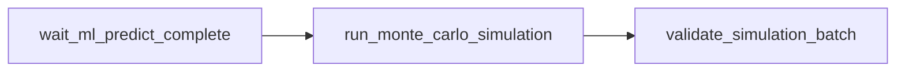

# `nascar.cup.machine_learning.models.monte_carlo`

Hourly Cup Monte Carlo race-simulation DAG. Waits for
`nascar.cup.machine_learning.models` / `predict_upcoming_week`, draws at least
1,000 simulated DraftKings-point outcomes per driver from the calibrated
prediction uncertainty, and persists batch + per-driver summaries to MariaDB
for the lineup generator and downstream BI.

- **DAG ID:** `nascar.cup.machine_learning.models.monte_carlo` (no `backfill.*` twin)
- **Source:** [dags/nascar/cup/machine_learning_models_monte_carlo.py](../../dags/nascar/cup/machine_learning_models_monte_carlo.py)
- **Tests:** [tests/unit/test_machine_learning_models_monte_carlo_dag.py](../../tests/unit/test_machine_learning_models_monte_carlo_dag.py),
  [tests/unit/test_monte_carlo.py](../../tests/unit/test_monte_carlo.py),
  [tests/unit/test_monte_carlo_task.py](../../tests/unit/test_monte_carlo_task.py)

## Schedule and settings

| Setting | Value |
| --- | --- |
| Cron / `schedule` | `CUP_SCRAPER_PROD_HOURLY_CRON` (`0 * * * *`) |
| `catchup` | `False` |
| `max_active_runs` | `1` |

## Task graph

## Tasks

### `wait_ml_predict_complete`

`ExternalTaskSensor` on `nascar.cup.machine_learning.models` /
`predict_upcoming_week` (same poke / timeout as other Cup ML sensors).

### `run_monte_carlo_simulation`

`PythonOperator` calling
[`include/nascar/ml/monte_carlo_task.py::run_monte_carlo_simulation_task`](../../include/nascar/ml/monte_carlo_task.py).
Pure-Python core lives in
[`include/nascar/ml/monte_carlo.py`](../../include/nascar/ml/monte_carlo.py)
(no Airflow / MySQL imports).

**Flow:**

1. Resolve the active DraftKings `dfs_scoring_rules` row. Skips with
   `no_active_rules` if missing.
2. Load the latest `kind='predict'` snapshot for the active rules
   (`v_series_current_week`). Skips with `no_predict_snapshot` if missing.
3. **Post-race idempotence guard.** When the snapshot's week has
   `r_finish_position` populated in `agg_week_results` (race is over)
   AND a live `ml_race_simulation_batches` row already exists for the
   snapshot, return
   `{"skipped": True, "reason": "mc_already_present_post_race"}`
   without re-simulating. Pre-race the simulator still re-runs every
   hour so the draws track refreshed predictions. See
   [Self-healing post-race recovery](./cup.machine_learning.models.md#self-healing-post-race-recovery)
   in the upstream ML DAG for the full chain.
4. Load active `ml_predictions` for the snapshot joined with
   `ml_training_rows` (for `r_start_position`). Skips with
   `no_ml_predictions` if empty.
5. For each target in `DEFAULT_TARGETS` (`r_finish_position`,
   `r_total_fastest_laps`, `r_total_laps_led`), look up the latest
   active `ml_model_evaluations` row for any model whose feature set
   targets that single stat in the same series. Prefer `metric='rmse'`;
   when only `metric='mae'` exists (the current production state) convert
   to σ assuming Gaussian residuals (σ ≈ MAE / 0.7979). Missing
   secondary-target σ collapses to zero (target held constant). Missing
   primary-target σ short-circuits with `no_primary_target_sigma` since
   no useful dispersion can be produced.
6. Build `MonteCarloDriverInput` records and call
   `simulate_driver_distributions`. Per simulation draw the simulator
   first samples `is_dnf ~ Bernoulli(P_dnf)` for every driver where
   `predict_task` shipped a blended `r_is_dnf` key on
   `predicted_targets_json` (absent → `P_dnf = 0`, behavior identical to
   pre-DNF callers). DNFed drivers in that iteration are randomly
   assigned to the tail positions `(n - k + 1) .. n` and non-DNFed
   drivers' raw `r_finish_position` draws are rank-reconciled across the
   non-DNF subset into a permutation of `1 .. (n - k)`, so every
   iteration is still a strict permutation of `1..field_size`
   (Phase E2 invariant preserved). For each DNFed driver in that
   iteration a single race-completion fraction `c ~ Uniform(0, 1)` is
   drawn and applied as a shared multiplier to both `r_total_laps_led`
   and `r_total_fastest_laps` (pre-constraint), modeling "the race
   ended early at fraction `c` and both leaderboards froze together"
   before `_apply_count_constraint` rounds + floors at 0. The
   per-target values then flow through `compute_dfs_points_from_targets`
   alongside the assigned finish position. Iterations remain coupled
   across drivers; this is what makes the joint-samples artifact
   meaningful downstream.
7. Aggregate each driver's simulated draws into 7-stat distribution
   summaries (mean / std / min / p05 / p50 / p95 / max) for the
   DFS-points block and each sampled target (`r_finish_position`,
   `r_total_fastest_laps`, `r_total_laps_led`), plus `dnf_pct` — the
   empirical Bernoulli rate of the per-iteration DNF draw (zero when
   no two-stage classifier was active for the snapshot).
8. Persist inside a single transaction: soft-delete any prior active
   `ml_race_simulation_batches` row for the same snapshot (and its
   summaries), insert the new batch header, then `executemany` the
   per-driver summary rows. Re-runs are idempotent.
9. **Joint-samples sidecar.** Write the full `(n_drivers, n_simulations)`
   DFS-point matrix plus the aligned `car_driver_ids` index to a numpy
   compressed archive at
   `${FS_MC_ARTIFACT_ROOT}/<batch_id>.npz`
   (default `/opt/airflow/artifacts/mc/`) and `UPDATE` the batch row's
   `joint_samples_artifact_uri` with the absolute path. The write happens
   AFTER the summary insert so an artifact failure cannot corrupt the
   per-driver source of truth; on failure the URI stays `NULL` and the
   lineup task transparently falls back to summary-derived independent
   Gaussian samples (logged as `mc_score_method='summary_fallback'`).

### `validate_simulation_batch`

`PythonOperator` calling `validate_simulation_batch_task`. Hard-fails the
DAG run when:

- No active batch exists for the snapshot.
- `n_simulations < 1000` on the latest batch.
- The count of active driver summaries does not match the active
  prediction pool for the snapshot.

This is the task the lineup generator's `wait_mc_complete` sensor blocks
on.

## Skip conditions

The run task returns `{"skipped": true, "reason": ...}` with the reason
logged at WARNING. The validate task instead raises (these are not skip
conditions; they are programming or pipeline errors).

| Reason | Cause |
| --- | --- |
| `no_active_rules` | No active `dfs_scoring_rules` row for DraftKings |
| `no_predict_snapshot` | No `kind='predict'` snapshot for the current week |
| `mc_already_present_post_race` | Race has finished AND a live `ml_race_simulation_batches` row already exists for the snapshot. The post-race self-healing branch ensures this DAG runs exactly once after results land, then quietly skips on subsequent hourly ticks until the week rolls over. |
| `no_ml_predictions` | No active `ml_predictions` rows for the snapshot |
| `no_primary_target_sigma` | Missing `rmse` / `mae` evaluation for `r_finish_position` |

## Configuration

- **Airflow connection:** `nascar_conn` (MySQL).
- **Env vars** (also documented in `.env.example`):

| Var | Default | Meaning |
| --- | --- | --- |
| `FS_MC_N_SIMULATIONS` | `10000` | Draws per driver per batch. Validation enforces ≥ `1000` (the floor remains 1000 for backfills / dev loops where lower-fidelity samples are acceptable). The joint sidecar memory is `(n_drivers × n_simulations × 8 B)` so a ~40-driver field at 10000 draws is ~3 MB per batch. |
| `FS_MC_RANDOM_SEED` | derived from snapshot id | Override the numpy seed for reproducibility |
| `FS_MC_ARTIFACT_ROOT` | `/opt/airflow/artifacts/mc` | Directory for `<batch_id>.npz` joint-samples sidecars. Compose mounts `${AIRFLOW_PROJ_DIR}/artifacts` here so worker and host see the same files. |
| `FS_PIPELINE_VERSION` / `GIT_COMMIT` | unset | Stamped onto the batch row for lineage |

## Database tables

- `ml_race_simulation_batches` — one row per snapshot, holds
  `n_simulations`, `random_seed`, `pipeline_version`, `status`, and
  (after migration `20260613T120000_lineup_mc_fingerprint.sql`)
  `joint_samples_artifact_uri` pointing at the per-batch `.npz` sidecar.
  Indexed on `(ml_training_snapshot_id, deleted_at)`.
- `ml_race_simulation_driver_summaries` — one row per
  `(batch_id, car_driver_id)`. Unique on `(batch_id, car_driver_id)`.
  Columns:
  - `mean_dfs_points` / `std_dfs_points` / `min_dfs_points` /
    `p05_dfs_points` / `p50_dfs_points` / `p95_dfs_points` /
    `max_dfs_points` — DFS-points distribution stats (primary signal).
  - `mean_r_finish_position` / `std_r_finish_position` /
    `min_r_finish_position` / `p05_r_finish_position` /
    `p50_r_finish_position` / `p95_r_finish_position` /
    `max_r_finish_position` — finish-position distribution stats
    (post tail-permutation for DNFed iterations).
  - `mean_r_total_fastest_laps` / `std_r_total_fastest_laps` /
    `min_r_total_fastest_laps` / `p05_r_total_fastest_laps` /
    `p50_r_total_fastest_laps` / `p95_r_total_fastest_laps` /
    `max_r_total_fastest_laps` — fastest-laps distribution stats
    (completion-fraction scaled for DNFed iterations).
  - `mean_r_total_laps_led` / `std_r_total_laps_led` /
    `min_r_total_laps_led` / `p05_r_total_laps_led` /
    `p50_r_total_laps_led` / `p95_r_total_laps_led` /
    `max_r_total_laps_led` — laps-led distribution stats
    (completion-fraction scaled for DNFed iterations).
  - `dnf_pct` — fraction of simulated iterations where the driver
    DNFed; equals the per-driver Bernoulli(P_dnf) empirical mean. Zero
    when the two-stage DNF classifier was inactive for this snapshot.

DDL: `fantasy-sports-db/nascar/ddl/tables/1082-*.sql`, `1083-*.sql`;
migrations
`fantasy-sports-db/nascar/migrations/20260526T120000_ml_race_simulation_tables.sql`,
`fantasy-sports-db/nascar/migrations/20260613T120000_lineup_mc_fingerprint.sql`,
`fantasy-sports-db/nascar/migrations/20260528T020000_ml_race_simulation_driver_summaries_target_stats.sql`.

## Joint-samples artifact

Each completed batch writes
`${FS_MC_ARTIFACT_ROOT}/<batch_id>.npz` (numpy
`savez_compressed`). The archive holds three arrays:

| Array | Shape | dtype | Meaning |
| --- | --- | --- | --- |
| `joint_dfs_points` | `(n_drivers, n_simulations)` | `float64` | DFS-point sample for driver `i` in iteration `s`. Rows aligned with `car_driver_ids`. |
| `car_driver_ids` | `(n_drivers,)` | `int64` | Maps each matrix row to a `nascar.car_drivers.id`. |
| `joint_finish_position` | `(n_drivers, n_simulations)` | `float64` | Assigned finish position per (driver, iter). DNFed iterations carry the random tail position; non-DNFed iterations carry the rank-reconciled position. |
| `joint_total_fastest_laps` | `(n_drivers, n_simulations)` | `float64` | Post-constraint fastest-laps count (completion-fraction scaled for DNFed iterations). |
| `joint_total_laps_led` | `(n_drivers, n_simulations)` | `float64` | Post-constraint laps-led count (completion-fraction scaled for DNFed iterations; shared `c` with `joint_total_fastest_laps`). |
| `joint_is_dnf` | `(n_drivers, n_simulations)` | `int8` | Per-iteration Bernoulli(P_dnf) outcome (0 / 1). |
| `meta` | scalar void | structured | `batch_id`, `snapshot_id`, `n_simulations`, `random_seed` for offline lineage cross-checks. |

The four per-target / DNF arrays are written best-effort; legacy MC
pipeline versions wrote only `joint_dfs_points`, `car_driver_ids`, and
`meta`. Readers that consume the sidecar must treat the per-target
arrays as optional.

Same iteration index across rows is a **coupled** draw (Phase E2 rank
coupling: finish positions are a permutation of `1..field_size`), so
summing rows column-wise gives the lineup's true joint distribution.
Files compress well (40 drivers × 1000 sims × 8 bytes ≈ 320 KB before
compression; typical on-disk size ~120-180 KB). No retention policy is
enforced today; clean up via `find ${FS_MC_ARTIFACT_ROOT} -mtime +30
-delete` if disk pressure becomes a concern.

## Limitations

- Cross-driver coupling is currently limited to finish-position
  permutations (Phase E2) and the DNF tail placement. Laps led and
  fastest laps are still drawn independently per driver (with the
  shared completion-fraction multiplier applied for DNFed iterations);
  modeling broader inter-driver count covariance explicitly would
  require a multivariate noise model and is deferred.
- `P_dnf` flows through `predicted_targets_json` under the key
  `r_is_dnf` whenever the two-stage classifier was active for the
  snapshot. Snapshots whose D3 classifier was unavailable carry
  `p_dnf = None` end-to-end; MC then skips the Bernoulli branch and
  `dnf_pct` rows are persisted as `0`.
- The DNF completion fraction is drawn from `Uniform(0, 1)` per
  (driver, iteration), without conditioning on retirement-lap data
  the upstream classifier doesn't currently model. If/when a richer
  exit-lap distribution becomes available we'd swap the prior here.
- Per-target σ is read from any matching active model, not specifically
  the one that produced the prediction (per-target model ids are not
  stored in `ml_predictions`). Both are typically the most recent active
  model and agree in practice; making this exact would require widening
  `ml_predictions` and is deferred.
- Joint-samples artifacts are not retention-managed automatically. A
  scheduled cleanup (e.g. `find ${FS_MC_ARTIFACT_ROOT} -mtime +30
  -delete`) is recommended once disk usage becomes material.

## Related

- Upstream: [cup.machine_learning.models.md](./cup.machine_learning.models.md)
- Downstream: [cup.dfs.lineup_generator.md](./cup.dfs.lineup_generator.md)
