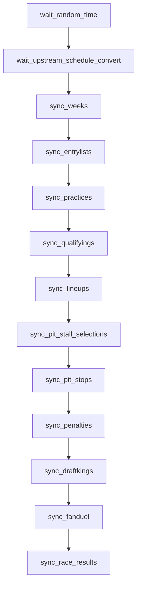

# `nascar.cup.scraper.frcs.race_week`

Per-race-weekend FRCS.pro Cup scrape. Drains every entry that
`nascar.cup.scraper.frcs.schedule` exposes in `schedule.csv` for the current
year, downloads the matching HTML pages, and converts them to CSVs that the
importer DAG later stages into MySQL.

- **DAG IDs:** `nascar.cup.scraper.frcs.race_week`, `backfill.nascar.cup.scraper.frcs.race_week`
- **Source:** [dags/nascar/cup/scraper/frcs/race_week.py](../../dags/nascar/cup/scraper/frcs/race_week.py)
- **Factory:** `register_frcs_race_week_dag` in
  [dags/nascar/cup/scraper/dag_factories.py](../../dags/nascar/cup/scraper/dag_factories.py)
- **Tests:** [tests/unit/test_frcs_race_week_dag.py](../../tests/unit/test_frcs_race_week_dag.py)

## Purpose

For each Cup week listed in `schedule.csv`, sync (a) the event-level pages
needed to populate practice / qualifying / lineup / penalty / DFS slate
inputs and (b) the race-results page + loop data. Outputs feed the importer
DAG's `load_stage_*` and `import_*` tasks.

## Schedule and basic settings

| Setting | Prod | Backfill |
| --- | --- | --- |
| Cron / `schedule` | `CUP_SCRAPER_PROD_HOURLY_CRON` (`0 * * * *`) | `BACKFILL_YEARLY_SCHEDULE` (`0 0 31 12 *`) |
| `start_date` | `datetime(2025, 7, 11)` | `BACKFILL_START_DATE` (`2010-12-31`) |
| `end_date` | `None` | `BACKFILL_END_DATE` (`2025-12-31`) |
| `catchup` | `False` | `True` |
| `max_active_runs` | `1` | `1` |
| Outlet `Asset` | `NASCAR_FRCS_CUP_RACE_WEEK_ASSET` (`nascar://frcs/cup/race-week.csv`) | `BACKFILL_FRCS_CUP_RACE_WEEK_ASSET` (`nascar://backfill/frcs/cup/race-week.csv`) |

## Upstream and downstream wiring

- **Upstream:** `wait_upstream_schedule_convert` blocks on
  `convert_year_schedule_html_to_csv` in
  `nascar.cup.scraper.frcs.schedule` for the same logical date
  (`mode=reschedule`, `poke_interval=30s`, `timeout=2h`).
- **Downstream:** `nascar.cup.importer` blocks on `sync_race_results` here
  (`wait_frcs_race_week_sync_race_results`).

## Task graph

## Tasks

### `wait_random_time`

- **Operator:** `WaitOperator`.
- **Behavior:** sleeps 0-5 seconds before any HTTP calls so concurrent
  hourly runs (and any concurrent Racing Reference race-week run) don't all
  fire HTTP requests on the same second.
- **Upstream:** (root). **Downstream:** `wait_upstream_schedule_convert`.

### `wait_upstream_schedule_convert`

- **Operator:** `ExternalTaskSensor` (`mode=reschedule`).
- **Target:** `nascar.cup.scraper.frcs.schedule.convert_year_schedule_html_to_csv`
  for the same logical date. Backfill twin targets `backfill.*`.
- **Behavior:** confirms today's `schedule.csv` is on disk before any week-
  scoped scraping runs. `poke_interval = CUP_EXTERNAL_SENSOR_POKE_INTERVAL`
  (30s); `timeout = CUP_RACE_WEEK_WAIT_SCHEDULE_TIMEOUT` (2h).
- **Inputs:** Airflow metadata DB (sensor checks upstream task state).
- **Upstream:** `wait_random_time`. **Downstream:** `sync_weeks`.

### `sync_weeks`

- **Operator:** `PythonOperator`.
- **Callable:** `cup_series_sync_weeks` in
  [include/nascar/data_sources/frcs_race_week.py](../../include/nascar/data_sources/frcs_race_week.py).
- **Behavior:** reads `schedule.csv` for the season and enumerates every week
  ("event") so subsequent sync tasks can iterate over them. Establishes the
  per-week folder layout `…/cup/<year>/<event_number>/` under the FRCS
  scraper root. The run anchor (logical date stamp) is pinned here for
  downstream tasks.
- **Inputs:** `schedule.csv` produced by the schedule DAG.
- **Outputs:** in-memory week list passed to the rest of the DAG via the
  shared run-anchor helper, plus directory scaffolding on disk.
- **Upstream:** `wait_upstream_schedule_convert`. **Downstream:**
  `sync_entrylists`.

### `sync_entrylists`

- **Operator:** `PythonOperator`.
- **Callable:** `cup_series_sync_entrylists`.
- **Behavior:** for each week, downloads the FRCS entrylist HTML page and
  converts it to `entrylist.csv` via `FrcsHtmlConverters`. Skips weeks that
  already have a current CSV unless the page changed.
- **Outputs:** `…/<event_number>/entrylist.csv`.
- **Upstream:** `sync_weeks`. **Downstream:** `sync_practices`.

### `sync_practices`

- **Operator:** `PythonOperator`.
- **Callable:** `cup_series_sync_practices`.
- **Behavior:** downloads every available `practice-<n>` HTML page per week
  (Cup typically has 1-2 practice sessions, occasionally more), converts
  each to `practice-<n>.csv`. The importer prefers FRCS practice CSVs over
  Racing Reference; this task is the FRCS half of that preference.
- **Outputs:** `…/<event_number>/practice-<n>.csv`.
- **Upstream:** `sync_entrylists`. **Downstream:** `sync_qualifyings`.

### `sync_qualifyings`

- **Operator:** `PythonOperator`.
- **Callable:** `cup_series_sync_qualifyings`.
- **Behavior:** downloads the qualifying HTML per week and writes
  `qualifying.csv`. This file is the importer's preferred qualifying source
  (RR is the fallback).
- **Outputs:** `…/<event_number>/qualifying.csv`.
- **Upstream:** `sync_practices`. **Downstream:** `sync_lineups`.

### `sync_lineups`

- **Operator:** `PythonOperator`.
- **Callable:** `cup_series_sync_lineups`.
- **Behavior:** downloads the starting lineup HTML per week and writes
  `lineup.csv`. This is the pre-race starting grid feed; the ML DAG's
  prediction snapshots require `r_start_position` populated from this load.
- **Outputs:** `…/<event_number>/lineup.csv`.
- **Upstream:** `sync_qualifyings`. **Downstream:** `sync_pit_stall_selections`.

### `sync_pit_stall_selections`

- **Operator:** `PythonOperator`.
- **Callable:** `cup_series_sync_pit_stall_selections`.
- **Behavior:** downloads the pit-stall selections HTML and writes a CSV per
  week. Useful for downstream context tables; not all weeks publish this
  page, so the task tolerates missing pages.
- **Outputs:** `…/<event_number>/pit-stall-selections.csv` (when present).
- **Upstream:** `sync_lineups`. **Downstream:** `sync_pit_stops`.

### `sync_pit_stops`

- **Operator:** `PythonOperator`.
- **Callable:** `cup_series_sync_pit_stops`.
- **Behavior:** downloads the in-race pit-stop detail HTML and writes
  `pit-stops.csv`. Drives the importer's `import_pitstops` chain.
- **Outputs:** `…/<event_number>/pit-stops.csv`.
- **Upstream:** `sync_pit_stall_selections`. **Downstream:** `sync_penalties`.

### `sync_penalties`

- **Operator:** `PythonOperator`.
- **Callable:** `cup_series_sync_penalties`.
- **Behavior:** downloads the in-race penalties HTML and writes
  `penalties.csv`. Feeds `import_penalties`.
- **Outputs:** `…/<event_number>/penalties.csv`.
- **Upstream:** `sync_pit_stops`. **Downstream:** `sync_draftkings`.

### `sync_draftkings`

- **Operator:** `PythonOperator`.
- **Callable:** `cup_series_sync_draftkings`.
- **Behavior:** downloads the DraftKings DFS slate HTML for the upcoming
  race and writes `draftkings.csv` (salaries, IDs). Required for the ML
  pipeline's downstream lineup optimizer (out of scope today) and for the
  importer's `import_draftkings` chain.
- **Outputs:** `…/<event_number>/draftkings.csv`.
- **Upstream:** `sync_penalties`. **Downstream:** `sync_fanduel`.

### `sync_fanduel`

- **Operator:** `PythonOperator`.
- **Callable:** `cup_series_sync_fanduel`.
- **Behavior:** downloads the FanDuel DFS slate HTML and writes
  `fanduel.csv`. Feeds `import_fanduel`. Today's ML DAG only consumes
  DraftKings scoring rules, but this CSV is still staged for completeness.
- **Outputs:** `…/<event_number>/fanduel.csv`.
- **Upstream:** `sync_draftkings`. **Downstream:** `sync_race_results`.

### `sync_race_results`

- **Operator:** `PythonOperator` with
  `outlets=[NASCAR_FRCS_CUP_RACE_WEEK_ASSET]` (or the backfill twin).
- **Callable:** `cup_series_sync_race_results`.
- **Behavior:** downloads the final race-results HTML for every finished
  week and converts to `results.csv`. Success of this task is the heartbeat
  that `nascar.cup.importer.wait_frcs_race_week_sync_race_results` waits on.
  Also bumps the outlet Asset for any Asset-triggered consumers.
- **Outputs:** `…/<event_number>/results.csv`; updates outlet Asset.
- **Upstream:** `sync_fanduel`. **Downstream:** none in this DAG; satisfies
  the FRCS sensor in [cup.importer.md](./cup.importer.md).
- **Failure notes:** the importer DAG's matching sensor times out at
  `CUP_IMPORTER_WAIT_RACE_WEEK_TIMEOUT` (6h) — restart this task within that
  window to keep the importer run.

## Data sources and sinks

- **External:** FRCS.pro per-event pages, e.g. `/nascar/cup/races/<event>/...`.
- **Disk:** `/home/airflow/scraper/nascar/frcs.pro/cup/<year>/<event_number>/`
  containing `entrylist.csv`, `practice-<n>.csv`, `qualifying.csv`,
  `lineup.csv`, `pit-stall-selections.csv`, `pit-stops.csv`,
  `penalties.csv`, `draftkings.csv`, `fanduel.csv`, `results.csv`.
- **MySQL:** none. The importer stages these CSVs into MySQL.

## Configuration

- **Connections:** none (HTTP + filesystem only).
- **Scraper root:** `DEFAULT_NASCAR_SCRAPER_ROOT` (`/home/airflow/scraper/nascar`).
- **User-Agent rotation:** `FRCS_USER_AGENTS` (shared with Racing Reference).

## Backfill variant

`backfill.nascar.cup.scraper.frcs.race_week` uses the same factory with:

- `schedule = BACKFILL_YEARLY_SCHEDULE`, `catchup=True`, and the
  backfill-only `BACKFILL_FRCS_CUP_RACE_WEEK_ASSET` so the prod
  Asset-triggered chain is not nudged by historical runs.
- `wait_upstream_schedule_convert` targets
  `backfill.nascar.cup.scraper.frcs.schedule.convert_year_schedule_html_to_csv`
  for the same Dec 31 logical date.
- Same task graph and callables as prod.

## Operational notes

- Tasks run sequentially because each downstream sync depends on the
  preceding week list / context to be stable for the run. The linear chain
  also limits HTTP pressure on FRCS.pro.
- A flaky page mid-chain will fail the run before `sync_race_results`,
  meaning the downstream importer sensor will continue to wait. Re-running
  from the failed step is safe — the converters skip files that already
  exist with the expected schema.
- `sync_pit_stall_selections`, `sync_draftkings`, and `sync_fanduel` may log
  warnings when the upstream page is missing (e.g. very early in race week)
  — that is expected and not a failure.

## Related tests

- [tests/unit/test_frcs_race_week_dag.py](../../tests/unit/test_frcs_race_week_dag.py) — task ids, ordering, sensor wiring.
- [tests/unit/test_frcs_source.py](../../tests/unit/test_frcs_source.py) — FRCS URL / path helpers.
- [tests/unit/test_frcs_pit_stops_csv_time_format.py](../../tests/unit/test_frcs_pit_stops_csv_time_format.py) — pit-stop CSV time-format contract.
- [tests/unit/test_html_to_csv_converter.py](../../tests/unit/test_html_to_csv_converter.py) — HTML→CSV converter behaviors.
- [tests/unit/test_race_week_context.py](../../tests/unit/test_race_week_context.py) — run anchor / year resolution.
