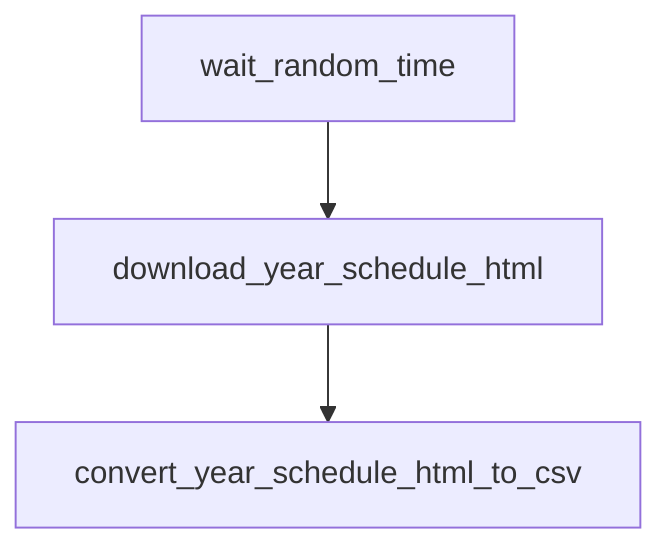

# `nascar.cup.scraper.frcs.schedule`

Hourly scrape of the Cup season schedule from
[FRCS.pro](https://frcs.pro/nascar/cup/races/schedule/), producing the
canonical `schedule.csv` that feeds the FRCS race-week DAG and (downstream)
the importer's schedule load.

- **DAG IDs:** `nascar.cup.scraper.frcs.schedule`, `backfill.nascar.cup.scraper.frcs.schedule`
- **Source:** [dags/nascar/cup/scraper/frcs/schedule.py](../../dags/nascar/cup/scraper/frcs/schedule.py)
- **Factory:** `register_frcs_schedule_dag` in
  [dags/nascar/cup/scraper/dag_factories.py](../../dags/nascar/cup/scraper/dag_factories.py)
- **Tests:** [tests/unit/test_frcs_schedule_dag.py](../../tests/unit/test_frcs_schedule_dag.py)

## Purpose

Each tick downloads the year's FRCS schedule HTML for the Cup series and
converts it to a flat `schedule.csv`. The CSV is the single source of truth
for which weeks/events exist in a season — every downstream DAG (FRCS
race-week, importer, aggregate, ML) ultimately keys off it.

## Schedule and basic settings

| Setting | Prod | Backfill |
| --- | --- | --- |
| Cron / `schedule` | `CUP_SCRAPER_PROD_HOURLY_CRON` (`0 * * * *`) | `BACKFILL_YEARLY_SCHEDULE` (`0 0 31 12 *`) |
| `start_date` | `datetime(2025, 7, 11)` | `BACKFILL_START_DATE` (`2010-12-31`) |
| `end_date` | `None` | `BACKFILL_END_DATE` (`2025-12-31`) |
| `catchup` | `False` | `True` |
| `max_active_runs` | `1` | `1` |
| Outlet `Asset` | `NASCAR_FRCS_CUP_SCHEDULE_ASSET` (`nascar://frcs/cup/schedule.csv`) | `BACKFILL_FRCS_CUP_SCHEDULE_ASSET` (`nascar://backfill/frcs/cup/schedule.csv`) |

## Upstream and downstream wiring

- **Upstream:** none. The wave starts with a randomized in-DAG wait.
- **Downstream:** `nascar.cup.scraper.frcs.race_week` blocks on
  `convert_year_schedule_html_to_csv` via an `ExternalTaskSensor`
  (`wait_upstream_schedule_convert`). Lineage consumers can subscribe to the
  outlet `Asset` instead.

## Task graph

## Tasks

### `wait_random_time`

- **Operator:** `airflow_utils.wait_operator.WaitOperator`.
- **Behavior:** sleeps for `random.randint(0, 5)` seconds at DAG-parse time so
  parallel hourly DAG runs don't all hit FRCS.pro on the exact same second.
- **Inputs / outputs:** none.
- **Upstream:** (root). **Downstream:** `download_year_schedule_html`.

### `download_year_schedule_html`

- **Operator:** `PythonOperator`.
- **Callable:** `include.nascar.data_sources.frcs.cup_series_download_year_schedule_html`
  in [include/nascar/data_sources/frcs.py](../../include/nascar/data_sources/frcs.py).
- **Behavior:** resolves the season year from the run context, builds the
  FRCS schedule URL (`https://frcs.pro/nascar/cup/races/schedule/<year>/`),
  downloads the page HTML, and writes it under the data source's
  `storage_path_series_year('cup', year)` directory — namely
  `/home/airflow/scraper/nascar/frcs.pro/cup/<year>/schedule.html` — using a
  randomized user agent from `FRCS_USER_AGENTS`.
- **Inputs:** Airflow run context (`logical_date`, etc.) for year resolution.
- **Outputs:** `schedule.html` on the scraper volume; XCom: none.
- **Upstream:** `wait_random_time`. **Downstream:** `convert_year_schedule_html_to_csv`.
- **Failure notes:** retries respect Airflow defaults; failures here usually
  mean FRCS.pro is unreachable or rate-limited. The race-week sensor
  downstream times out at `CUP_RACE_WEEK_WAIT_SCHEDULE_TIMEOUT` (2h).

### `convert_year_schedule_html_to_csv`

- **Operator:** `PythonOperator` with `outlets=[NASCAR_FRCS_CUP_SCHEDULE_ASSET]`
  (or the backfill twin for `backfill.*`).
- **Callable:** `include.nascar.data_sources.frcs.cup_series_convert_year_schedule_html_to_csv`.
- **Behavior:** parses the downloaded `schedule.html` via
  `FrcsHtmlConverters` and writes the canonical `schedule.csv` next to it.
  Columns include `event_number`, `week_race_name`, `week_date`, track id
  hints, etc. The success of this task is the heartbeat the FRCS race-week
  DAG waits on each hour.
- **Inputs:** `schedule.html` from the previous task.
- **Outputs:** `schedule.csv` at the same path; updates outlet Asset for
  downstream lineage / Asset-based scheduling.
- **Upstream:** `download_year_schedule_html`. **Downstream:** none inside
  this DAG; satisfies the `wait_upstream_schedule_convert`
  `ExternalTaskSensor` in [cup.scraper.frcs.race_week.md](./cup.scraper.frcs.race_week.md).

## Data sources and sinks

- **External:** `https://frcs.pro/nascar/cup/races/schedule/<year>/`.
- **Disk:** `/home/airflow/scraper/nascar/frcs.pro/cup/<year>/`
  (`schedule.html`, `schedule.csv`).
- **MySQL:** none. Downstream importers stage the CSV into MySQL.

## Configuration

- **Connections:** none required (no MySQL writes).
- **Scraper root override:** the `FrcsSource(scraper_root=...)` constructor
  defaults to `DEFAULT_NASCAR_SCRAPER_ROOT` (`/home/airflow/scraper/nascar`).
  Mount the host scraper volume at `/home/airflow/scraper`.
- **User-Agent rotation:** `FRCS_USER_AGENTS` (shared with Racing Reference).

## Backfill variant

`backfill.nascar.cup.scraper.frcs.schedule` reuses the same factory but with:

- `schedule = BACKFILL_YEARLY_SCHEDULE` so a single run fires per calendar
  year, `catchup=True` so all years between `BACKFILL_START_DATE` and
  `BACKFILL_END_DATE` are filled when the DAG is first enabled.
- Outlet Asset switched to `BACKFILL_FRCS_CUP_SCHEDULE_ASSET` so production
  Asset-based DAGs are not triggered by backfill runs (and vice versa).
- Same callables, same disk layout, same downstream contract — the
  `backfill.nascar.cup.scraper.frcs.race_week` DAG waits on this DAG's
  `convert_year_schedule_html_to_csv` for the matching logical date.

## Operational notes

- The DAG is `max_active_runs=1`, so a slow scrape will queue rather than
  parallelize. Healthy hourly runs complete in seconds.
- Failures here cascade: the FRCS race-week DAG's sensor will eventually time
  out at 2h, which then makes the importer DAG's 6h sensor on
  `sync_race_results` time out as well.
- Logs are visible in the Airflow UI under the standard `dag_id/task_id/...`
  path; HTTP errors are logged by `include.utils.scraper.Scraper`.

## Related tests

- [tests/unit/test_frcs_schedule_dag.py](../../tests/unit/test_frcs_schedule_dag.py) — DAG metadata, task ids, ordering.
- [tests/unit/test_frcs_source.py](../../tests/unit/test_frcs_source.py) — `FrcsSource` URL / path helpers.
- [tests/unit/test_schedule_week_date_csv.py](../../tests/unit/test_schedule_week_date_csv.py) — CSV column contract.
- [tests/unit/test_schedule_backfill_skip_existing_csv.py](../../tests/unit/test_schedule_backfill_skip_existing_csv.py) — backfill idempotency.
