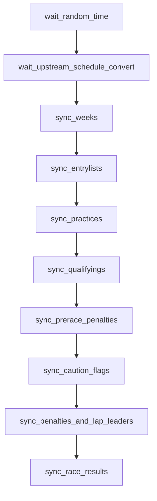

# `nascar.cup.scraper.racing_reference.race_week`

Per-race-weekend Racing Reference scrape for the Cup series. Mirrors the FRCS
race-week DAG but pulls from www.racing-reference.info; the importer uses
these CSVs to fill in fields that FRCS does not expose (loop data, lap
leaders, caution flags, pre-race penalties) and as a fallback for shared
fields like qualifying and practice.

- **DAG IDs:** `nascar.cup.scraper.racing_reference.race_week`, `backfill.nascar.cup.scraper.racing_reference.race_week`
- **Source:** [dags/nascar/cup/scraper/racing_reference/race_week.py](../../dags/nascar/cup/scraper/racing_reference/race_week.py)
- **Factory:** `register_racing_reference_race_week_dag` in
  [dags/nascar/cup/scraper/dag_factories.py](../../dags/nascar/cup/scraper/dag_factories.py)
- **Tests:** [tests/unit/test_racing_reference_race_week_dag.py](../../tests/unit/test_racing_reference_race_week_dag.py)

## Purpose

For each Cup week listed in the Racing Reference `schedule.csv`, sync the
event-level pages (entrylist, practices, qualifying, pre-race penalties,
caution flags, lap leaders + penalties, and race results + loop data) into
the per-week folder. Outputs feed the importer DAG's
`load_stage_*` / `import_*` tasks, often as the canonical source of truth
for fields FRCS does not provide.

## Schedule and basic settings

| Setting | Prod | Backfill |
| --- | --- | --- |
| Cron / `schedule` | `CUP_SCRAPER_PROD_HOURLY_CRON` (`0 * * * *`) | `BACKFILL_YEARLY_SCHEDULE` (`0 0 31 12 *`) |
| `start_date` | `datetime(2025, 7, 11)` | `BACKFILL_START_DATE` (`2010-12-31`) |
| `end_date` | `None` | `BACKFILL_END_DATE` (`2025-12-31`) |
| `catchup` | `False` | `True` |
| `max_active_runs` | `1` | `1` |
| Outlet `Asset` | `NASCAR_RACING_REFERENCE_CUP_RACE_WEEK_ASSET` (`nascar://racing-reference/cup/race-week.csv`) | `BACKFILL_RACING_REFERENCE_CUP_RACE_WEEK_ASSET` (`nascar://backfill/racing-reference/cup/race-week.csv`) |

## Upstream and downstream wiring

- **Upstream:** `wait_upstream_schedule_convert` blocks on
  `nascar.cup.scraper.racing_reference.schedule.convert_year_schedule_html_to_csv`
  (or its `backfill.*` twin) for the same logical date.
- **Downstream:** `nascar.cup.importer.wait_racing_reference_race_week_sync_race_results`
  waits on this DAG's `sync_race_results`.

## Task graph

## Tasks

### `wait_random_time`

- **Operator:** `WaitOperator`.
- **Behavior:** 0-5 second jitter before any HTTP request so the RR and FRCS
  race-week DAGs don't both fire on the same second.
- **Upstream:** (root). **Downstream:** `wait_upstream_schedule_convert`.

### `wait_upstream_schedule_convert`

- **Operator:** `ExternalTaskSensor` (`mode=reschedule`).
- **Target:** `nascar.cup.scraper.racing_reference.schedule.convert_year_schedule_html_to_csv`
  for the same logical date (backfill twin targets `backfill.*`).
- **Behavior:** confirms the RR `schedule.csv` is on disk before any
  week-scoped scraping runs. `poke_interval = 30s`, `timeout = 2h`.
- **Upstream:** `wait_random_time`. **Downstream:** `sync_weeks`.

### `sync_weeks`

- **Operator:** `PythonOperator`.
- **Callable:** `cup_series_sync_weeks` in
  [include/nascar/data_sources/racing_reference_race_week.py](../../include/nascar/data_sources/racing_reference_race_week.py).
- **Behavior:** loads the RR `schedule.csv` for the season, enumerates weeks
  (keyed by `week_number`, which can differ from FRCS `event_number`), and
  scaffolds the per-week folder layout
  `…/www.racing-reference.info/cup/<year>/<week_number>/`. Pins the run
  anchor used by every downstream task.
- **Inputs:** RR `schedule.csv`.
- **Outputs:** week list + directory scaffolding.
- **Upstream:** `wait_upstream_schedule_convert`. **Downstream:** `sync_entrylists`.

### `sync_entrylists`

- **Operator:** `PythonOperator`.
- **Callable:** `cup_series_sync_entrylists`.
- **Behavior:** downloads the RR entrylist HTML per week and converts to
  `entrylist.csv`. RR entrylists are a fallback when FRCS lags.
- **Outputs:** `…/<week_number>/entrylist.csv`.
- **Upstream:** `sync_weeks`. **Downstream:** `sync_practices`.

### `sync_practices`

- **Operator:** `PythonOperator`.
- **Callable:** `cup_series_sync_practices`.
- **Behavior:** downloads the RR practice HTML pages and converts. RR
  practice CSVs miss FRCS-only columns (multi-lap averages, 10-lap window
  fields) — the importer leaves those columns NULL when the RR file is
  loaded.
- **Outputs:** `…/<week_number>/practice-<n>.csv`.
- **Upstream:** `sync_entrylists`. **Downstream:** `sync_qualifyings`.

### `sync_qualifyings`

- **Operator:** `PythonOperator`.
- **Callable:** `cup_series_sync_qualifyings`.
- **Behavior:** downloads and converts the RR qualifying page; serves as the
  importer's fallback when FRCS `qualifying.csv` is missing.
- **Outputs:** `…/<week_number>/qualifying.csv`.
- **Upstream:** `sync_practices`. **Downstream:** `sync_prerace_penalties`.

### `sync_prerace_penalties`

- **Operator:** `PythonOperator`.
- **Callable:** `cup_series_sync_prerace_penalties`.
- **Behavior:** downloads the RR pre-race penalties page and converts. RR
  is the only source for this; the importer's `import_penalties` chain
  reads it via the `racing_reference` source.
- **Outputs:** `…/<week_number>/prerace-penalties.csv`.
- **Upstream:** `sync_qualifyings`. **Downstream:** `sync_caution_flags`.

### `sync_caution_flags`

- **Operator:** `PythonOperator`.
- **Callable:** `cup_series_sync_caution_flags`.
- **Behavior:** downloads the RR caution-flag report and converts to
  `caution-flags.csv`. Feeds downstream loop-data tables consumed by the
  aggregate DAG.
- **Outputs:** `…/<week_number>/caution-flags.csv`.
- **Upstream:** `sync_prerace_penalties`. **Downstream:**
  `sync_penalties_and_lap_leaders`.

### `sync_penalties_and_lap_leaders`

- **Operator:** `PythonOperator`.
- **Callable:** `cup_series_sync_penalties_and_lap_leaders`.
- **Behavior:** downloads two related pages (in-race penalties and lap
  leaders) and converts each to its own CSV. Together they fill in the
  caution / lap-leader counters consumed by the aggregate DAG's
  `agg_week_results` build.
- **Outputs:** `…/<week_number>/penalties.csv`, `…/<week_number>/lap-leaders.csv`.
- **Upstream:** `sync_caution_flags`. **Downstream:** `sync_race_results`.

### `sync_race_results`

- **Operator:** `PythonOperator` with
  `outlets=[NASCAR_RACING_REFERENCE_CUP_RACE_WEEK_ASSET]` (or backfill twin).
- **Callable:** `cup_series_sync_race_results`.
- **Behavior:** downloads the final RR race-results page plus the loop-data
  HTML and converts both. The `results.csv` is the RR-side input the
  importer uses alongside the FRCS results; loop-data CSV feeds advanced
  per-driver stats. Success bumps the outlet Asset and satisfies the
  importer's `wait_racing_reference_race_week_sync_race_results` sensor.
- **Outputs:** `…/<week_number>/results.csv`,
  `…/<week_number>/loop-data.csv`; updates outlet Asset.
- **Upstream:** `sync_penalties_and_lap_leaders`. **Downstream:** none
  inside this DAG.
- **Failure notes:** the importer's matching sensor times out at
  `CUP_IMPORTER_WAIT_RACE_WEEK_TIMEOUT` (6h).

## Data sources and sinks

- **External:** Racing Reference per-event pages, e.g.
  `https://www.racing-reference.info/race/<year>_<event>/...`.
- **Disk:** `/home/airflow/scraper/nascar/www.racing-reference.info/cup/<year>/<week_number>/`
  with `entrylist.csv`, `practice-<n>.csv`, `qualifying.csv`,
  `prerace-penalties.csv`, `caution-flags.csv`, `penalties.csv`,
  `lap-leaders.csv`, `results.csv`, `loop-data.csv`.
- **MySQL:** none — the importer stages these CSVs.

## Configuration

- **Connections:** none.
- **Scraper root:** `DEFAULT_NASCAR_SCRAPER_ROOT` (`/home/airflow/scraper/nascar`).
- **User-Agent rotation:** `RACING_REFERENCE_USER_AGENTS`.

## Backfill variant

`backfill.nascar.cup.scraper.racing_reference.race_week` uses the same
factory with `BACKFILL_YEARLY_SCHEDULE`, `catchup=True`,
`BACKFILL_RACING_REFERENCE_CUP_RACE_WEEK_ASSET`, and the
`backfill.nascar.cup.scraper.racing_reference.schedule.convert_year_schedule_html_to_csv`
sensor target for the same Dec 31 logical date.

## Operational notes

- The DAG runs tasks sequentially to keep HTTP pressure low on RR.
- `sync_qualifyings`, `sync_practices`, and `sync_prerace_penalties` log
  warnings when the source page is missing — that is expected (RR doesn't
  publish every weekend's qualifying or pre-race penalties).
- A failure mid-chain leaves the importer race-week sensor pending; re-run
  from the failed step.

## Related tests

- [tests/unit/test_racing_reference_race_week_dag.py](../../tests/unit/test_racing_reference_race_week_dag.py) — task ids, ordering, sensor wiring.
- [tests/unit/test_racing_reference_source.py](../../tests/unit/test_racing_reference_source.py) — RR URL / path helpers.
- [tests/unit/test_racing_reference_race_week_year_context.py](../../tests/unit/test_racing_reference_race_week_year_context.py) — run anchor resolution.
- [tests/unit/test_html_to_csv_converter.py](../../tests/unit/test_html_to_csv_converter.py) — converter regressions.
- [tests/unit/test_cup_rr_week_folder_map.py](../../tests/unit/test_cup_rr_week_folder_map.py) — RR `week_number` ↔ FRCS `event_number` mapping.
