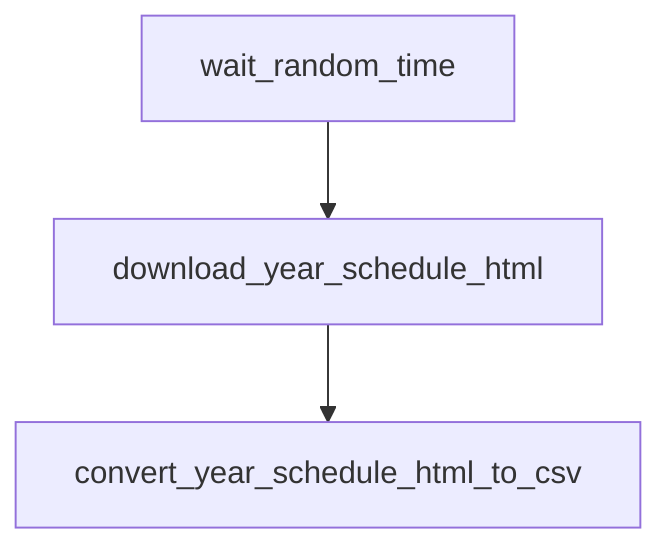

# `nascar.cup.scraper.racing_reference.schedule`

Hourly scrape of the Cup season schedule from
[Racing Reference](https://www.racing-reference.info/raceyear/) — the
alternate-source mirror of `nascar.cup.scraper.frcs.schedule`. The CSV it
produces is used by the importer to fill in fields FRCS does not expose
(notably `week_number`) and by the Racing Reference race-week DAG to know
which weeks to scrape.

- **DAG IDs:** `nascar.cup.scraper.racing_reference.schedule`, `backfill.nascar.cup.scraper.racing_reference.schedule`
- **Source:** [dags/nascar/cup/scraper/racing_reference/schedule.py](../../dags/nascar/cup/scraper/racing_reference/schedule.py)
- **Factory:** `register_racing_reference_schedule_dag` in
  [dags/nascar/cup/scraper/dag_factories.py](../../dags/nascar/cup/scraper/dag_factories.py)
- **Tests:** [tests/unit/test_racing_reference_schedule_dag.py](../../tests/unit/test_racing_reference_schedule_dag.py)

## Purpose

Each tick downloads the Racing Reference Cup `raceyear/<year>/W` page and
converts it to `schedule.csv`. The RR schedule is the source of truth for the
Racing Reference week folder numbering (`week_number`) which differs from
FRCS's `event_number`; the importer reconciles them via
[include/nascar/cup_rr_week_folder_map.py](../../include/nascar/cup_rr_week_folder_map.py).

## Schedule and basic settings

| Setting | Prod | Backfill |
| --- | --- | --- |
| Cron / `schedule` | `CUP_SCRAPER_PROD_HOURLY_CRON` (`0 * * * *`) | `BACKFILL_YEARLY_SCHEDULE` (`0 0 31 12 *`) |
| `start_date` | `datetime(2025, 7, 11)` | `BACKFILL_START_DATE` (`2010-12-31`) |
| `end_date` | `None` | `BACKFILL_END_DATE` (`2025-12-31`) |
| `catchup` | `False` | `True` |
| `max_active_runs` | `1` | `1` |
| Outlet `Asset` | `NASCAR_RACING_REFERENCE_CUP_SCHEDULE_ASSET` (`nascar://racing-reference/cup/schedule.csv`) | `BACKFILL_RACING_REFERENCE_CUP_SCHEDULE_ASSET` (`nascar://backfill/racing-reference/cup/schedule.csv`) |

## Upstream and downstream wiring

- **Upstream:** none. The DAG opens with an in-DAG randomized wait.
- **Downstream:** `nascar.cup.scraper.racing_reference.race_week` blocks on
  `convert_year_schedule_html_to_csv` via an `ExternalTaskSensor`
  (`wait_upstream_schedule_convert`).

## Task graph

## Tasks

### `wait_random_time`

- **Operator:** `airflow_utils.wait_operator.WaitOperator`.
- **Behavior:** sleeps `random.randint(0, 5)` seconds so RR scrapes don't
  bunch with the FRCS scrapes on the top of the hour.
- **Inputs / outputs:** none.
- **Upstream:** (root). **Downstream:** `download_year_schedule_html`.

### `download_year_schedule_html`

- **Operator:** `PythonOperator`.
- **Callable:** `include.nascar.data_sources.racing_reference.cup_series_download_year_schedule_html`
  in [include/nascar/data_sources/racing_reference.py](../../include/nascar/data_sources/racing_reference.py).
- **Behavior:** builds the RR schedule URL
  (`https://www.racing-reference.info/raceyear/<year>/W`), downloads the
  HTML, and writes it under
  `/home/airflow/scraper/nascar/www.racing-reference.info/cup/<year>/schedule.html`
  using a randomized user agent from `RACING_REFERENCE_USER_AGENTS`.
- **Outputs:** `schedule.html` on the scraper volume.
- **Upstream:** `wait_random_time`. **Downstream:** `convert_year_schedule_html_to_csv`.

### `convert_year_schedule_html_to_csv`

- **Operator:** `PythonOperator` with `outlets=[<schedule asset>]`.
- **Callable:** `cup_series_convert_year_schedule_html_to_csv`.
- **Behavior:** parses the Racing Reference schedule HTML via
  `RacingReferenceHtmlToCsv` and writes `schedule.csv` next to it. Columns
  include `week_number` (the RR-side numbering used for folder layout),
  `week_date`, and `week_race_name`. The RR race-week DAG and the importer
  both use these rows to reconcile event mapping.
- **Outputs:** `schedule.csv`; updates the outlet Asset.
- **Upstream:** `download_year_schedule_html`. **Downstream:** satisfies the
  RR race-week DAG's `wait_upstream_schedule_convert`
  `ExternalTaskSensor`.

## Data sources and sinks

- **External:** `https://www.racing-reference.info/raceyear/<year>/W`.
- **Disk:** `/home/airflow/scraper/nascar/www.racing-reference.info/cup/<year>/`
  (`schedule.html`, `schedule.csv`).
- **MySQL:** none.

## Configuration

- **Connections:** none.
- **Scraper root:** `DEFAULT_NASCAR_SCRAPER_ROOT` (`/home/airflow/scraper/nascar`).
- **User-Agent rotation:** `RACING_REFERENCE_USER_AGENTS`.

## Backfill variant

`backfill.nascar.cup.scraper.racing_reference.schedule` reuses the factory
with `BACKFILL_YEARLY_SCHEDULE`, `catchup=True`, and
`BACKFILL_RACING_REFERENCE_CUP_SCHEDULE_ASSET`. The
`backfill.nascar.cup.scraper.racing_reference.race_week` DAG waits on its
`convert_year_schedule_html_to_csv` for the matching Dec 31 logical date.

## Operational notes

- Racing Reference markup changes occasionally; converter regressions surface
  in `tests/unit/test_html_to_csv_converter.py` and
  `tests/unit/test_racing_reference_source.py`.
- The DAG is `max_active_runs=1`, so a slow scrape queues instead of
  parallelizing.
- Sensor timeouts downstream: RR race-week waits up to
  `CUP_RACE_WEEK_WAIT_SCHEDULE_TIMEOUT` (2h). If RR is down for longer,
  expect the race-week DAG to fail its sensor and the importer DAG to time
  out on its own 6h race-week sensor 4-6h later.

## Related tests

- [tests/unit/test_racing_reference_schedule_dag.py](../../tests/unit/test_racing_reference_schedule_dag.py) — task ids, ordering, sensor wiring.
- [tests/unit/test_racing_reference_source.py](../../tests/unit/test_racing_reference_source.py) — RR URL / path helpers.
- [tests/unit/test_cup_rr_week_folder_map.py](../../tests/unit/test_cup_rr_week_folder_map.py) — `week_number` reconciliation.
